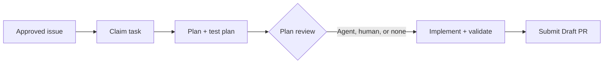

<div align="center">

# 🐝 SwarmOS

**Your issues. Your agents. One coordinated workflow.**

[](https://github.com/supernovae/SwarmOS/actions/workflows/swarm-validate.yml)
[](https://github.com/supernovae/SwarmOS/actions/workflows/security.yml)
[](go.mod)
[](LICENSE)
[](#bring-your-own-agents)

*Coordinate coding agents on GitHub, from an approved issue to a reviewed plan and a Draft PR. No separate coordination server or database.*

[**Quickstart**](#quickstart) · [**How it works**](#how-it-works) · [**Project setup**](docs/project.md) · [**Developer guide**](docs/developer.md) · [**Architecture**](docs/ARCHITECTURE.md)

</div>

---

## Why SwarmOS?

Coding agents can do useful work. Getting several of them to work together—without picking up the same task, losing context, or skipping review—is a different problem.

SwarmOS (`swarm`) gives them a shared way to pick up approved work, make a plan, run your checks, and bring the result back for review. GitHub Issues describe the work; Git tracks ownership and checkpoints. You choose which agents can participate and where a person needs to step in.

It fits into the repository you already use, rather than asking you to move your backlog or adopt another control plane.

| What you need | What SwarmOS provides |
| --- | --- |
| Clear scope before an agent starts | Structured issues with an objective, constraints, and acceptance criteria, approved by a maintainer. |
| Several agents sharing a backlog | Time-limited claims coordinated through Git, so competing workers cannot both win the same claim. |
| A plan before implementation | Planning and test-plan artifacts, with an optional agent or human review gate. |
| The right agent for each job | Separate planner, reviewer, developer, and tester assignments across supported coding tools. |
| Work that can move between people or machines | Per-task branches and worktrees, with published checkpoints for handoffs. |
| A reviewable result | Repository checks, protected-path validation, and Draft PRs with the task and artifact history. |

## How it works



A human gate pauses the task until an authorized person approves the plan. An agent gate asks a configured reviewer to check it first. If the task or plan changes, the old approval does not carry over. Submitting the result is a separate step; merging remains up to your repository's reviewers and branch rules.

## Quickstart

### 1. Install `swarm`

This README describes the current development version. **v0.1.0 does not include all of this workflow.** Until the next release, install the reviewed commit below with Go 1.26.9 or newer:

```bash
export SWARM_VERSION=f48685bdceee880ff39fc85941eccbdd9f2cff7f
go install github.com/supernovae/swarmos/cmd/swarm@"$SWARM_VERSION"
```

Make sure Go's binary directory is on your `PATH`. Tagged binaries for Linux, macOS, and Windows are available on the [releases page](https://github.com/supernovae/SwarmOS/releases); use the documentation for the version you install.

### 2. Set up your repository

From a local checkout with a GitHub `origin`, authenticate with `gh auth login`, then:

```bash
swarm init --sync-labels --backend github --swarm-version "$SWARM_VERSION"
swarm doctor
```

Initialization creates `.swarm/` configuration, role prompts, an issue form, and CI for your project. Review and commit those files before approving work. Configure your installed agents, model credentials, and reviewer sandbox in `.swarm/config.yaml`; the [setup guide](docs/project.md) and [agent integration runbook](docs/developer.md#agent-integration-runbook) cover the details.

### 3. Give it a task

```bash
swarm issue create --backend github \
  --title "Add JSON output to the status command" \
  --objective "Let scripts read application status as JSON" \
  --constraint "Keep the existing text output unchanged" \
  --acceptance "status --json emits valid JSON with the current status" \
  --workflow feature --gate agent
```

New tasks start as drafts. Inspect the issue, then approve it when the scope is right. Replace `42` with the issue number printed above:

```bash
swarm issue approve 42
swarm work 42 --dry-run  # See the selected agents and policy without starting work.
swarm work 42
swarm submit 42         # Validate and open a Draft PR.
```

`work` runs headlessly by default; use `--headless=false` for an interactive session. For offline development, select `--backend local` explicitly. SwarmOS never silently substitutes local tracking for GitHub.

## Bring your own agents

SwarmOS supports **Claude Code (`claude`), Codex (`codex`), OpenCode (`opencode`), and OhMyPi (`omp`)**. Use one across the workflow or give each role a different tool:

```bash
swarm work 42 \
  --planner-agent claude \
  --reviewer-agent omp \
  --developer-agent codex \
  --tester-agent opencode
```

Only agents allowed by the repository configuration can run. You supply their installations and model access; SwarmOS supplies the task context and coordinates the work. Driver commands, checked versions, model selection, and credential setup live in the [integration runbook](docs/developer.md#agent-integration-runbook). Grok and Dot names are supported only as explicitly configured wrappers around a supported driver, not native integrations.

## Share the backlog, not just the prompt

For a team or a pool of workers, register the repositories you want to work on and let agents pull from their approved queues:

```bash
swarm repo add                           # Register this checkout.
swarm work --next --all                   # Pick up work across registered repos.
swarm work 42 --phase plan --handoff      # Checkpoint a plan for another worker.
swarm node init
swarm node run --all --concurrency 2 --max-jobs 4
```

A normal node run drains available work and exits. Add `--watch` to keep polling, or `--auto-submit` to open Draft PRs after successful validation. Human-gated work stays paused for approval. To break a larger task into linked issues, use `swarm issue decompose <issue>`; the child tasks still need approval before execution.

Use `swarm status` to follow progress and `--json` on lifecycle commands for automation. The [developer guide](docs/developer.md) covers recovery and worker operation; `swarm --help` lists the command groups and options.

## A note on trust

SwarmOS is for repositories and agent tools you trust. A worktree keeps task changes separate from your main checkout; it is **not** a sandbox. Reviewers get an additional isolation boundary, but planner, developer, and tester processes still run with your user's host access. Git coordination also relies on trusted writers to its state refs.

Checks and protected paths come from the approved baseline, not from an agent's proposed replacement. Those controls help keep a task on track; they do not make arbitrary code or prompts safe. Read the [security policy](SECURITY.md) before running unattended workers.

## Go deeper

- **[Project setup and approvals](docs/project.md)** — Configure a repository, author tasks, and set up validation and GitHub protections.
- **[Developer and worker guide](docs/developer.md)** — Agent setup, checkpoints, handoffs, recovery, and worker pools.
- **[Workflows and review gates](docs/WORKFLOWS.md)** — Role prompts, plan review, and the fixed execution lifecycle.
- **[Architecture](docs/ARCHITECTURE.md)** — Git-backed claims, fencing, and checkpoint publication.
- **[Security](SECURITY.md)** — Trust boundaries, vulnerability reporting, and release verification.
- **[Future work](todo.md)** — Planned coordinator/admin tooling and other capabilities not implemented today.
