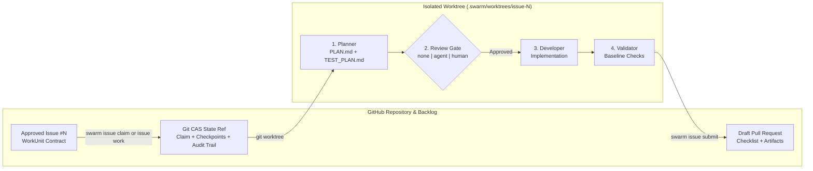

<div align="center">

# 🐝 SwarmOS

**Your issues. Your agents. One coordinated workflow.**

[](https://github.com/supernovae/SwarmOS/actions/workflows/swarm-validate.yml)
[](https://github.com/supernovae/SwarmOS/actions/workflows/security.yml)
[](go.mod)
[](LICENSE)
[](#bring-your-own-agents)

*Turn GitHub Issues into structured work contracts, coordinate multiple coding agents without a separate server, isolate every task in its own Git worktree, and ship artifact-backed Draft PRs.*

[**Quickstart**](#quickstart) · [**How It Works**](#how-it-works) · [**Grok Bot Guide**](docs/grokbot.md) · [**OpenAI Dot Guide**](docs/openai-dot.md) · [**Project Setup**](docs/project.md) · [**Developer Guide**](docs/developer.md)

</div>

---

## Why SwarmOS?

Single-agent coding tools are great at editing files, but coordinating several agents across a real backlog is where things usually fall apart: agents step on the same task, skip design review, dirty your main checkout, or open pull requests without proof that your checks ran.

**SwarmOS (`swarm`)** gives your agents and teammates a shared operating model directly inside your repository: **GitHub Issues define the work, Git compare-and-swap refs coordinate ownership and checkpoints, and isolated worktrees keep every task clean.** Whether you are an **open-source maintainer** letting contributors around the world point their coding agents at approved issues, or an **engineering organization** orchestrating internal agents across private repositories without running a separate control plane, your repo already has everything it needs.

| Challenge | How SwarmOS Solves It |
| :--- | :--- |
| **Vague issue prompts** lead to scope drift | **Schema-Validated WorkUnits** capture an explicit `Objective`, `Constraints`, `Acceptance Criteria`, `Workflow`, and `Plan Gate`, approved by a maintainer before work begins. |
| **Agents colliding on the same issue** | **Git Compare-and-Swap Claims** give each attempt a time-bounded lease and fencing token so concurrent workers never overwrite each other. |
| **Unreviewed code dumps** | **Plan-First Execution** writes `PLAN.md` and `TEST_PLAN.md` first, then runs your chosen `none`, `agent`, or `human` review gate before touching implementation code. |
| **Dirty working trees & lost progress** | **Isolated Git Worktrees** provision every task in `.swarm/worktrees/issue-<N>` on branch `swarm/issue-<N>-<slug>` with transferable Git checkpoints. |
| **Vendor lock-in to a single CLI** | **Multi-Agent Routing** lets you mix **Claude Code (`claude`), Codex (`codex`), OpenCode (`opencode`), and OhMyPi (`omp`)**—and coordinate from [**Grok Bot**](docs/grokbot.md) or [**OpenAI Dot**](docs/openai-dot.md). |
| **Untested or unsafe diffs** | **Baseline Validation** runs the required checks and protected-path rules from the approved base commit before opening an artifact-backed Draft PR. |

See [CHANGELOG.md](CHANGELOG.md) for what changed in each release.

---

## How It Works



1. **Create & Approve (`swarm issue create` / `swarm issue approve`)**: Author a structured WorkUnit issue via the CLI or GitHub Issue Form. Maintainer approval makes the issue the executable work contract; it does not approve a future implementation.
2. **Claim & Provision (`swarm issue claim` / `swarm issue work`)**: SwarmOS acquires a fenced lease, creates `.swarm/worktrees/issue-<N>`, and compiles `.swarm/active/WORKUNIT.md` and `SYSTEM_PROMPT.md`.
3. **Plan & Review (`PLAN.md` + `TEST_PLAN.md`)**: The planner maps out the file-level design and acceptance tests. Depending on your gate (`agent`, `human`, or `none`), an isolated reviewer agent audits the plan or the workflow pauses for a maintainer's `swarm issue review-plan <issue> --approve`. This second approval authorizes implementation, not the final code.
4. **Implement, Validate & Submit (`swarm issue validate` / `swarm issue submit`)**: The developer implements the approved plan, SwarmOS verifies protected paths and required checks against the approved baseline, and `swarm issue submit <issue>` opens the linked Draft PR. The issue remains the approved contract; the PR proposes its implementation. Use `swarm issue status <issue>` for its recorded PR link and GitHub for final code and acceptance review.

---

## Quickstart

### 1. Install `swarm`

Download the prebuilt binary for **Linux**, **macOS**, or **Windows** from [**GitHub Releases**](https://github.com/supernovae/SwarmOS/releases/latest) (or browse [all releases](https://github.com/supernovae/SwarmOS/releases)), or install with Go 1.26.10+:

```bash
go install github.com/supernovae/swarmos/cmd/swarm@latest
```

To build from a source checkout instead, run `make install` (or `go install ./cmd/swarm`); it installs into `$HOME/go/bin` by default, so keep that directory on your `PATH`. `make check` runs the same formatting, vet, staticcheck, and race-enabled tests as CI.

`swarm repo init` pins generated CI and fork automation to the swarm you ran it with: a release installs that release, and a clean source build installs its exact commit (push that commit before CI runs). From a build with uncommitted changes, init keeps the pin your workflows already use.

Check the installed binary before starting a worker or reporting an issue:

```bash
swarm version
swarm version --json
```

Release binaries include the version, commit, build date, Go toolchain, and platform. Go-installed binaries report their module version. Local `go build` binaries use Go's embedded module and Git metadata, including a `+dirty` suffix for modified checkouts; their date is the source commit time. Metadata that was not embedded remains `dev`, `none`, or `unknown`.

### 2. Initialize Your Repository

From a Git checkout connected to GitHub (`gh auth login`), scaffold your `.swarm/` harness and run diagnostics:

```bash
swarm repo init --sync-labels --backend github
swarm repo doctor --backend github
```

> [!TIP]
> Bringing SwarmOS into a large or long-lived repository? Preview the changes first with `swarm repo init --dry-run --verbose`, or let your coding agent do the setup with you: `codex "$(swarm repo onboard)"` (any harness works). The agent reads your CI to propose real validation checks, merges SwarmOS files with what you already have, and hands everything back for review before anything is committed.

Example `swarm repo doctor` output:

```text
CATEGORY   CHECK                                    STATUS   DETAIL
--------   -----                                    ------   ------
system     git                                      OK       git version 2.54.0
tracker    gh-cli                                   OK       /usr/local/bin/gh
harness    .swarm/config.yaml                       OK       v1 (default_agent=codex, default_gate=agent)
harness    .swarm/validation/required-checks.yaml   OK       4 checks, 17 protected paths
harness    ci lint/format coverage                  OK       required checks cover every recognized lint/format tool in .github/workflows
binary     claude                                   OK       /usr/local/bin/claude
binary     codex                                    OK       /usr/local/bin/codex
binary     omp                                      OK       /usr/local/bin/omp
binary     opencode                                 OK       /usr/local/bin/opencode
execution  mode                                     OK       mode=isolated; backend=native
execution  codex/planner                            OK       selected; native Codex; login available; boundary checks passed
```

Commit the generated `.swarm/`, `.github/`, `.claude/`, and `.opencode/` files to your default branch so every teammate and agent works from the same project rules.

### 3. Create, Approve & Ship a Task

```bash
# 1. Create a structured WorkUnit issue (starts as a draft; pass --ready to approve immediately)
swarm issue create --backend github \
  --title "Add JSON output to the status command" \
  --objective "Let scripts read application status as JSON" \
  --constraint "Keep the existing text output unchanged" \
  --acceptance "status --json emits valid JSON with the current status" \
  --workflow feature --gate agent

# 2. Approve the issue when the scope looks right (replace 42 with your issue number)
swarm issue approve 42 --backend github

# 3. Preview the resolved agents and gate, then run the workflow and open a Draft PR
swarm issue work 42 --dry-run --backend github
swarm issue work 42 --backend github
swarm issue submit 42 --backend github
```

> [!TIP]
> `swarm issue work` runs headlessly by default. Pass `--headless=false` to pair with your agent, or use `swarm node run --watch` to keep picking up approved tasks. On Linux, isolated execution uses Codex's native sandbox or bounded tools for Claude Code, OpenCode 2, and OhMyPi, with provider login managed by the harness. Start with `swarm repo doctor`; the [worker guide](docs/developer.md#choose-how-you-work) covers setup and other harnesses. Use `--backend local` to experiment with local coordination storage.

`swarm repo doctor` highlights your selected agents and reports unused, unqualified harnesses as `OPTIONAL`. The [harness guides](docs/harness/README.md) cover setup and boundaries for each agent, and the [qualification guide](docs/native-qualification.md) tracks tested releases.

---

## Bring Your Own Agents

SwarmOS integrates **Claude Code (`claude`), OpenAI Codex (`codex`), OpenCode 2 (`opencode`), and OhMyPi (`omp`)**. Use a single tool across the workflow or route each role to your favorite harness:

```bash
swarm issue work 42 \
  --planner-agent claude \
  --reviewer-agent omp \
  --developer-agent codex \
  --tester-agent opencode
```

Models are optional in `.swarm/config.yaml`: set `agents.<name>.model` when the project needs a specific model, or leave selection to the harness. Each harness has its own guide covering setup, how SwarmOS runs it, and troubleshooting: [Codex](docs/harness/codex.md), [Claude Code](docs/harness/claude.md), [OpenCode 2](docs/harness/opencode.md), and [OhMyPi](docs/harness/omp.md).

Want to coordinate work from an always-on conversational teammate?
- **[Working with Grok Bot & SwarmOS](docs/grokbot.md)** — Connect Grok Bot to GitHub, chat with your repository, request PR reviews, or let Grok drive `swarm` on its cloud computer.
- **[Working with OpenAI Dot, Codex & SwarmOS](docs/openai-dot.md)** — Add the repositories you want to swarm on to your Codex Cloud environment (or connected dev machine) and let your Dot coordinate tasks end to end.

---

## Team Handoffs & Multi-Repo Worker Pools

Register the repositories you work on so teammates and worker pools can pull from a shared backlog:

```bash
# Register this checkout in ~/.config/swarm/repos.yaml
swarm repo add --backend github

# Checkpoint a completed plan so another teammate or worker can pick up the next phase
swarm issue work 42 --phase plan --handoff --backend github

# Claim and run the next ready task across all registered repositories
swarm issue work --next --all --backend github

# Run a bounded worker pool that drains up to 4 tasks and opens Draft PRs
swarm node init
swarm node run --all --concurrency 2 --max-jobs 4 --auto-submit --backend github
```


---

## Fork-Based Open-Source Contributions (`--fork`)

External contributors do not need push access to the upstream repository. When maintainers opt in to the upstream fork coordinator Action, contributors can work in isolated local worktrees, push checkpoints to their own personal GitHub fork, open cross-repository Draft PRs, and revise them after review—while issue approval, validation policy, human plan review, and PR merge remain upstream maintainer actions.

```bash
# Maintainer (once, on the upstream default branch):
# Generates .github/workflows/swarm-fork-coordinator.yml; later `swarm repo init` runs keep it current
swarm repo init --fork-coordinator
swarm issue approve 42 --backend github

# Contributor (clones upstream as origin, adds writable personal fork as "fork"):
git clone https://github.com/OWNER/REPO.git
cd REPO
gh repo fork --remote=true --remote-name=fork

# Claim, work on local branch swarm/issue-42-<claim_id>, push checkpoints to "fork",
# and open a fork-qualified Draft PR (<fork-owner>:swarm/issue-42-<claim_id> -> upstream):
swarm --fork issue claim 42
swarm --fork issue work 42
swarm --fork issue renew 42   # optional when you need additional lease time
swarm --fork issue submit 42

# After review, revise the same PR (55 here) from your fork:
swarm --fork pr work 55
swarm --fork pr submit 55
```

See the [**Fork Mode Guide (`docs/fork-mode.md`)**](docs/fork-mode.md) for architecture details, per-contributor claim caps (`fork.max_active_claims`), and security boundaries.
---

## CLI Overview

| Command | What It Does |
| :--- | :--- |
| `swarm repo init [--dry-run] [--force] [--sync-labels] [--template-dir <dir>] [--fork-coordinator]` | Scaffold or upgrade `.swarm/`, `AGENTS.md`, `.swarm/SKILLS.md`, GitHub Issue Forms, consumer CI / fork-coordinator workflows, and `/swarm-*` slash commands. Rerun it after upgrading swarm: untouched generated files are updated, while your edits and your own files (including other workflows and an existing `AGENTS.md`, which gets a marked SwarmOS section) are kept (`--force` replaces files at SwarmOS paths, never your `AGENTS.md` or other workflows). `--swarm-version <ref>` overrides the pinned release. `--dry-run` previews the changes, with diffs for existing files, and writes nothing. |
| `swarm repo onboard` | Print a guide your coding agent follows to onboard or upgrade the repository with you: preview init, propose validation checks from your CI, merge with existing files, and hand back a reviewable diff. Also available as `/swarm-onboard`. |
| `swarm repo doctor` | Check `git`, `gh`, GitHub `Epic` issue type & maintainer auth, `.swarm/` schemas, and configured agent binaries. Warns, with a suggested `required-checks.yaml` entry, when CI runs a lint or format tool that no required check runs. |
| `swarm issue create`, `swarm issue epic create`, `swarm issue approve`, `swarm issue lint`, `swarm issue decompose` | Create draft WorkUnits (`--parent`), standalone Epics (`--body-file`), approve revisions, lint schemas (with hints on how to strengthen an issue), or split WorkUnits into linked draft sub-issues. |
| `swarm issue edit <issue> [--dry-run] [--json]` | Replace selected WorkUnit sections with lint and approval/claim checks; preview a diff before editing and reapprove changed contracts separately. |
| `swarm repo lessons [--apply]` | Propose additions to `.swarm/rules/lessons.md` from what agents learned in merged PRs; `--apply` appends them locally for you to review and commit. |
| `swarm repo plan [--from <file> \| --scan] [--normalize] [--apply] [--ready] [--export <path>]` | Preview `Step N` tasks from a roadmap, publish a native `Epic` with linked draft child WorkUnits (`--apply`), scan and triage open issues and pull requests (`--scan`), or export a plan snapshot. |
| `swarm issue claim <issue>` / `swarm issue claim --next [--all]` | Claim a specific approved issue or select ready work by lowest issue number, with native epic sibling order, without running agents. |
| `swarm issue work [<issue>] [--next] [--all]` | Run `plan`, `review`, `implement`, and `validate`; `--next` shares claim selection order (supports `--dry-run`, `--handoff`, and role overrides). |
| `swarm issue stage [<issue>] [--phase plan\|implement] [--harness <name>] [--model <name>] [--handoff]` | Stage interactive or harness-produced plan and implementation artifacts onto an active lease with provenance metadata. |
| `swarm issue review-plan <issue> [--approve\|--reject]` | Run an isolated agent review or record a maintainer's human gate decision. |
| `swarm issue validate [<issue>] [--base <approved-base-sha>]` / `swarm repo validate --base <trusted-full-commit-sha> [--protected-paths enforce\|report]` | Validate a claimed issue against its approved base and artifacts (`--base`, if given, must match it), or run checkout-only CI validation against a trusted full base without a claim. |
| `swarm issue submit [<issue>] [--base <target-branch>]` | Clean temporary markers, checkpoint and push the worktree branch, and open or reuse its linked Draft PR (targeting the default branch unless `--base` names another) with collapsible artifacts and provenance attestation. |
| `swarm issue status [<issue>] [--all]` | Inspect active claims, lease TTL, current phase, and published artifacts. |
| `swarm issue reconcile <issue>` | Record the linked PR outcome and repair its issue label and audit projection. |
| `swarm issue cleanup <issue> [--apply]` | Preview task resources; explicitly retire an eligible merged remote branch while retaining local work and provenance. |
| `swarm pr status <PR>` / `swarm pr work <PR> [--instructions <text>]` | Inspect or continue developing a PR linked to an approved WorkUnit, including failing tests and review feedback, in a separate PR worktree. Contributors add `--fork` to revise their own fork PRs. |
| `swarm pr stage <PR> [--phase plan\|implement] [--harness <name>] [--model <name>] [--handoff] [--json]` | Stage an interactive plan or local implementation checkpoint in the separate managed PR worktree; links artifacts to the original issue without publishing the PR. |
| `swarm pr rebase <PR> [--continue\|--abort]` | Rebase onto the PR's approved target base; retain conflicts for deliberate resolution. |
| `swarm pr validate <PR>` / `swarm pr submit <PR>` | Validate the local revision and explicitly publish it to the same PR, refusing to overwrite a concurrent remote update. |
| `swarm repo add`, `swarm repo list`, `swarm repo remove` | Manage the local multi-repository registry (`~/.config/swarm/repos.yaml`). |
| `swarm node init`, `swarm node status`, `swarm node run` | Configure a worker node profile and run concurrent worker pools using the same selection order as `issue claim --next` (`--concurrency`, `--max-jobs`, `--watch`). |
| `swarm issue renew <issue>` / `swarm issue release <issue>` | Extend an active lease's TTL or release a claim back to the queue. |
| `swarm fork-coordinator --event <path> [--json]` | Process a verified `issue_comment.created` fork worker request inside the upstream GitHub Action. |
| `swarm version [--json]` | Print version, commit, and platform metadata. |

`swarm issue validate` and `swarm pr validate` always run the required checks. With a released build, `issue submit` and `pr submit` reuse a passing validation from the same worker and claim when the checkpoint content, approved base, trusted policy, and swarm version match exactly. Submit reports the original validation's age and tree SHA and includes that provenance in the PR. Edits, context changes, development builds, and fork submissions run checks again. CI always runs its checks. Checks that run on the host share a persistent SwarmOS-owned Go build cache per repository, so repeat runs stay fast; see [validation policy](docs/project.md#validation-policy-and-protected-paths).

Every leaf command accepts `--json` for scripting (for example, `swarm issue claim --json`, `swarm issue status --json`, `swarm repo doctor --json`, and `swarm repo validate --base <sha> --json`). Each prints one JSON document with a `kind` field, and failures print `{"kind": ..., "status": "failed", "error": ...}`; the `issue`, `repo`, `pr`, and `node` groups themselves only print help. When `issue work`, `issue submit`, `pr work`, `pr rebase`, or `pr submit` stops because the plan got changes requested, a maintainer needs to approve, or there is a conflict, the failure also carries an advisory `next_action` (`reason`, `argv`, `human_required`). The command then exits with `3`, `4`, or `5` instead of `1`. See [Reacting to stops in scripts](docs/developer.md#reacting-to-stops-in-scripts). Worker commands accept the global `--fork [--fork-remote <name>]` for personal-fork contributions.

To upgrade an existing repository, install the new swarm and rerun `swarm repo init`. It updates every generated file you haven't changed (workflows, their pins, slash commands, prompts, and templates) and lists the customized files it kept. Run `swarm repo init --dry-run --verbose` first to see what will change, including diffs for the files you customized, or run `/swarm-onboard` in your coding agent to merge them with you. Review the diff and commit it like any other change.

For an existing approved WorkUnit PR, use `pr work` to develop or fix its implementation, `pr stage` to record an interactive plan or implementation in the PR worktree, and `pr rebase` to update ancestry. None publishes the candidate branch; only `pr submit` does. Maintainers revise PRs with upstream write access; contributors revise their own fork PRs with `--fork`. See [Continuing an Existing PR](docs/developer.md#continuing-an-existing-pr) for approvals, conflicts, and publication.

---

## Documentation & Guides

- **[Day in the Life of a Repo Admin (`docs/ADMIN_GUIDE.md`)](docs/ADMIN_GUIDE.md)** — Daily maintainer playbook for roadmap decomposition (`swarm repo plan --from`), backlog scanning (`swarm repo plan --scan`), and auditing provenance-attested Draft PRs.
- **[Owning a Busy Repository (`docs/backlog.md`)](docs/backlog.md)** — Turn a big pile of open issues into calm lanes: what to stabilize, likely duplicates, quiet issues, and work that's ready for agents.
- **[GitHub Security, Branching & Agent Authorization (`docs/GITHUB.md`)](docs/GITHUB.md)** — Configure repository rulesets, `SWARM_GITHUB_TOKEN` auth without `gh` CLI, secret-manager tokens via `SWARM_GITHUB_TOKEN_COMMAND`, and role-separated collaborator allowlists.
- **[Fork Mode Guide (`docs/fork-mode.md`)](docs/fork-mode.md)** — Contribute from a personal GitHub fork without upstream push access using the upstream fork coordinator Action.
- **[Working with Grok Bot (`docs/grokbot.md`)](docs/grokbot.md)** — Connect Grok Bot to your repositories, talk to your codebase, run PR reviews, and coordinate SwarmOS workers.
- **[Working with OpenAI Dot & Codex (`docs/openai-dot.md`)](docs/openai-dot.md)** — Configure Codex Cloud environments and remote repositories so your Dot can plan, review, and ship changes.
- **[Agent Harness Guides (`docs/harness/`)](docs/harness/README.md)** — Setup, invocation, isolation boundary, and troubleshooting for Codex, Claude Code, OpenCode 2, and OhMyPi.
- **[Project & Maintainer Setup (`docs/project.md`)](docs/project.md)** — Configure `.swarm/config.yaml`, validation rules, plan gates, and repository protections.
- **[Developer & Worker Guide (`docs/developer.md`)](docs/developer.md)** — Everyday CLI workflows, interactive `swarm issue stage`, agent harness table, reviewer sandboxing, handoffs, and recovery.
- **[Workflows & Review Gates (`docs/WORKFLOWS.md`)](docs/WORKFLOWS.md)** — Role prompts, `PLAN.md` / `TEST_PLAN.md` / `REVIEW.md` artifacts, provenance attestations, and gate transitions.
- **[Architecture (`docs/ARCHITECTURE.md`)](docs/ARCHITECTURE.md)** — Git compare-and-swap state refs, claim fencing, worktree checkpoints, and process boundaries.
- **[Changelog (`CHANGELOG.md`)](CHANGELOG.md)** — What changed in each release.
- **[Security Policy (`SECURITY.md`)](SECURITY.md)** — Trust model, reviewer isolation, vulnerability reporting, and release attestation verification.
- **[Agent & Contributor Guide (`AGENTS.md`)](AGENTS.md)** — Repository conventions, documentation voice guardrails, and review rules for coding agents and contributors.
