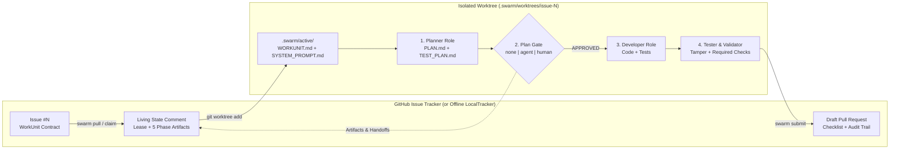

<div align="center">

# 🐝 SwarmOS

**Serverless, Contract-Driven Multi-Agent Orchestration Native to GitHub & Git**

[](https://github.com/supernovae/SwarmOS/actions/workflows/swarm-validate.yml)
[](https://github.com/supernovae/SwarmOS/actions/workflows/security.yml)
[](go.mod)
[](LICENSE)
[](#multi-agent-harness-matrix)

*Turn GitHub Issues into machine-validated contracts, coordinate distributed coding agents without external servers, isolate execution in Git worktrees, and ship artifact-backed Draft PRs.*

[**Quickstart**](#quickstart) · [**Project Setup Guide**](docs/project.md) · [**Developer & Node Guide**](docs/developer.md) · [**Architecture**](docs/ARCHITECTURE.md) · [**Workflows**](docs/WORKFLOWS.md)

</div>

---

## Why SwarmOS?

Most multi-agent coding frameworks require external databases, proprietary control planes, or lock you into a single vendor's CLI. **SwarmOS (`swarm`)** takes a zero-infrastructure approach: **your Git repository and GitHub Issues *are* the control plane.**

| Capability | How SwarmOS Works |
| :--- | :--- |
| **Contract-Driven WorkUnits** | Issues are validated against JSON Schema (`Objective`, `Constraints`, `Acceptance Criteria`, `Workflow`, `DependsOn`, `RequiredCapabilities`) before any agent starts. |
| **Serverless Optimistic Leases** | Claims and phase artifacts live inside a single structured GitHub Issue comment with lazy TTL expiration and deterministic lowest-`CommentID` tie-breaking. |
| **Isolated Git Worktrees** | Every claimed issue is provisioned in `.swarm/worktrees/issue-<N>` on branch `swarm/issue-<N>-<slug>`—keeping your main working tree untouched. |
| **Universal Multi-Agent Harness** | Compiles `.swarm/active/WORKUNIT.md`, `SYSTEM_PROMPT.md`, `AGENTS.md`, `CLAUDE.md`, and `/swarm-*` slash commands for **Claude Code (`claude`), Codex (`codex`), OpenCode (`opencode`), and OhMyPi (`omp`)**. |
| **Plan-First & Review Gates** | Enforces a `Planner` $\rightarrow$ `Review Gate (none \| agent \| human)` $\rightarrow$ `Developer` $\rightarrow$ `Tester/Validator` pipeline with per-role agent routing. |
| **Team Handoffs & Worker Pools** | Partition epics with `swarm decompose`, hand off completed plans between teammates with `--handoff`, or run parallel multi-repo worker pools with `swarm node run`. |
| **Defense-in-Depth Security** | Enforces `swarm:ready` / author trust gates, strips hidden HTML comments to block prompt injection, and prevents tampering with `.github/workflows/**` or `.swarm/validation/**`. |

---

## How It Works



---

## Quickstart

### 1. Install `swarm`

Download a prebuilt binary for **Linux**, **macOS**, or **Windows** from [**GitHub Releases**](https://github.com/supernovae/SwarmOS/releases), or install with Go:

```bash
go install github.com/supernovae/swarmos/cmd/swarm@latest
```

### 2. Initialize a Project & Verify Environment

```bash
# Scaffold .swarm/ contracts, workflows, prompts, GitHub Issue Form, and CI workflow
swarm init --sync-labels

# Check git, GitHub auth, .swarm/ schemas, and installed agent CLIs (claude, codex, opencode, omp)
swarm doctor
```

### 3. Create, Pull & Execute Work

```bash
# Create a schema-validated WorkUnit issue on GitHub (or pass --backend local for offline mode)
swarm issue create \
  --title "Add version subcommand" \
  --objective "Add swarm version command printing JSON/text build info" \
  --constraint "Stdlib only" \
  --acceptance "swarm version --json outputs valid JSON" \
  --workflow feature \
  --gate agent

# Pull the next unclaimed `swarm:ready` issue, run Plan -> Reviewer Gate -> Implement -> Validate
swarm work --next --planner-agent claude --reviewer-agent omp --developer-agent codex --gate agent --headless

# Commit worktree changes and open an artifact-backed Draft PR
swarm submit 1
```

---

## Multi-Agent Harness Matrix

| Agent (`--agent`) | Binary | Headless Invocation | Interactive Invocation |
| :--- | :--- | :--- | :--- |
| **Claude Code** (`claude`) | `claude` | `claude -p --append-system-prompt-file .swarm/active/SYSTEM_PROMPT.md "<Task>"` | `claude --append-system-prompt-file .swarm/active/SYSTEM_PROMPT.md "<Task>"` |
| **Grok Bot** (`grok`) | `grok` | `grok -p "<System + WORKUNIT.md + Task>"` | `grok "<Task>"` |
| **OhMyPi** (`omp`) | `omp` | `omp -p --no-pty --append-system-prompt .swarm/active/SYSTEM_PROMPT.md "<Task>"` | `omp --append-system-prompt .swarm/active/SYSTEM_PROMPT.md "<Task>"` |
| **OpenAI Codex** (`codex`) | `codex` | `codex exec "<System + WORKUNIT.md + Task>"` | `codex "<Task>"` |
| **OpenAI Dot** (`dot`) | `dot` | `dot exec "<System + WORKUNIT.md + Task>"` | `dot "<Task>"` |
| **OpenCode** (`opencode`) | `opencode` | `opencode run "<System + WORKUNIT.md + Task>"` | `opencode --prompt "<Task>"` |
| **Deterministic Mock** (`mock`) | Built-in | Offline CI & dry-run adapter (`--agent mock`) | Offline CI & dry-run adapter |

---

## CLI Overview

| Command | Description |
| :--- | :--- |
| `swarm init [--force] [--sync-labels]` | Scaffold `.swarm/`, GitHub Issue Form, GitHub Action, and `.claude`/`.opencode` slash commands. |
| `swarm doctor` | Probe `git`, `gh auth`, `.swarm/` schemas, and installed agent binaries (`claude`, `codex`, `opencode`, `omp`). |
| `swarm repo add\|list\|remove` | Register local or remote repositories (`--clone` supported) in `~/.config/swarm/repos.yaml`. |
| `swarm node init\|status\|run` | Configure node capabilities (`~/.config/swarm/node.yaml`) and run parallel worker pools (`--concurrency N --auto-submit`). |
| `swarm issue create\|lint` | Create a schema-validated WorkUnit issue or lint an existing issue against `workunit.schema.json`. |
| `swarm decompose <issue> [--sequential]` | Partition a parent WorkUnit into linked child issues with `parent_issue` and `depends_on` ordering. |
| `swarm claim <issue>` | Verify trust policy, acquire an optimistic lease comment, provision worktree, and compile `WORKUNIT.md`. |
| `swarm pull [--all]` | Find, claim, and provision the next unclaimed or handed-off `swarm:ready` issue across current or registered repos. |
| `swarm work [<issue>] [--next] [--all]` | Run `plan`, `review`, `implement`, and `validate` with per-role agents and optional `--handoff`. |
| `swarm review <issue>` | Run an automated reviewer agent (`--agent <name>`) or record human approval/rejection (`--approve` / `--reject`). |
| `swarm validate [<issue>] [--ci]` | Verify artifact completeness, check protected paths for tampering, and run `required-checks.yaml`. |
| `swarm submit [<issue>]` | Strip temporary harness markers, commit and push worktree changes, and open an artifact-backed Draft PR. |
| `swarm status [<issue>] [--all]` | Display open work units, active lease owners, remaining TTL, workflow step, and published artifacts. |
| `swarm renew` / `swarm release` | Extend an active lease's TTL or release a claim back to the backlog. |
| `swarm version [--json]` | Print `swarm` version, commit, build date, and platform metadata. |

---

## Documentation Guides

- **[Project & Maintainer Guide (`docs/project.md`)](docs/project.md)** — Onboarding a repository, configuring `.swarm/config.yaml` and `required-checks.yaml`, setting up trust gates, authoring WorkUnit issues, and partitioning epics with `swarm decompose`.
- **[Developer, Team & Worker Node Guide (`docs/developer.md`)](docs/developer.md)** — Pulling work (`swarm pull`, `swarm work --next`), interactive vs. headless execution, per-role agent routing, collaborative team handoffs (`--handoff`), multi-repo registration (`swarm repo`), and parallel worker nodes (`swarm node run`).
- **[Grok Bot Guide (`docs/grokbot.md`)](docs/grokbot.md)** — Configuring and using Grok Bot as a SwarmOS agent or reviewer.
- **[OpenAI Dot & Codex Guide (`docs/openai-dot.md`)](docs/openai-dot.md)** — Configuring Dot and Codex-backed review workflows.
- **[Architecture & Security Model (`docs/ARCHITECTURE.md`)](docs/ARCHITECTURE.md)** — Deep dive into optimistic comment-ID leases, lazy expiration, HTML comment sanitization, worktree isolation, and protected-path tamper checks.
- **[Workflows & Role Contracts (`docs/WORKFLOWS.md`)](docs/WORKFLOWS.md)** — Customizing `.swarm/workflows/*.yaml`, role prompts (`planner`, `reviewer`, `developer`, `tester`), and plan approval gates (`none`, `agent`, `human`).
- **[Security Policy (`SECURITY.md`)](SECURITY.md)** — Vulnerability reporting, CodeQL/`govulncheck` CI scanning, and verifying release binaries with `gh attestation verify`.
