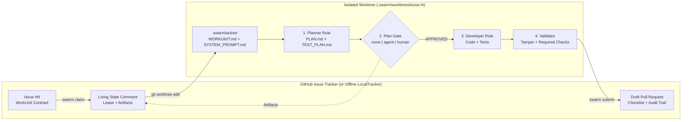

<div align="center">

# 🐝 SwarmOS

**Serverless, Contract-Driven Multi-Agent Orchestration Native to GitHub & Git**

[](go.mod)
[](LICENSE)
[](#multi-agent-harness-matrix)
[](docs/ARCHITECTURE.md)

*Turn GitHub Issues into machine-validated contracts, coordinate distributed coding agents without external servers, isolate execution in Git worktrees, and ship artifact-backed Draft PRs.*

[**Quickstart**](#quickstart) · [**How It Works**](#how-it-works) · [**CLI Reference**](#cli-reference) · [**Architecture Docs**](docs/ARCHITECTURE.md) · [**Workflow Guide**](docs/WORKFLOWS.md)

</div>

---

## Why SwarmOS?

Most multi-agent coding frameworks require external databases, proprietary control planes, or lock you into a single vendor's CLI. **SwarmOS (`swarm`)** takes a radically simpler, zero-infrastructure approach: **your Git repository and GitHub Issues *are* the control plane.**

| Challenge in Multi-Agent Coding | How SwarmOS Solves It |
| :--- | :--- |
| **Ambiguous issue prompts** lead to hallucinated scope | **JSON-Schema WorkUnit Contracts** enforce explicit `Objective`, `Constraints`, `Acceptance Criteria`, and `Workflow` before any agent starts. |
| **Agents colliding on the same task** or branch | **Optimistic Comment-ID Leases** with lazy TTL expiration and deterministic tie-breaking on GitHub Issue comments—zero external database required. |
| **Dirty working trees** and branch conflicts | **Automatic Git Worktree Provisioning** isolates every issue inside `.swarm/worktrees/issue-<N>` on branch `swarm/issue-<N>-<slug>`. |
| **Vendor lock-in** to a single AI coding tool | **Universal Harness Compiler** compiles context (`WORKUNIT.md`, `SYSTEM_PROMPT.md`, `AGENTS.md`, `CLAUDE.md`, `/swarm-*` slash commands) across **Claude Code (`claude`), Codex (`codex`), OpenCode (`opencode`), and OhMyPi (`omp`)**. |
| **Unreviewed code dumps** that skip design | **Plan-First Execution Engine** with configurable `none`, `agent` (cross-agent reviewer), or `human` approval gates before implementation begins. |
| **Prompt injection & CI tampering** | **Trust Gates & Protected-Path Tamper Detection** require `swarm:ready` or trusted author associations, strip hidden HTML comments, and block edits to `.github/workflows/**` or `.swarm/validation/**`. |

---

## How It Works



1. **Define (`swarm issue create` / GitHub Issue Form)**: Issues declare an `Objective`, `Constraints`, `Acceptance Criteria`, `Workflow` (`feature | bugfix | refactor`), and optional `Plan Gate` (`none | agent | human`).
2. **Claim (`swarm claim <issue>`)**: Verifies the repository's trust policy (`swarm:ready` label or trusted author), acquires a time-bounded lease via an optimistic state comment on the issue, provisions an isolated Git worktree, and compiles `.swarm/active/WORKUNIT.md`.
3. **Plan (`swarm work <issue> --phase plan`)**: The **Planner** agent inspects the codebase without modifying production files and writes `.swarm/active/PLAN.md` and `.swarm/active/TEST_PLAN.md`. Both artifacts are published back to the issue's living state comment.
4. **Gate (`--gate none | agent | human`)**:
   - `none`: Proceeds directly to implementation.
   - `agent`: Runs a dedicated **Reviewer** agent (e.g., cross-checking a `claude` plan with `omp` or `codex`) that audits the plan against every constraint and writes `.swarm/active/REVIEW.md` (`VERDICT: APPROVED` or `VERDICT: CHANGES_REQUESTED`).
   - `human`: Applies label `swarm:plan-review` and pauses cleanly until approved via `swarm review <issue> --approve` or a `/swarm approve-plan` comment on GitHub.
5. **Implement & Validate (`swarm work` / `swarm validate`)**: The **Developer** agent executes `PLAN.md`. SwarmOS then verifies that protected CI/harness paths are untouched and runs every check in `.swarm/validation/required-checks.yaml`.
6. **Submit (`swarm submit <issue>`)**: Strips ephemeral harness pointers, commits changes to `swarm/issue-<N>-<slug>`, pushes the branch, and opens a **Draft PR** containing the acceptance checklist and full artifact audit table.

---

## Quickstart

### 1. Install `swarm`

```bash
# Install with Go 1.24+
go install github.com/supernovae/swarmos/cmd/swarm@latest

# Or build from source in this repository
git clone https://github.com/supernovae/SwarmOS.git
cd SwarmOS
go build -o bin/swarm ./cmd/swarm
```

### 2. Initialize Your Repository & Run Diagnostics

`swarm init` auto-detects your project stack (`Go`, `Rust`, `Python`, `TypeScript/JavaScript`), scaffolds `.swarm/`, installs the GitHub Issue Form and GitHub Actions workflow, and generates universal `/swarm-*` slash commands for `.claude/commands/` and `.opencode/command/`.

```bash
# Scaffold .swarm/ and sync swarm:* labels to GitHub
swarm init --sync-labels

# Verify git, GitHub auth, .swarm/ contracts, and installed agent CLIs
swarm doctor
```

Example `swarm doctor` output:

```text
CATEGORY   CHECK                                    STATUS   DETAIL
--------   -----                                    ------   ------
system     git                                      OK       git version 2.54.0
tracker    gh-auth                                  OK       github.com
harness    .swarm/config.yaml                       OK       v1 (default_agent=claude, default_gate=none)
harness    .swarm/validation/required-checks.yaml   OK       3 checks, 3 protected paths
agent      claude                                   OK       /opt/homebrew/bin/claude
agent      codex                                    OK       /opt/homebrew/bin/codex
agent      opencode                                 OK       /opt/homebrew/bin/opencode
agent      omp                                      OK       /opt/homebrew/bin/omp
```

### 3. Run an End-to-End Work Unit

You can run against **GitHub Issues** (default when a GitHub remote is configured) or offline against the file-locked **Local Tracker** (`--backend local` or `SWARM_BACKEND=local`):

```bash
# 1. Create a contract-validated WorkUnit issue
swarm issue create \
  --title "Add version subcommand" \
  --objective "Add swarm version command printing JSON/text build info" \
  --constraint "Stdlib only" \
  --acceptance "swarm version --json outputs valid JSON" \
  --workflow feature \
  --gate agent

# 2. Claim the issue, run Plan -> Reviewer Agent Gate -> Implement -> Validate
swarm work 1 --agent claude --reviewer-agent omp --gate agent --headless

# 3. Inspect live orchestration status, TTL, and published artifacts
swarm status 1

# 4. Commit worktree changes and open an artifact-backed Draft PR
swarm submit 1
```

### 4. Pulling Work Down & Multi-Repo Orchestration

Contributors and autonomous worker nodes don't need to look up issue numbers manually or stay inside a single repository. SwarmOS includes a file-locked **Multi-Repo Registry** (`~/.config/swarm/repos.yaml`) with remote-slug safety verification:

```bash
# Register the current repository (auto-detects owner/repo from git remote)
swarm repo add

# Register or auto-clone additional repositories into ~/.swarm/repos/<owner>/<repo>
swarm repo add supernovae/SwarmOS --clone
swarm repo list

# View open work units, active leases, and TTL across ALL registered repositories
swarm status --all

# Pull & claim the next unclaimed `swarm:ready` issue (current repo or --all repos)
swarm pull
swarm pull --all

# Or pull the next available `swarm:ready` issue AND run the full workflow automatically
swarm work --next --all --agent claude --reviewer-agent omp --gate agent --headless
```

**Logical Safety Across Multiple Repositories**:
- **Remote-Slug Verification**: `swarm repo add` verifies the local Git checkout's `origin` remote matches `<owner/repo>`, preventing accidental cross-repository worktree or PR mixups.
- **Location-Independent `--repo`**: Once a repository is registered, passing `--repo owner/repo` from *any* directory automatically resolves its local checkout path and isolated `.swarm/worktrees/issue-<N>` directory.
- **Race-Resilient Queue Dispatch**: `swarm pull` and `swarm work --next` skip untrusted or actively leased issues, run a non-destructive `git fetch origin --prune`, and automatically fall through to the next ready issue if a concurrent agent wins a claim race.

---

## Multi-Agent Harness Matrix

SwarmOS treats coding agents as pluggable execution engines over a shared repository contract. Every worktree is provisioned with `.swarm/active/WORKUNIT.md`, `.swarm/active/SYSTEM_PROMPT.md`, managed blocks in `AGENTS.md` and `CLAUDE.md`, and slash commands (`/swarm-plan`, `/swarm-review`, `/swarm-implement`, `/swarm-validate`).

| Agent (`--agent`) | Binary | Headless Invocation | Interactive Invocation |
| :--- | :--- | :--- | :--- |
| **Claude Code** (`claude`) | `claude` | `claude -p --append-system-prompt-file .swarm/active/SYSTEM_PROMPT.md "<Task>"` | `claude --append-system-prompt-file .swarm/active/SYSTEM_PROMPT.md "<Task>"` |
| **OhMyPi** (`omp`) | `omp` | `omp -p --no-pty --append-system-prompt .swarm/active/SYSTEM_PROMPT.md "<Task>"` | `omp --append-system-prompt .swarm/active/SYSTEM_PROMPT.md "<Task>"` |
| **OpenAI Codex** (`codex`) | `codex` | `codex exec "<System + WORKUNIT.md + Task>"` | `codex "<Task>"` |
| **OpenCode** (`opencode`) | `opencode` | `opencode run "<System + WORKUNIT.md + Task>"` | `opencode --prompt "<Task>"` |
| **Deterministic Mock** (`mock`) | Built-in | Offline CI & dry-run adapter (`--agent mock`) | Offline CI & dry-run adapter |

---

## CLI Reference

| Command | Description |
| :--- | :--- |
| `swarm init [--force] [--sync-labels]` | Scaffold `.swarm/`, GitHub Issue Form, GitHub Action, and `.claude`/`.opencode` slash commands. |
| `swarm doctor` | Probe `git`, `gh auth`, `.swarm/` schemas, and installed agent binaries (`claude`, `codex`, `opencode`, `omp`). |
| `swarm repo add\|list\|remove` | Register repositories (`--clone` supported), list registered checkouts, or unregister a repo. |
| `swarm issue create [flags]` | Create a schema-validated SwarmOS WorkUnit issue (`--title`, `--objective`, `--constraint`, `--acceptance`, `--workflow`, `--gate`). |
| `swarm issue lint <issue>` | Validate an existing issue's body against `.swarm/contracts/workunit.schema.json`. |
| `swarm claim <issue> [--agent <name>] [--duration 4h]` | Verify trust policy, acquire optimistic lease comment, provision worktree, and compile `.swarm/active/WORKUNIT.md`. |
| `swarm pull [--all] [--agent <name>]` | Find, claim, and provision the next unclaimed `swarm:ready` issue in the current or registered repos. |
| `swarm work [<issue>] [--next] [--all] [flags]` | Orchestrate `plan`, `review`, `implement`, and `validate` phases (`--next` auto-pulls the next ready issue). |
| `swarm review <issue> [flags]` | Run an automated reviewer agent (`--agent <name>`) or record human approval/rejection (`--approve`, `--reject --notes "..."`). |
| `swarm validate [<issue>] [--ci]` | Verify artifact completeness, check protected paths for unauthorized edits, and run `.swarm/validation/required-checks.yaml`. |
| `swarm submit [<issue>] [--base main]` | Strip ephemeral harness markers, commit and push worktree changes, and open a Draft PR with the artifact summary table. |
| `swarm status [<issue>] [--all]` | Show open work units, active lease owners, remaining TTL, current workflow phase, and published artifacts (`--all` spans registered repos). |
| `swarm renew <issue> [--duration 4h]` | Extend an active lease's TTL (up to `lease.max_renewals`). |
| `swarm release <issue> [--reason "..."]` | Release an active claim and remove `swarm:claimed` / `swarm:in-progress` labels. |
Global flags available on all commands:
- `--backend github|local` (or `SWARM_BACKEND`): Select GitHub REST API tracker or offline file-locked local tracker.
- `--repo owner/repo` (or `SWARM_REPO`): Target a specific GitHub repository.
- `--root <path>`: Specify repository root directory.

---

## Repository Structure (`.swarm/`)

When initialized in a repository, SwarmOS maintains a clean separation between committed governance rules and git-ignored ephemeral state:

```text
.
├── .github/
│   ├── ISSUE_TEMPLATE/swarm-workunit.yml   # Native GitHub Issue Form for WorkUnits
│   └── workflows/swarm-validate.yml        # CI workflow running tests + `swarm validate --ci`
├── .claude/commands/swarm-*.md             # Slash commands (/swarm-plan, /swarm-review, ...)
├── .opencode/command/swarm-*.md            # OpenCode slash commands
└── .swarm/
    ├── config.yaml                         # Default agent, gate, lease TTL, and security policy
    ├── project.md                          # Stack profile & build/test commands
    ├── architecture.md                     # Architectural invariants
    ├── conventions.md                      # Coding conventions injected into agent prompts
    ├── contracts/
    │   ├── workunit.schema.json            # JSON Schema (Draft 2020-12) for WorkUnits
    │   └── artifact.schema.json            # JSON Schema for published phase artifacts
    ├── prompts/
    │   ├── planner.md                      # Role contract for Planner agents
    │   ├── reviewer.md                     # Role contract for Reviewer agents
    │   ├── developer.md                    # Role contract for Developer agents
    │   └── tester.md                       # Role contract for Tester agents
    ├── workflows/
    │   ├── feature.yaml                    # Feature workflow specification
    │   ├── bugfix.yaml                     # Bugfix workflow specification
    │   └── refactor.yaml                   # Refactor workflow specification
    ├── validation/
    │   └── required-checks.yaml            # Protected path globs & required check commands
    ├── active/                             # (gitignored) Compiled active WorkUnit & artifacts
    └── worktrees/                          # (gitignored) Isolated per-issue git worktrees
```

---

## Documentation & Deep Dives

- **[Architecture & Concurrency Model (`docs/ARCHITECTURE.md`)](docs/ARCHITECTURE.md)** — Deep dive into optimistic comment-ID leases, lazy expiration, HTML comment stripping, and protected-path tamper defense.
- **[Workflows, Prompts & Review Gates (`docs/WORKFLOWS.md`)](docs/WORKFLOWS.md)** — Customizing `.swarm/workflows/*.yaml`, configuring cross-agent plan reviews (`--gate agent`), and authoring WorkUnit contracts in Fenced YAML, Issue Forms, or external YAML files.
- **[WorkUnit JSON Schema (`.swarm/contracts/workunit.schema.json`)](.swarm/contracts/workunit.schema.json)** — Canonical schema used by `swarm issue lint` and `swarm claim`.
- **[Artifact JSON Schema (`.swarm/contracts/artifact.schema.json`)](.swarm/contracts/artifact.schema.json)** — Canonical schema for `design`, `test-plan`, `review`, `implementation`, and `validation` artifacts.

---

## Contributing & Verification

Run the full race-enabled test suite and validator locally before submitting changes:

```bash
go test -v -race ./...
go build -o bin/swarm ./cmd/swarm
./bin/swarm validate --ci
```
