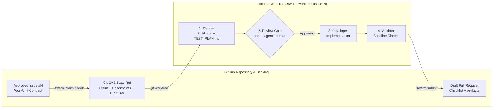

<div align="center">

# 🐝 SwarmOS

**Your issues. Your agents. One coordinated workflow.**

[](https://github.com/supernovae/SwarmOS/actions/workflows/swarm-validate.yml)
[](https://github.com/supernovae/SwarmOS/actions/workflows/security.yml)
[](go.mod)
[](LICENSE)
[](#bring-your-own-agents)

*Turn GitHub Issues into structured work contracts, coordinate multiple coding agents without a separate server, isolate every task in its own Git worktree, and ship artifact-backed Draft PRs.*

[**Quickstart**](#quickstart) · [**How It Works**](#how-it-works) · [**Grok Bot Guide**](docs/grokbot.md) · [**OpenAI Dot Guide**](docs/openai-dot.md) · [**Project Setup**](docs/project.md) · [**Developer Guide**](docs/developer.md)

</div>

---

## Why SwarmOS?

Single-agent coding tools are great at editing files, but coordinating several agents across a real backlog is where things usually fall apart: agents step on the same task, skip design review, dirty your main checkout, or open pull requests without proof that your checks ran.

**SwarmOS (`swarm`)** gives your agents and teammates a shared operating model directly inside your repository: **GitHub Issues define the work, Git compare-and-swap refs coordinate ownership and checkpoints, and isolated worktrees keep every task clean.** Whether you are an **open-source maintainer** letting contributors around the world point their coding agents at approved issues, or an **engineering organization** orchestrating internal agents across private repositories without running a separate control plane, your repo already has everything it needs.

| Challenge | How SwarmOS Solves It |
| :--- | :--- |
| **Vague issue prompts** lead to scope drift | **Schema-Validated WorkUnits** capture an explicit `Objective`, `Constraints`, `Acceptance Criteria`, `Workflow`, and `Plan Gate`, approved by a maintainer before work begins. |
| **Agents colliding on the same issue** | **Git Compare-and-Swap Claims** give each attempt a time-bounded lease and fencing token so concurrent workers never overwrite each other. |
| **Unreviewed code dumps** | **Plan-First Execution** writes `PLAN.md` and `TEST_PLAN.md` first, then runs your chosen `none`, `agent`, or `human` review gate before touching implementation code. |
| **Dirty working trees & lost progress** | **Isolated Git Worktrees** provision every task in `.swarm/worktrees/issue-<N>` on branch `swarm/issue-<N>-<slug>` with transferable Git checkpoints. |
| **Vendor lock-in to a single CLI** | **Multi-Agent Routing** lets you mix **Claude Code (`claude`), Codex (`codex`), OpenCode (`opencode`), and OhMyPi (`omp`)**—and coordinate from [**Grok Bot**](docs/grokbot.md) or [**OpenAI Dot**](docs/openai-dot.md). |
| **Untested or unsafe diffs** | **Baseline Validation** runs the required checks and protected-path rules from the approved base commit before opening an artifact-backed Draft PR. |

---

## How It Works



1. **Create & Approve (`swarm issue create` / `swarm issue approve`)**: Author a structured WorkUnit issue via the CLI or GitHub Issue Form, then approve its revision when it is ready for agents to pick up.
2. **Claim & Provision (`swarm claim` / `swarm work`)**: SwarmOS acquires a fenced lease, creates `.swarm/worktrees/issue-<N>`, and compiles `.swarm/active/WORKUNIT.md` and `SYSTEM_PROMPT.md`.
3. **Plan & Review (`PLAN.md` + `TEST_PLAN.md`)**: The planner maps out the file-level design and acceptance tests. Depending on your gate (`agent`, `human`, or `none`), an isolated reviewer agent audits the plan or the workflow pauses for a maintainer's `swarm review <issue> --approve`.
4. **Implement, Validate & Submit (`swarm validate` / `swarm submit`)**: The developer implements the approved plan, SwarmOS verifies protected paths and required checks against the approved baseline, and `swarm submit` opens a Draft PR with the full artifact trail.

---

## Quickstart

### 1. Install `swarm`

Download the latest prebuilt binary for **Linux**, **macOS**, or **Windows** from [**GitHub Releases**](https://github.com/supernovae/SwarmOS/releases/latest) (or browse [all releases](https://github.com/supernovae/SwarmOS/releases)), or install `v0.3.0` with Go 1.26.9+:

```bash
go install github.com/supernovae/swarmos/cmd/swarm@v0.3.0
```

### 2. Initialize Your Repository

From a Git checkout connected to GitHub (`gh auth login`), scaffold your `.swarm/` harness and run diagnostics:

```bash
swarm init --sync-labels --backend github --swarm-version v0.3.0
swarm doctor --backend github
```

Example `swarm doctor` output:

```text
CATEGORY   CHECK                                    STATUS   DETAIL
--------   -----                                    ------   ------
system     git                                      OK       git version 2.54.0
tracker    gh-cli                                   OK       /opt/homebrew/bin/gh
harness    .swarm/config.yaml                       OK       v1 (default_agent=claude, default_gate=agent)
harness    .swarm/validation/required-checks.yaml   OK       3 checks, 6 protected paths
agent      claude                                   OK       /opt/homebrew/bin/claude
agent      codex                                    OK       /opt/homebrew/bin/codex
agent      omp                                      OK       /opt/homebrew/bin/omp
agent      opencode                                 OK       /opt/homebrew/bin/opencode
```

Commit the generated `.swarm/`, `.github/`, `.claude/`, and `.opencode/` files to your default branch so every teammate and agent works from the same project rules.

### 3. Create, Approve & Ship a Task

```bash
# 1. Create a structured WorkUnit issue (starts as a draft; pass --ready to approve immediately)
swarm issue create --backend github \
  --title "Add JSON output to the status command" \
  --objective "Let scripts read application status as JSON" \
  --constraint "Keep the existing text output unchanged" \
  --acceptance "status --json emits valid JSON with the current status" \
  --workflow feature --gate agent

# 2. Approve the issue when the scope looks right (replace 42 with your issue number)
swarm issue approve 42 --backend github

# 3. Preview the resolved agents and gate, then run the workflow and open a Draft PR
swarm work 42 --dry-run --backend github
swarm work 42 --backend github
swarm submit 42 --backend github
```

> [!TIP]
> `swarm work` runs headlessly by default. Pass `--headless=false` to open an interactive terminal session inside the worktree, or pass `--backend local` to experiment in an offline local sandbox.

---

## Bring Your Own Agents

SwarmOS supports **Claude Code (`claude`), OpenAI Codex (`codex`), OpenCode (`opencode`), and OhMyPi (`omp`)**. Use a single tool across the workflow or route each role to your favorite harness:

```bash
swarm work 42 \
  --planner-agent claude \
  --reviewer-agent omp \
  --developer-agent codex \
  --tester-agent opencode
```

Want to coordinate work from an always-on conversational teammate?
- **[Working with Grok Bot & SwarmOS](docs/grokbot.md)** — Connect Grok Bot to GitHub, chat with your repository, request PR reviews, or let Grok drive `swarm` on its cloud computer.
- **[Working with OpenAI Dot, Codex & SwarmOS](docs/openai-dot.md)** — Add the repositories you want to swarm on to your Codex Cloud environment (or connected dev machine) and let your Dot coordinate tasks end to end.

---

## Team Handoffs & Multi-Repo Worker Pools

Register the repositories you work on so teammates and worker pools can pull from a shared backlog:

```bash
# Register this checkout in ~/.config/swarm/repos.yaml
swarm repo add --backend github

# Checkpoint a completed plan so another teammate or worker can pick up the next phase
swarm work 42 --phase plan --handoff --backend github

# Claim and run the next ready task across all registered repositories
swarm work --next --all --backend github

# Run a bounded worker pool that drains up to 4 tasks and opens Draft PRs
swarm node init
swarm node run --all --concurrency 2 --max-jobs 4 --auto-submit --backend github
```

---

## CLI Overview

| Command | What It Does |
| :--- | :--- |
| `swarm init [--force] [--sync-labels] [--template-dir <dir>] [--swarm-version <ref>]` | Scaffold `.swarm/`, `AGENTS.md`, `.swarm/SKILLS.md`, GitHub Issue Forms, consumer CI workflow, and `/swarm-*` slash commands. |
| `swarm doctor` | Check `git`, `gh`, `.swarm/` schemas, and configured agent binaries. |
| `swarm issue create\|approve\|lint\|decompose` | Create draft WorkUnits, approve revisions, lint schemas, or split epics into linked child tasks. |
| `swarm plan [--from <file> \| --scan] [--normalize] [--apply] [--ready]` | Decompose a project roadmap into dependency-ordered WorkUnit issues or scan and import open issues against project goals. |
| `swarm claim <issue>` / `swarm pull [--all]` | Claim a specific approved issue or pull the next ready task across registered repositories. |
| `swarm work [<issue>] [--next] [--all]` | Run `plan`, `review`, `implement`, and `validate` (supports `--dry-run`, `--handoff`, and role overrides). |
| `swarm stage [<issue>] [--phase plan\|implement] [--harness <name>] [--model <name>]` | Stage interactive or harness-produced plan and implementation artifacts onto an active lease with provenance metadata. |
| `swarm review <issue> [--approve\|--reject]` | Run an isolated agent review or record a maintainer's human gate decision. |
| `swarm validate [<issue>] [--ci --base <sha>]` | Verify artifacts, check protected paths, and run `.swarm/validation/required-checks.yaml`. |
| `swarm submit [<issue>]` | Clean temporary markers, checkpoint and push the worktree branch, and open or update a Draft PR with collapsible artifacts and provenance attestation. |
| `swarm status [<issue>] [--all]` | Inspect active claims, lease TTL, current phase, and published artifacts. |
| `swarm repo add\|list\|remove` | Manage the local multi-repository registry (`~/.config/swarm/repos.yaml`). |
| `swarm node init\|status\|run` | Configure a worker node profile and run concurrent worker pools (`--concurrency`, `--max-jobs`, `--watch`). |
| `swarm renew <issue>` / `swarm release <issue>` | Extend an active lease's TTL or release a claim back to the queue. |
| `swarm version [--json]` | Print version, commit, and platform metadata. |

Every lifecycle command supports `--json` for scripts and automation.

---

## Documentation & Guides

- **[Day in the Life of a Repo Admin (`docs/ADMIN_GUIDE.md`)](docs/ADMIN_GUIDE.md)** — Daily maintainer playbook for roadmap decomposition (`swarm plan --from`), backlog scanning (`swarm plan --scan`), and auditing provenance-attested Draft PRs.
- **[GitHub Security, Branching & Agent Authorization (`docs/GITHUB.md`)](docs/GITHUB.md)** — Configure repository rulesets, `SWARM_GITHUB_TOKEN` auth without `gh` CLI, and role-separated collaborator allowlists.
- **[Working with Grok Bot (`docs/grokbot.md`)](docs/grokbot.md)** — Connect Grok Bot to your repositories, talk to your codebase, run PR reviews, and coordinate SwarmOS workers.
- **[Working with OpenAI Dot & Codex (`docs/openai-dot.md`)](docs/openai-dot.md)** — Configure Codex Cloud environments and remote repositories so your Dot can plan, review, and ship changes.
- **[Project & Maintainer Setup (`docs/project.md`)](docs/project.md)** — Configure `.swarm/config.yaml`, validation rules, plan gates, and repository protections.
- **[Developer & Worker Guide (`docs/developer.md`)](docs/developer.md)** — Everyday CLI workflows, interactive `swarm stage`, agent harness table, reviewer sandboxing, handoffs, and recovery.
- **[Workflows & Review Gates (`docs/WORKFLOWS.md`)](docs/WORKFLOWS.md)** — Role prompts, `PLAN.md` / `TEST_PLAN.md` / `REVIEW.md` artifacts, provenance attestations, and gate transitions.
- **[Architecture (`docs/ARCHITECTURE.md`)](docs/ARCHITECTURE.md)** — Git compare-and-swap state refs, claim fencing, worktree checkpoints, and process boundaries.
- **[Security Policy (`SECURITY.md`)](SECURITY.md)** — Trust model, reviewer isolation, vulnerability reporting, and release attestation verification.
- **[Agent & Contributor Guide (`AGENTS.md`)](AGENTS.md)** — Repository conventions, documentation voice guardrails, and review rules for coding agents and contributors.
