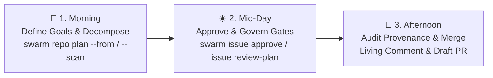

# Day in the Life of a SwarmOS Repository Admin

This guide walks through how a repository maintainer, tech lead, or engineering manager uses SwarmOS day-to-day to stay **ahead of Pull Requests**—turning roadmaps and raw issue backlogs into dependency-ordered `WorkUnit` contracts, governing how plans are produced and reviewed, and auditing provenance-attested Draft PRs.



---

## 1. One-Time Setup: Define Your Repository's Goals, Skills & Issue Forms

When you initialize a repository (or upgrade an existing `.swarm/` setup), SwarmOS scaffolds local agent factory contracts, preset GitHub Issue Forms (including `.github/ISSUE_TEMPLATE/swarm-community.yml` for community intake and `swarm-workunit.yml` for draft WorkUnits), and syncs `swarm:*` repository labels:

```bash
swarm repo init --sync-labels --backend github
swarm repo doctor --backend github
```

> [!NOTE]
> **GitHub Organization & Repository Checklist:**
> 1. **Enable the `Epic` Issue Type**: In your GitHub Organization Settings (**Settings → Issues → Issue types**), ensure the `Epic` issue type is enabled so `swarm repo plan --from <file> --apply` and `swarm issue epic create` can publish native Epic hierarchy and sub-issues.
> 2. **Verify Current Actor & Issue Type**: Run `swarm repo doctor --backend github` to check whether the `Epic` issue type is enabled on the repository and whether your current GitHub identity has `maintain` or `admin` permission to publish Epics through SwarmOS.
> 3. **Review Issue Forms & Intake Settings**: `swarm repo init` creates local `.github/ISSUE_TEMPLATE/` forms and syncs `swarm:*` labels, while GitHub's own web UI and API issue creation remain governed by your GitHub repository and organization settings. Review your repository's issue forms (`swarm-community.yml` vs `swarm-workunit.yml`) and organization issue-type permissions in GitHub Settings.
As a repo admin, tailor three foundational files before your team or community starts swarming:

1. **`.swarm/goals.md`** — Your project's mission, quality bar, architectural priorities, and non-negotiable safety invariants. SwarmOS compiles this file into every agent's `.swarm/active/SYSTEM_PROMPT.md` and uses it during `swarm repo plan --scan` to check backlog alignment.
2. **`.swarm/rules/*.md` & `.swarm/skills/*.md`** — Reusable engineering rules and triage/planning skills. If your organization shares standard templates across repositories, pass `--template-dir /path/to/org-templates` during `swarm repo init`. `.swarm/rules/lessons.md` holds what contributors have learned about the repo the hard way. Agents note their own surprises as they work, and `swarm repo lessons --apply` collects those from merged PRs for you to review and commit (see [Let the repo remember what it learned](backlog.md#6-let-the-repo-remember-what-it-learned)). Every agent reads the file with every task.
3. **`.swarm/config.yaml` (`plan_mode` & `default_gate`)** — Control how plans are created and reviewed:
   - `plan_mode: auto` (default) — Allows automated planner agents (`swarm issue work` or `swarm pr work`) and interactive staging (`swarm issue stage --phase plan` or `swarm pr stage <PR> --phase plan`).
   - `plan_mode: agent` — Requires plans to be generated by a configured planner agent in `.swarm/config.yaml` (disallows manual `issue stage` and `pr stage --phase plan`).
   - `plan_mode: interactive` — Pauses `swarm issue work` or `swarm pr work` at `awaiting-plan` after provisioning the respective worktree so a developer or interactive harness writes `PLAN.md` and `TEST_PLAN.md` and runs `swarm issue stage <N> --phase plan` or `swarm pr stage <PR> --phase plan` in the appropriate worktree.
   - `default_gate: none | agent | human` — Sets the minimum review a plan needs before implementation. A WorkUnit or workflow can ask for a stricter gate, but never a weaker one.
   - `security.reviewer_collaborators`, `security.reviewer_agents`, and `security.independent_review` — Name who can approve plans. Reviewers listed in `reviewer_collaborators` are assigned and mentioned when a plan pauses at a human gate. See [Name your reviewers](GITHUB.md#name-your-reviewers).

Commit your `.swarm/` and `.github/` changes to `main` so they become the immutable baseline for all tasks.

---

## 2. Morning: Turn Roadmaps & Raw Issues into Execution Waves (`swarm repo plan`)

Instead of waiting for uncoordinated PRs to land in your review queue, start the day by shaping the backlog with `swarm repo plan` (using `/swarm-project-plan` in Claude Code / OpenCode, or the shared `.swarm/skills/triage-and-plan.md` skill as a regular prompt in Codex / `omp`).

### Option A: Turn an Idea into a Roadmap File, Native Epic & Child WorkUnits (`--from`)

Write a repo-local Markdown roadmap (`ROADMAP.md`) with a top-level `# <Epic Title>` and one `## <Task Title>` section per child task (each with `### Objective`, `### Constraints`, observable `### Acceptance Criteria` checkboxes, and optional `depends on: <earlier-step-number>`), then preview and publish the hierarchy:

```bash
# 1. Preview the Epic and Step 1..N child tasks and execution waves (no tracker changes)
swarm repo plan --from ROADMAP.md --backend github

# 2. Maintainer-only: publish one unlabeled Epic issue (type: Epic) containing the full plan
#    and attach draft child WorkUnit sub-issues (swarm:draft)
swarm repo plan --from ROADMAP.md --apply --backend github

# 3. Selectively approve the child WorkUnit issues you want workers to claim first
swarm issue approve 2 --backend github
```

Re-running `swarm repo plan --from ROADMAP.md --apply` is idempotent: it reuses the existing Epic and unchanged child issues, refreshes the Epic body if you added new tasks, creates and links only the new child tasks as `swarm:draft`, and reports any removed tasks as leftovers without closing them. You can also create a standalone Epic and attach child WorkUnits directly:

```bash
swarm issue epic create --title "Q4 Reliability Epic" --body-file EPIC.md --backend github
swarm issue create --parent 10 --title "Add circuit breaker" \
  --objective "Prevent cascading retries" \
  --constraint "No new external dependencies" \
  --acceptance "Unit tests cover open/half-open transitions" \
  --backend github
```
### Option B: Scan, Import & Triage Open GitHub Issues (`--scan`)

When users or teammates open raw, unstructured issues on GitHub, run `swarm repo plan --scan` to sense-make the open backlog against `.swarm/goals.md`, `.swarm/rules/`, and your codebase:

```bash
# Preview the backlog sense-making report in your terminal
swarm repo plan --scan --backend github

# Apply triage labels, normalize unstructured issues into valid WorkUnits,
# and post the sense-making report to tracking issue #1
swarm repo plan --scan --apply --normalize --publish-issue 1 --backend github
```

What `swarm repo plan --scan` does for you (while automatically skipping non-executable `Epic` issues):
- **Classifies open issues (including `swarm:community` intake reports) with a triage label**:
  - `swarm:ready` — Valid, maintainer-approved `WorkUnit` ready for agents to claim.
  - `swarm:draft` — Valid structured `WorkUnit` awaiting your `swarm issue approve <N>`.
  - `swarm:needs-scope` — Raw or `swarm:community` intake issue missing structured `Objective`, `Constraints`, or `Acceptance Criteria`. Passing `--normalize` with `--apply` converts the issue body into a structured `WorkUnit` draft (`swarm:draft`) for maintainer review.
  - `swarm:blocked` — Issue waiting on open `depends_on` prerequisites or touching `protected_paths` (`.github/workflows/**`, `.swarm/**`) without `allow_harness_changes: true`.
  - If Issue `#12` and Issue `#15` both reference `internal/api/handler.go`, `swarm repo plan --scan` flags the overlap and places them into **sequential Execution Waves** (`Wave 1`, `Wave 2`) so two parallel agents never cause merge conflicts on the same file.
- **Sorts open pull requests into lanes too** (competing, dependency updates, quiet, ready for review, in progress), noting which belong to a WorkUnit. See [Dependency updates without the noise](backlog.md#5-dependency-updates-without-the-noise) for taming Dependabot.
- **Sorts the backlog into lanes** (stabilize first, probable duplicates, quiet for a while, ask the author, waiting, ready, needs a decision) so a large backlog reads as a short to-do list. See [Owning a Busy Repository](backlog.md) for the full walkthrough and `--stale-days`.
- **Suggests a shape for each issue** so you can tell a quick fix from a research project at a glance. See [Matching the plan to the work](WORKFLOWS.md#matching-the-plan-to-the-work). Routine issues make great first tasks for new contributors. Exploratory raw issues get a `human` plan gate in their normalized draft, so you see the plan before any code is written. Urgent ones get at least an `agent` gate. The shape is only a suggestion and never becomes a label.

---

## 3. Mid-Day: Approve Tasks & Monitor Living Issue Projections

### Approving Vetted Drafts
Once you are happy with the scope of the issues in **Wave 1**, approve them for execution:

```bash
swarm issue approve 12 --backend github
swarm issue approve 14 --backend github
```

`swarm issue approve` removes `swarm:draft` / `swarm:needs-scope` / `swarm:blocked`, applies `swarm:ready`, and records the cryptographic `task_digest`, `policy_digest`, and `base_sha` in `refs/heads/swarm-state/issue-<N>`. This approves the issue's WorkUnit contract for execution, not the plan or completed code.

### Following Progress in the Single Living Issue Comment
As workers claim tasks and move through `plan` $\rightarrow$ `review` $\rightarrow$ `implement` $\rightarrow$ `validate`, SwarmOS updates a **single living comment** (`### 🐝 SwarmOS Orchestration & Provenance State`) on each GitHub Issue rather than spamming new comments on every heartbeat:

- **Status Summary Table**: Current phase, lease status, effective gate, base SHA, checkpoint SHA, task/policy digests, and linked Draft PR.
- **Harness & Model Provenance Table**: Shows the exact role (`planner`, `reviewer`, `developer`, `tester`), configured agent, harness driver (`claude`, `codex`, `opencode`, `omp`), CLI version, model selector, sandbox boundary (`host`, `sandbox-exec`, `bwrap`, `container`), and artifact SHA-256 digest.
- **Collapsible `<details>` Artifacts**: Click to expand the full `PLAN.md`, `TEST_PLAN.md`, `REVIEW.md` verdict, implementation diff summary, and validation check logs directly inside the issue thread.

### Reviewing Human-Gated Plans (`--gate human`)
For sensitive architectural tasks where you set `gate: human`:
1. The worker generates `PLAN.md` and `TEST_PLAN.md` and pauses with label `swarm:plan-review`.
2. Expand the `📋 Implementation Plan` and `🧪 Test Plan` blocks in the living issue comment.
3. Approve or request changes from your terminal:
   ```bash
   swarm issue review-plan 12 --approve --notes "Approved — keep the retry backoff capped at 30s" --backend github
   ```

`swarm issue review-plan` records the separate implementation-plan approval; code and acceptance review happen later on the linked PR in GitHub.

---

## 4. Afternoon: Audit Provenance & Merge Draft PRs

When a worker runs `swarm issue submit <N>`, SwarmOS opens (or reuses) a linked Draft Pull Request proposing implementation of the approved issue contract. `swarm issue status <N>` shows its PR number and URL. The PR gives reviewers everything needed to assess the implementation:

1. **Contract Checklist**: `Closes #<N>`, `## Objective`, `## Constraints`, and `## Acceptance criteria`.
2. **`## 🔒 Harness & Model Provenance Attestation`**:
   - A human-readable table of every role's harness, CLI version, model, execution boundary, and artifact SHA-256 digest.
   - A collapsible `Machine-Readable Provenance Attestation (JSON)` block containing the schema-versioned `ProvenanceAttestation` payload with **zero PII** (no local usernames, hostnames, filesystem paths, or environment secrets).
3. **`## 📦 Attached SwarmOS Artifacts`**:
   - Collapsible `<details>` sections containing the exact `PLAN.md`, `TEST_PLAN.md`, `REVIEW.md` audit, implementation diff stat, and baseline-pinned validation check results.
4. **Independent CI Verification**:
   - The consumer `.github/workflows/swarm-validate.yml` runs `swarm repo validate --base "$BASE_SHA"` in GitHub Actions to confirm all required checks pass and no protected paths were modified without requiring an issue claim.

5. **Hosted Review Bots (optional)**:
   - If your organization uses Codex code review, Copilot code review, or Cursor Bugbot, they can review the Draft PR like any other. `swarm pr status <PR>` lists their checks and reviews and says whether each one covers the current head. See [Working Alongside Hosted Agents & Review Bots](GITHUB.md#4-working-alongside-hosted-agents--review-bots).

Final code and acceptance review happen in GitHub. For another implementation pass, use `swarm pr work <PR>`; use `swarm pr rebase <PR>` to update ancestry, and `swarm pr submit <PR>` to publish the validated revision to the same PR. A newer target policy requires maintainer approval of the linked issue's baseline. See [Continuing an Existing PR](developer.md#continuing-an-existing-pr).

Once you merge the PR for a Wave 1 issue, any Wave 2 issues that listed it under `depends_on` automatically become eligible for workers on their next `swarm issue claim --next` or `swarm issue work --next` run.

---

## Quick Reference for Repo Admins

| Daily Admin Task | Command |
| :--- | :--- |
| Sync all 10 `swarm:*` labels (`ready`, `draft`, `community`, `needs-scope`, `blocked`, etc.) | `swarm repo init --sync-labels --backend github` |
| Check GitHub `Epic` issue type availability and maintainer `create-epic` permission | `swarm repo doctor --backend github` |
| Preview `ROADMAP.md` decomposition (`Step 1..N`) without tracker writes | `swarm repo plan --from ROADMAP.md --backend github` |
| Publish native `Epic` and linked `swarm:draft` child WorkUnits | `swarm repo plan --from ROADMAP.md --apply --backend github` |
| Create a standalone `Epic` issue from a Markdown file | `swarm issue epic create --title "..." --body-file EPIC.md --backend github` |
| Scan open issues, apply triage labels & normalize raw/`swarm:community` issues | `swarm repo plan --scan --apply --normalize --backend github` |
| Turn what agents learned in merged PRs into `.swarm/rules/lessons.md` entries | `swarm repo lessons --apply --backend github` |
| Lint and approve a child WorkUnit issue for agent execution | `swarm issue lint <N> && swarm issue approve <N> --backend github` |
| Approve or reject a human-gated plan | `swarm issue review-plan <N> --approve --notes "..." --backend github` |
| Inspect active leases and artifacts across the repo | `swarm issue status --backend github` |

---

## Related Guides

- **[GitHub Security, Branching & Agent Authorization (`docs/GITHUB.md`)](GITHUB.md)** — Configure branch rulesets, `SWARM_GITHUB_TOKEN`, and collaborator allowlists.
- **[Project & Maintainer Setup (`docs/project.md`)](project.md)** — Detailed reference for `.swarm/config.yaml` and `required-checks.yaml`.
- **[Developer & Worker Guide (`docs/developer.md`)](developer.md)** — Interactive `swarm issue stage` workflows, handoffs, and worker pools.
