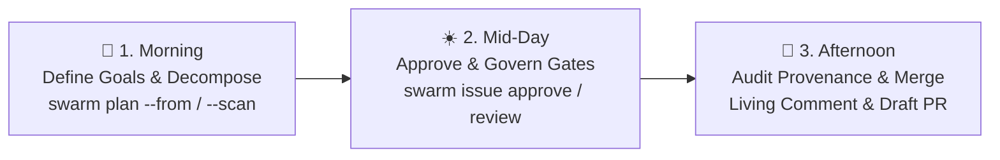

# Day in the Life of a SwarmOS Repository Admin

This guide walks through how a repository maintainer, tech lead, or engineering manager uses SwarmOS day-to-day to stay **ahead of Pull Requests**—turning roadmaps and raw issue backlogs into dependency-ordered `WorkUnit` contracts, governing how plans are produced and reviewed, and auditing provenance-attested Draft PRs.



---

## 1. One-Time Setup: Define Your Repository's Goals, Skills & Issue Forms

When you initialize a repository (or upgrade an existing `.swarm/` setup), SwarmOS scaffolds an agent factory and preset GitHub Issue Forms:

```bash
swarm init --sync-labels --backend github --swarm-version v0.2.0
```

As a repo admin, tailor three foundational files before your team or community starts swarming:

1. **`.swarm/goals.md`** — Your project's mission, quality bar, architectural priorities, and non-negotiable safety invariants. SwarmOS compiles this file into every agent's `.swarm/active/SYSTEM_PROMPT.md` and uses it during `swarm plan --scan` to check backlog alignment.
2. **`.swarm/rules/*.md` & `.swarm/skills/*.md`** — Reusable engineering rules and triage/planning skills. If your organization shares standard templates across repositories, pass `--template-dir /path/to/org-templates` during `swarm init`.
3. **`.swarm/config.yaml` (`plan_mode` & `default_gate`)** — Control how plans are created and reviewed:
   - `plan_mode: auto` (default) — Allows both automated planner agents (`swarm work`) and interactive staging (`swarm stage --phase plan`).
   - `plan_mode: agent` — Requires plans to be generated by a configured planner agent in `.swarm/config.yaml` (disallows manual `swarm stage --phase plan`).
   - `plan_mode: interactive` — Pauses `swarm work` at `awaiting-plan` after provisioning the worktree so a developer or interactive harness writes `PLAN.md` and `TEST_PLAN.md` and runs `swarm stage <N> --phase plan`.

Commit your `.swarm/` and `.github/` changes to `main` so they become the immutable baseline for all tasks.

---

## 2. Morning: Turn Roadmaps & Raw Issues into Execution Waves (`swarm plan`)

Instead of waiting for uncoordinated PRs to land in your review queue, start the day by shaping the backlog with `swarm plan` (or `/swarm-project-plan` inside Claude Code / OpenCode).

### Option A: Decompose a Roadmap or Feature Spec into Issues (`--from`)

Write a Markdown roadmap (`ROADMAP.md`) with `## <Task Title>` sections (or a YAML list of `WorkUnit` definitions), then preview how SwarmOS decomposes and orders the work:

```bash
# 1. Preview proposed WorkUnits, inferred workflows, and execution waves (no tracker changes)
swarm plan --from ROADMAP.md --backend github

# 2. Create the issues on GitHub labeled swarm:draft
swarm plan --from ROADMAP.md --apply --backend github

# 3. Or create and immediately approve all tasks as swarm:ready in one step
swarm plan --from ROADMAP.md --apply --ready --backend github
```

### Option B: Scan, Import & Triage Open GitHub Issues (`--scan`)

When users or teammates open raw, unstructured issues on GitHub, run `swarm plan --scan` to sense-make the open backlog against `.swarm/goals.md`, `.swarm/rules/`, and your codebase:

```bash
# Preview the backlog sense-making report in your terminal
swarm plan --scan --backend github

# Apply triage labels, normalize unstructured issues into valid WorkUnits,
# and post the sense-making report to tracking issue #1
swarm plan --scan --apply --normalize --publish-issue 1 --backend github
```

What `swarm plan --scan` does for you:
- **Classifies every open issue with a triage label**:
  - `swarm:ready` — Valid, maintainer-approved `WorkUnit` ready for agents to claim.
  - `swarm:draft` — Valid structured `WorkUnit` awaiting your `swarm issue approve <N>`.
  - `swarm:needs-scope` — Raw or imported issue missing structured `Objective`, `Constraints`, or `Acceptance Criteria`. Passing `--normalize` with `--apply` automatically converts the issue body into a structured `WorkUnit` (inheriting default constraints from `.swarm/goals.md` and `.swarm/rules/`) and promotes its label to `swarm:draft`.
  - `swarm:blocked` — Issue waiting on open `depends_on` prerequisites or touching `protected_paths` (`.github/workflows/**`, `.swarm/**`) without `allow_harness_changes: true`.
- **Detects file & package touchpoint collisions (`Overlaps`)**:
  - If Issue `#12` and Issue `#15` both reference `internal/api/handler.go`, `swarm plan --scan` flags the overlap and places them into **sequential Execution Waves** (`Wave 1`, `Wave 2`) so two parallel agents never cause merge conflicts on the same file.

---

## 3. Mid-Day: Approve Tasks & Monitor Living Issue Projections

### Approving Vetted Drafts
Once you are happy with the scope of the issues in **Wave 1**, approve them for execution:

```bash
swarm issue approve 12 --backend github
swarm issue approve 14 --backend github
```

`swarm issue approve` removes `swarm:draft` / `swarm:needs-scope` / `swarm:blocked`, applies `swarm:ready`, and records the cryptographic `task_digest`, `policy_digest`, and `base_sha` in `refs/heads/swarm-state/issue-<N>`.

### Following Progress in the Single Living Issue Comment
As workers claim tasks and move through `plan` $\rightarrow$ `review` $\rightarrow$ `implement` $\rightarrow$ `validate`, SwarmOS updates a **single living comment** (`### 🐝 SwarmOS Orchestration & Provenance State`) on each GitHub Issue rather than spamming new comments on every heartbeat:

- **Status Summary Table**: Current phase, lease status, effective gate, base SHA, checkpoint SHA, task/policy digests, and linked Draft PR.
- **Harness & Model Provenance Table**: Shows the exact role (`planner`, `reviewer`, `developer`, `tester`), configured agent, harness driver (`claude`, `codex`, `opencode`, `omp`), CLI version, model selector, sandbox boundary (`host`, `sandbox-exec`, `bwrap`, `container`), and artifact SHA-256 digest.
- **Collapsible `<details>` Artifacts**: Click to expand the full `PLAN.md`, `TEST_PLAN.md`, `REVIEW.md` verdict, implementation diff summary, and validation check logs directly inside the issue thread.

### Reviewing Human-Gated Plans (`--gate human`)
For sensitive architectural tasks where you set `gate: human`:
1. The worker generates `PLAN.md` and `TEST_PLAN.md` and pauses with label `swarm:plan-review`.
2. Expand the `📋 Implementation Plan` and `🧪 Test Plan` blocks in the living issue comment.
3. Approve or request changes from your terminal:
   ```bash
   swarm review 12 --approve --notes "Approved — keep the retry backoff capped at 30s" --backend github
   ```

---

## 4. Afternoon: Audit Provenance & Merge Draft PRs

When a worker runs `swarm submit <N>`, SwarmOS opens (or updates) a Draft Pull Request that gives reviewers everything needed to merge with confidence:

1. **Contract Checklist**: `Closes #<N>`, `## Objective`, `## Constraints`, and `## Acceptance criteria`.
2. **`## 🔒 Harness & Model Provenance Attestation`**:
   - A human-readable table of every role's harness, CLI version, model, execution boundary, and artifact SHA-256 digest.
   - A collapsible `Machine-Readable Provenance Attestation (JSON)` block containing the schema-versioned `ProvenanceAttestation` payload with **zero PII** (no local usernames, hostnames, filesystem paths, or environment secrets).
3. **`## 📦 Attached SwarmOS Artifacts`**:
   - Collapsible `<details>` sections containing the exact `PLAN.md`, `TEST_PLAN.md`, `REVIEW.md` audit, implementation diff stat, and baseline-pinned validation check results.
4. **Independent CI Verification**:
   - `.github/workflows/swarm-validate.yml` runs `swarm validate --ci --base "$BASE_SHA"` in GitHub Actions to confirm all required checks pass and no protected paths were modified.

Once you merge the PR for a Wave 1 issue, any Wave 2 issues that listed it under `depends_on` automatically become eligible for workers on their next `swarm pull` or `swarm work --next` run.

---

## Quick Reference for Repo Admins

| Daily Admin Task | Command |
| :--- | :--- |
| Sync all 9 `swarm:*` labels (`ready`, `draft`, `needs-scope`, `blocked`, etc.) | `swarm init --sync-labels --backend github` |
| Decompose `ROADMAP.md` into draft issues | `swarm plan --from ROADMAP.md --apply --backend github` |
| Scan open issues, apply triage labels & normalize raw issues | `swarm plan --scan --apply --normalize --backend github` |
| Lint and approve an issue for agent execution | `swarm issue lint <N> && swarm issue approve <N> --backend github` |
| Approve or reject a human-gated plan | `swarm review <N> --approve --notes "..." --backend github` |
| Inspect active leases and artifacts across the repo | `swarm status --backend github` |

---

## Related Guides

- **[GitHub Security, Branching & Agent Authorization (`docs/GITHUB.md`)](GITHUB.md)** — Configure branch rulesets, `SWARM_GITHUB_TOKEN`, and collaborator allowlists.
- **[Project & Maintainer Setup (`docs/project.md`)](project.md)** — Detailed reference for `.swarm/config.yaml` and `required-checks.yaml`.
- **[Developer & Worker Guide (`docs/developer.md`)](developer.md)** — Interactive `swarm stage` workflows, handoffs, and worker pools.
