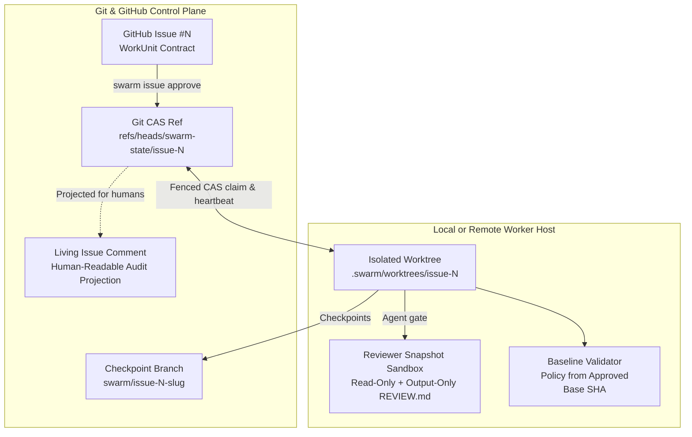

# SwarmOS Architecture

SwarmOS is built around a simple premise: **your Git repository and GitHub Issues already provide everything needed to coordinate multiple coding agents—without running an external coordination server or database.**

---

## 1. Git Compare-and-Swap Coordination (`internal/coordination/` & `internal/lease/`)

SwarmOS stores authoritative task coordination state in dedicated Git refs (`refs/heads/swarm-state/issue-<N>` on GitHub, or a file-locked CAS store when `--backend local` is explicitly selected) and projects a human-readable summary comment onto the GitHub Issue.

Each state transition uses **Git compare-and-swap (`git push --force-with-lease`)** so concurrent workers serialize cleanly:

- **Immutable Approval Binding**: `swarm issue approve <issue>` verifies the caller's repository permission, parses the `WorkUnit`, resolves the current default-branch base commit, and records the `WorkUnit` digest, `.swarm/` policy digest, and `base_sha` in the state ref before applying `swarm:ready`.
- **Fenced Claims & Heartbeats**: Claiming a task generates a unique `claim_id` fencing token with a renewable TTL. Every subsequent artifact publication, branch checkpoint, renewal, and PR submission verifies that the caller still holds the active `claim_id` and that the task/policy digests have not changed.
- **Stale-Worker Protection**: If a worker loses its lease or a heartbeat renewal fails, its context is canceled immediately so a delayed process can never overwrite a newer claimant's state or branch.

---

## 2. Isolated Worktrees & Transferable Checkpoints (`internal/workspace/`)

Each claimed issue runs inside its own linked Git worktree at `.swarm/worktrees/issue-<N>` on branch `swarm/issue-<N>-<slug>`, pinned to the approved base commit:

- **Compiled Active Bundle**: SwarmOS generates `.swarm/active/WORKUNIT.md` and `.swarm/active/SYSTEM_PROMPT.md` inside the worktree, adds `.swarm/active/` to the worktree's `.git/info/exclude`, and injects managed pointer blocks into `AGENTS.md` and `CLAUDE.md`.
- **Atomic Branch Checkpoints**: On handoff or phase completion, SwarmOS strips temporary harness markers, commits the worktree state without rewriting history, and pushes both the checkpoint branch and the updated `swarm-state/issue-<N>` ref together. Another teammate or worker node pulling the handed-off task fetches and verifies that exact checkpoint SHA before continuing.
- **Dependency Ordering**: When a `WorkUnit` declares `depends_on`, SwarmOS waits until prerequisite issues are merged/closed (or share an explicitly verified stacked base/checkpoint lineage) before treating the task as ready.

---

## 3. Plan-Bound Gates & Baseline Validation (`internal/workflow/` & `internal/validation/`)

- **Cryptographically Bound Plan Reviews**: Both automated agent reviews (`--gate agent`) and maintainer approvals (`--gate human`) record the hashes of `WORKUNIT.md`, `PLAN.md`, and `TEST_PLAN.md`. Modifying the plan or issue automatically invalidates the prior approval so unreviewed plan changes cannot slip into implementation.
- **Trusted Baseline Policy**: During `swarm validate` and `swarm submit`, SwarmOS loads `.swarm/validation/required-checks.yaml` directly from the **approved base commit** (`base_sha`) rather than the candidate worktree. It diffs all committed, staged, working-tree, and untracked changes against `protected_paths` before running each required check in a sanitized environment.

---

## 4. Process & Reviewer Isolation (`internal/sandbox/` & `internal/agent/`)

SwarmOS separates ordinary code-editing roles from plan-review isolation:

- **Sandboxed Plan Reviewer**: When running the `reviewer` role, SwarmOS copies the repository into a separate immutable snapshot (rejecting symlinks that escape the root), masks the user's home directory, denies access to the live worktree, and runs the reviewer inside `sandbox-exec` (macOS), `bwrap` (Linux), or a rootless/read-only OCI container (`docker` / `podman`). Only a bounded regular `REVIEW.md` file is imported back from the run.
- **Credential Hygiene**: All spawned agent subprocesses run with a fresh temporary `HOME` and receive only the environment variable names explicitly allowlisted in `agents.<name>.env`. Coordinator publishing tokens (`GH_*`, `GITHUB_*`, `GIT_*`, `SSH_*`) are never forwarded to agent subprocesses.
- **Trusted Host Roles**: Planner, developer, and tester roles run your compiler, test suite, and local tools inside their worktree as host processes under your user account. See [`SECURITY.md`](../SECURITY.md) for operational guidance when running unattended worker nodes.

---

## Related Guides

- **[Project & Maintainer Setup (`docs/project.md`)](project.md)** — Initialize `.swarm/`, configure agents, and approve WorkUnits.
- **[Developer & Worker Guide (`docs/developer.md`)](developer.md)** — Everyday CLI workflows, handoffs, and recovery.
- **[Workflows & Review Gates (`docs/WORKFLOWS.md`)](WORKFLOWS.md)** — Role prompts, artifacts, and gate transitions.
- **[Future Roadmap (`todo.md`)](../todo.md)** — Optional future coordinator service and planned enhancements.
