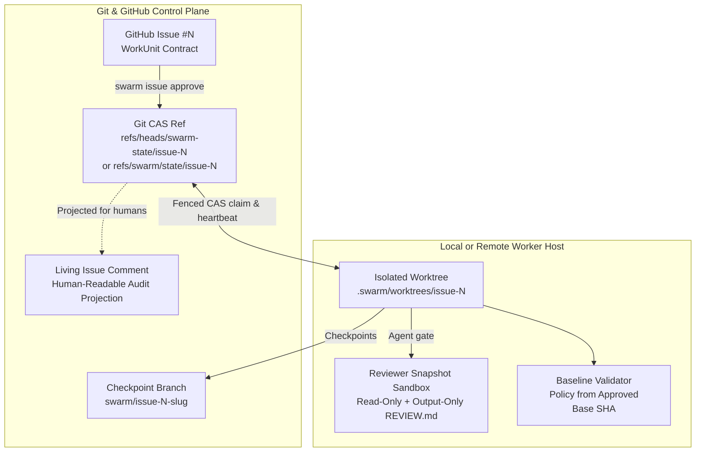

# SwarmOS Architecture

SwarmOS is built around a simple premise: **your Git repository and GitHub Issues already provide everything needed to coordinate multiple coding agents—without running an external coordination server or database.**

---

## 1. Git Compare-and-Swap Coordination (`internal/coordination/` & `internal/lease/`)

SwarmOS stores authoritative task coordination state in dedicated Git refs (`refs/heads/swarm-state/issue-<N>` or `refs/swarm/state/issue-<N>` on GitHub, or a file-locked CAS store when `--backend local` is explicitly selected) and projects a human-readable summary comment onto the GitHub Issue.

The `ledger_namespace` setting selects one ref layout per repository for issue state, checkpoint retention, and fork contributor indexes: `branch` (`refs/heads/swarm-state/`, `swarm-checkpoints/`, `swarm-contributors/`; the default when the key is absent) or `hidden` (`refs/swarm/state/`, `checkpoints/`, `contributors/`; written by `swarm repo init` for new repositories). The CLI, lease manager, and fork coordinator resolve it from `.swarm/config.yaml` on the upstream remote's advertised default branch before their first ledger read, never from a worktree, candidate commit, or fork. Every ledger read and write also checks the same entry in the other namespace and fails with both ref names if it exists, so there is never a fallback or a second authority. Task branches stay under `refs/heads/swarm/` in both modes. `swarm repo migrate-refs` moves an existing repository's ledgers in one atomic, leased push; see [Ledger ref namespaces](GITHUB.md#ledger-ref-namespaces).

Each state transition uses **Git compare-and-swap (`git push --force-with-lease`)** so concurrent workers serialize cleanly:

- **Immutable Approval Binding**: `swarm issue approve <issue>` verifies the caller's repository permission, parses the `WorkUnit`, resolves the current default-branch base commit, and records the `WorkUnit` digest, `.swarm/` policy digest, and `base_sha` in the state ref before applying `swarm:ready`.
- **Fenced Claims & Heartbeats**: Claiming a task generates a unique `claim_id` fencing token with a renewable TTL. Every subsequent artifact publication, branch checkpoint, renewal, and PR submission verifies that the caller still holds the active `claim_id` and that the task/policy digests have not changed.
- **Claim budget:** The coordinator loads lease policy from the approved base and clamps acquisition and renewal expiry to `ClaimedAt + duration × (1 + max_renewals)`. Caller renewal limits can be stricter than policy. Every heartbeat renewal counts. The nominal deadline and current expiry remain distinct: consuming renewal slots early can shorten usable time.
- **Clean wind-down:** Stage admission reserves one third of the approved lease duration. After the final renewal, the heartbeat watches expiry instead of requesting another renewal. At the reserve boundary, a coordinator-only cancellation cause stops execution. Developer/tester snapshots pass the existing bounded filesystem import checks and a fresh claim/protected-path check before checkpointing and fenced handoff. Ordinary cancellation and unsafe exports retain their failure/discard behavior. Cleanup uses a bounded live coordinator context, and expiry or fence loss remains an error. Issue checkpoints publish through fenced CAS; PR revision heads remain local until explicit submission.
- **Stale-Worker Protection**: If a worker loses its lease or a heartbeat renewal fails, its context is canceled immediately so a delayed process can never overwrite a newer claimant's state or branch.

---

## 2. Isolated Worktrees & Transferable Checkpoints (`internal/workspace/`)

Each claimed issue runs inside its own linked Git worktree at `.swarm/worktrees/issue-<N>` on branch `swarm/issue-<N>-<slug>`, pinned to the approved base commit:

- **Compiled Active Bundle**: SwarmOS generates `.swarm/active/WORKUNIT.md` and `.swarm/active/SYSTEM_PROMPT.md` inside the worktree, adds `.swarm/active/` to the worktree's `.git/info/exclude`, and injects managed pointer blocks into `AGENTS.md` and `CLAUDE.md`.
- **Atomic Branch Checkpoints**: On handoff or phase completion, SwarmOS strips temporary harness markers, commits the worktree state without rewriting history, and pushes both the checkpoint branch and the updated issue state ref together. Another teammate or worker node pulling the handed-off task fetches and verifies that exact checkpoint SHA before continuing.
- **Dependency Ordering**: When a `WorkUnit` declares `depends_on`, SwarmOS waits until prerequisite issues are merged/closed (or share an explicitly verified stacked base/checkpoint lineage) before treating the task as ready.

---

## 3. Plan-Bound Gates & Baseline Validation (`internal/workflow/` & `internal/validation/`)

- **Cryptographically Bound Plan Reviews**: Both automated agent reviews (`--gate agent`) and maintainer approvals (`--gate human`) record the hashes of `WORKUNIT.md`, `PLAN.md`, and `TEST_PLAN.md`. Modifying the plan or issue automatically invalidates the prior approval so unreviewed plan changes cannot slip into implementation.
- **Trusted Baseline Policy**: During `swarm issue validate` and `swarm issue submit`, SwarmOS loads `.swarm/validation/required-checks.yaml` directly from the **approved base commit** (`base_sha`) rather than the candidate worktree. It diffs all committed, staged, working-tree, and untracked changes against `protected_paths` before running each required check in a sanitized environment. Patterns follow Go's `filepath.Match`, plus `**` as a whole path component: `**/.gitattributes` matches `.gitattributes` at the root and in any directory, `a/**/b.yaml` matches `a/b.yaml` and `a/x/y/b.yaml`, and `dir/**` matches `dir` and everything below it. A malformed pattern in the trusted policy, such as `[`, fails validation with an error naming the pattern.
- **Content-bound validation reuse**: Released builds record the checkpoint-equivalent tree through a private Git index, plus the approved base, trusted policy digest, claim, and swarm version. Only fenced coordinator recording grants reuse authority, bound to the worker and claim. Submit reuses matching PASS evidence and records its source run; imports and fork requests cannot grant this authority. CI and explicit validation always execute checks.

---

## 4. Process & Reviewer Isolation (`internal/sandbox/` & `internal/agent/`)

### Design decision: use the harness's security model first

Users bring their agents and sign in through those agents' normal login flows. The harness owns provider authentication, sessions, refresh, and model connectivity. SwarmOS owns task coordination, repository policy, artifact acceptance, and publication.

Choose the simplest supported execution path that meets the project's policy:

1. Use the harness's native authentication, permissions, and sandbox.
2. Keep the authenticated harness in the user's environment and delegate tools to a restricted executor through a supported interface.
3. Use a disposable container with a documented, restricted authentication integration when the harness needs an external boundary.

Harnesses and their underlying OS controls are trusted dependencies. Each adapter documents its supported versions and platforms, effective permissions, tool coverage, and cancellation behavior. Focused checks cover the boundaries the project requires, including shell commands, file tools, subprocesses, and enabled MCP tools or plugins. Add an external executor only to cover a specific gap. A permission prompt alone does not establish isolation.

The two user-facing modes remain `isolated` and explicit `trusted-local`. `isolated` describes the enforced boundary, regardless of which supported harness or runtime provides it. The Codex native path uses the existing provider login. SwarmOS will not add a universal credential store, OAuth lifecycle, or model proxy.

### Implemented backend selection

`execution.backend` defaults to `native`. On Linux, Codex uses its native sandbox. Claude Code, OpenCode 2, and OhMyPi use their supported tool-control interfaces with a restricted Bubblewrap executor. Provider sessions stay with the authenticated harness. `swarm repo doctor` checks versions and actual filesystem/network restrictions. It reports login availability through supported status interfaces, and marks unprobed provider sessions explicitly. An unsupported adapter or failed probe stops the run before claiming work.

| Approach | Fit and tradeoff |
| --- | --- |
| **Trusted harness with native tool isolation — selected** | Reuses normal Codex login and session renewal. Codex enforces tool permissions; SwarmOS supplies task snapshots, runs boundary checks, and accepts bounded artifacts. The host-side harness and its internal tool dispatcher remain trusted. |
| **Trusted harness with an external executor** | Implemented for Claude through restricted-mode MCP, OpenCode 2 through a private server and V2 permissions, and OhMyPi through RPC host tools. Built-ins that bypass the executor are unavailable. |
| **Containerized harness with restricted authentication** | Useful for independently enforced isolation and resource quotas. The OCI executor is available for offline agents; provider-supported login, refresh, and revocation need qualification before authenticated use. |

Codex's documented CLI permission profiles supply its native boundary. App-server is another supported integration interface. The delegated adapters combine their tool transport with harness controls that restrict built-in execution paths. See the provider's [permissions](https://learn.chatgpt.com/docs/permissions) and [app-server](https://learn.chatgpt.com/docs/app-server) documentation.

- **Execution:** Codex shell and file tools use a restricted native profile. MCP, plugins, hooks, browser tools, and subagents are disabled. Validation uses the same harness's `sandbox` command without provider credentials. Interactive execution streams `codex exec` and accepts follow-up turns under the same permissions.
- **Files and authority:** Workers receive a detached snapshot without live Git metadata, coordinator state, or autoloaded `.codex`/`.agents` directories. Planner and reviewer input is read-only. SwarmOS imports only expected role artifacts or bounded developer/tester changes, then performs the existing provenance, policy, lease, and approval checks.
- **Credentials:** Codex opens its normal login store; SwarmOS neither reads nor copies provider tokens. Tool processes receive a clean environment and private home. Publishing credentials stay with the coordinator. Explicit `trusted-local` launches retain their existing allowlisted model-environment setup.
- **Optional OCI:** Approved repository policy can select `execution.backend: oci`. Existing explicit container settings also retain that selection. Native execution cannot silently replace a required container boundary. See [execution modes](../SECURITY.md#execution-modes) for setup and [future work](../todo.md#oci-authentication-and-enterprise-integrations) for authenticated OCI qualification.

Native capability tests cover host-file canaries, environment filtering, read-only roles, network denial, artifact import, and cancellation of a detached subprocess. The reproducible authenticated WorkUnit test exercises all four roles, interactive planning, unattended implementation, human approval, native validation, and a local Draft PR. The four-harness mixed workflow, native macOS/Windows, provider session-expiration scenarios, and additional tool integrations remain qualification work. See the current [evidence](native-qualification.md).

Adapters use minimum stable versions, supported-interface checks, and runtime canaries. OpenCode also checks merged permissions; OhMyPi checks its effective tool catalog. Diagnostics and artifact provenance record the version used. Follow the [qualification procedure](native-qualification.md#adding-a-codex-release) when updating the tested matrix; repository policy can select a particular installed binary.

### Tool capabilities

The default supports reading, editing, building, testing, and analysis with locally installed tools. Repository role routing and read-only stages apply across harnesses.

| Capability | Codex | Claude Code / OpenCode 2 / OhMyPi |
| --- | --- | --- |
| Workspace reads and edits | Native file tools under the permission profile | Isolated read/write/edit tools |
| Shell, subprocesses, local analysis | Native command sandbox | Bubblewrap executor; background children end with each call |
| Provider connectivity | Harness-owned login and model transport | Harness-owned login and model transport |
| MCP | Restricted pending integration-specific qualification | Only the generated task-tool server; OhMyPi uses RPC host tools |
| Subagents and delegated tasks | Restricted pending inherited-boundary tests | Restricted until delegated calls can retain the same executor boundary |
| Hooks, plugins, language servers | Autoloading restricted; command-line analysis remains available | Autoloading restricted; command-line analysis remains available |
| Tool network, browser, computer interaction | Restricted | Restricted |

The executor addresses a specific gap: host file and command tools in these adapters are not covered by a complete native OS sandbox. SwarmOS uses standard Bubblewrap namespaces rather than a new sandbox technology. Future capability additions should preserve the harness's own interfaces and qualify each execution path individually.

---

## Related Guides

- **[Project & Maintainer Setup (`docs/project.md`)](project.md)** — Initialize `.swarm/`, configure agents, and approve WorkUnits.
- **[Developer & Worker Guide (`docs/developer.md`)](developer.md)** — Everyday CLI workflows, handoffs, and recovery.
- **[Workflows & Review Gates (`docs/WORKFLOWS.md`)](WORKFLOWS.md)** — Role prompts, artifacts, and gate transitions.
- **[Agent Harness Guides (`docs/harness/`)](harness/README.md)** — Per-harness setup, invocation, and isolation boundaries.
- **[Future Roadmap (`todo.md`)](../todo.md)** — Optional future coordinator service and planned enhancements.
