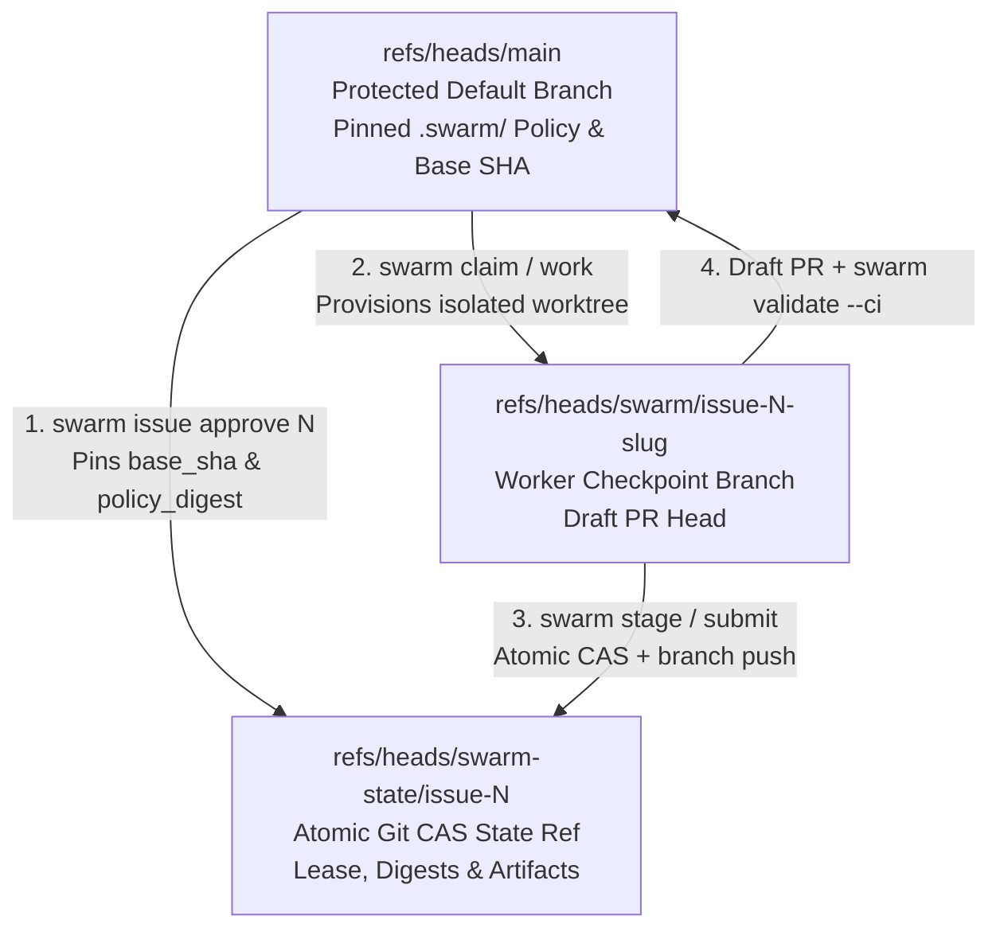

# GitHub Security, Branching Strategy & Agent Authorization Guide

SwarmOS uses GitHub Issues, Git compare-and-swap (CAS) refs, and Draft Pull Requests as a zero-infrastructure control plane. This guide shows how to configure branch rulesets, token authentication (without requiring the `gh` CLI), and role-separated collaborator accounts so coding agents and reviewer agents operate with least privilege.

---

## 1. Authentication Without the `gh` CLI

SwarmOS communicates with the GitHub REST API in-process and passes token credentials directly to `git fetch` and `git push` over HTTPS. **The `gh` CLI binary is optional**—headless worker nodes, CI containers, and dedicated agent collaborators only need `git` and a GitHub token.

SwarmOS resolves credentials in the following order:

1. **`SWARM_GITHUB_TOKEN`** — Dedicated token for the `swarm` coordinator process (recommended for agent nodes and role-separated collaborators).
2. **`GH_TOKEN` / `GITHUB_TOKEN`** — Standard GitHub environment token.
3. **`gh auth login` keyring** — Used automatically on developer laptops when no token environment variable is set.

```bash
# Run any SwarmOS command on a headless machine without installing gh
export SWARM_GITHUB_TOKEN="github_pat_..."
swarm doctor --backend github
swarm work --next --backend github
```

> [!NOTE]
> SwarmOS keeps coordinator tokens (`SWARM_GITHUB_TOKEN`, `GH_TOKEN`, `GITHUB_TOKEN`, `GIT_*`, `SSH_*`) inside the `swarm` parent process. Spawned agent subprocesses (`claude`, `codex`, `opencode`, `omp`) run with an isolated temporary `HOME` and receive only the model API keys listed under `agents.<name>.env` in `.swarm/config.yaml`.

---

## 2. Recommended Git Branch & Ref Strategy

SwarmOS separates repository history into three Git ref namespaces so agent checkpoints and coordination state never pollute your default branch:



### Recommended GitHub Repository Rulesets

In your GitHub repository, open **Settings → Rules → Rulesets** and configure two rulesets:

#### Ruleset A: Protect the Default Branch (`refs/heads/main`)
- **Target branch**: `Default branch` (`main`)
- **Restrict deletions**: Enabled
- **Block force pushes**: Enabled
- **Require a pull request before merging**:
  - Required approvals: `1` (or more)
  - Dismiss stale pull request approvals when new commits are pushed: Enabled
  - Require review from Code Owners: Enabled (add `.swarm/**` and `.github/**` to `.github/CODEOWNERS`)
- **Require status checks to pass**:
  - Require branches to be up to date before merging
  - Required check: `validate` (from `.github/workflows/swarm-validate.yml`)

#### Ruleset B: Allow Atomic CAS on Coordination State Refs (`refs/heads/swarm-state/**`)
SwarmOS updates `refs/heads/swarm-state/issue-<N>` using `git push --force-with-lease` so concurrent workers detect lease conflicts deterministically.
- Keep `refs/heads/swarm-state/**` and `refs/heads/swarm/**` **exempt from "Block force pushes"** (or scope your force-push block strictly to `Default branch`), while granting Collaborator `Write` access to your authorized worker accounts.

---

## 3. Authorizing Agents as Collaborators in Code

Rather than running coding agents under a human maintainer's personal admin token, organizations can create dedicated **GitHub Collaborator accounts** (machine users or GitHub App identities) for workers and reviewers and bind their permissions in `.swarm/config.yaml`.

### Step 1: Create Role-Separated Collaborator Identities & Fine-Grained PATs

1. Create two dedicated GitHub accounts (for example, `acme-swarm-worker` and `acme-swarm-reviewer`) and invite them to your repository with the **Write** role (never `Admin` or `Maintain` if `main` requires maintainer merge approval).
2. Generate a **Fine-Grained Personal Access Token** for each account scoped only to the target repository with:
   - **Contents**: `Read and write` (required to push `refs/heads/swarm/issue-*` and `refs/heads/swarm-state/issue-*`)
   - **Issues**: `Read and write` (required to update the living projection comment and `swarm:*` phase labels)
   - **Pull requests**: `Read and write` (required for `swarm submit` to open and update Draft PRs)
   - **Metadata**: `Read-only`

### Step 2: Enforce Collaborator Allowlists in `.swarm/config.yaml`

Pin the allowed worker and reviewer GitHub usernames under `security:` in `.swarm/config.yaml` on your default branch:

```yaml
version: 1
default_agent: claude
default_gate: agent
plan_mode: auto

roles:
  planner: claude
  reviewer: omp
  developer: codex
  tester: opencode

lease:
  duration: 4h
  renewable: true
  max_renewals: 3

security:
  require_ready_label: true
  ready_label: "swarm:ready"
  # Only these GitHub identities may acquire leases or push implementation checkpoints:
  approved_collaborators:
    - acme-swarm-worker
    - acme-swarm-reviewer
    - alice-maintainer
  # Only these GitHub identities may publish plan review verdicts (swarm review):
  reviewer_collaborators:
    - acme-swarm-reviewer
    - alice-maintainer

agents:
  claude:
    binary: claude
    model: claude-sonnet-4-5
    roles: [planner]
    env: [ANTHROPIC_API_KEY]
  omp:
    binary: omp
    model: gemini-2.5-pro
    roles: [reviewer]
    sandbox: sandbox-exec
    review_network: true
    env: [GEMINI_API_KEY]
  codex:
    binary: codex
    model: gpt-5-codex
    roles: [developer]
    env: [OPENAI_API_KEY]
  opencode:
    binary: opencode
    roles: [tester]
    env: [OPENAI_API_KEY]
```

### Step 3: Run Role-Separated Worker and Reviewer Nodes

With `approved_collaborators` and `reviewer_collaborators` committed to `main`, you can run planning/implementation and plan review under separate credentials:

```bash
# 1. Maintainer approves the WorkUnit issue on main
SWARM_GITHUB_TOKEN="$MAINTAINER_TOKEN" swarm issue approve 42 --backend github

# 2. Worker collaborator claims #42, generates PLAN.md + TEST_PLAN.md, and hands off to review
SWARM_GITHUB_TOKEN="$WORKER_TOKEN" swarm work 42 --phase plan --handoff --backend github

# 3. Reviewer collaborator runs the sandboxed plan audit and publishes REVIEW.md
#    (If $WORKER_TOKEN attempts `swarm review 42`, SwarmOS rejects it via reviewer_collaborators!)
SWARM_GITHUB_TOKEN="$REVIEWER_TOKEN" swarm review 42 --handoff --backend github

# 4. Worker collaborator implements the approved plan, validates against base_sha, and opens the Draft PR
SWARM_GITHUB_TOKEN="$WORKER_TOKEN" swarm work 42 --phase implement --backend github
SWARM_GITHUB_TOKEN="$WORKER_TOKEN" swarm submit 42 --backend github
```

### How Each Boundary Is Enforced

| Action | Required GitHub Permission | `.swarm/config.yaml` Policy Check |
| :--- | :--- | :--- |
| `swarm issue approve <N>` | Repository `write`, `maintain`, or `admin` | Must be an authenticated collaborator; pins `task_digest`, `policy_digest`, and `base_sha`. |
| `swarm claim <N>` / `swarm work <N>` | Repository `write` | Actor must match `security.approved_collaborators` (when configured) and issue must carry `swarm:ready`. |
| `swarm review <N>` (Agent Gate) | Repository `write` | Actor must match `security.reviewer_collaborators` (when configured); reviewer subprocess runs in a read-only sandbox. |
| `swarm review <N> --approve` (Human Gate) | Repository `write`, `maintain`, or `admin` (non-Bot account) | Actor must be a human GitHub user and match `security.reviewer_collaborators` (when configured). |
| `swarm submit <N>` | Repository `write` | Requires a verified review verdict matching the current `WorkUnit`, `PLAN.md`, and `TEST_PLAN.md` digests plus passing baseline-pinned checks. |

---

## Related Guides

- **[Day in the Life of a Repo Admin (`docs/ADMIN_GUIDE.md`)](ADMIN_GUIDE.md)** — End-to-end maintainer playbook for roadmap decomposition, backlog scanning, and PR auditing.
- **[Project & Maintainer Setup (`docs/project.md`)](project.md)** — Initialize `.swarm/`, configure validation checks, and manage Issue Forms.
- **[Developer & Worker Guide (`docs/developer.md`)](developer.md)** — Interactive `swarm stage` workflows, handoffs, and multi-repo worker pools.
