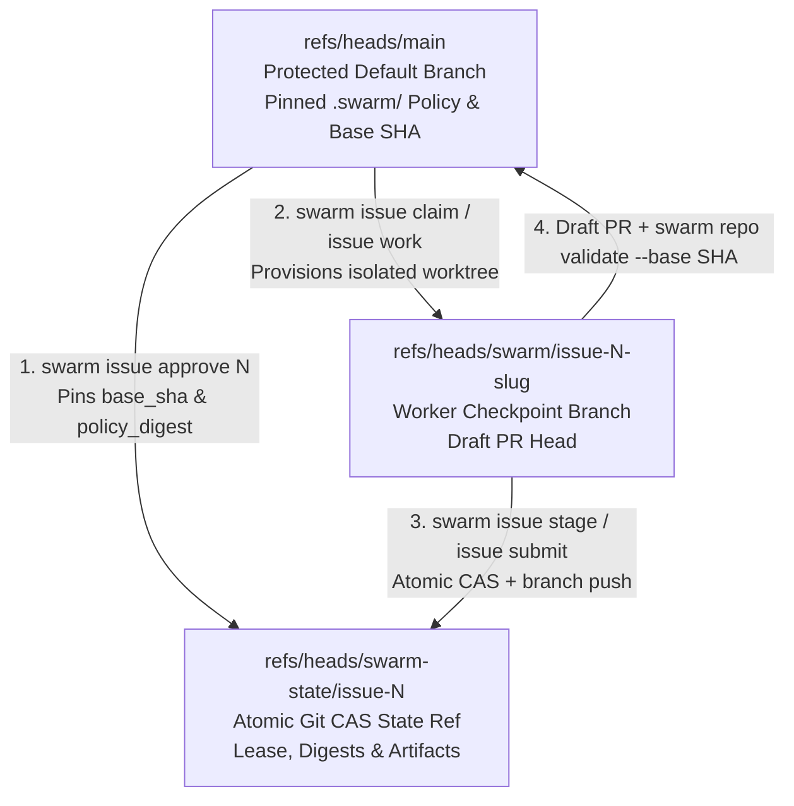

# GitHub Security, Branching Strategy & Agent Authorization Guide

SwarmOS uses GitHub Issues, Git compare-and-swap (CAS) refs, and Draft Pull Requests as a zero-infrastructure control plane. This guide shows how to configure branch rulesets, token authentication (without requiring the `gh` CLI), and role-separated collaborator accounts so coding agents and reviewer agents operate with least privilege.

---

## 1. Authentication Without the `gh` CLI

SwarmOS communicates with the GitHub REST API in-process and passes token credentials directly to `git fetch` and `git push` over HTTPS. **The `gh` CLI binary is optional**—headless worker nodes, CI containers, and dedicated agent collaborators only need `git` and a GitHub token.

SwarmOS resolves credentials in the following order:

1. **`SWARM_GITHUB_TOKEN`**: a dedicated token for the `swarm` coordinator process (recommended for agent nodes and role-separated collaborators).
2. **`SWARM_GITHUB_TOKEN_COMMAND`**: a command that prints the token, such as `op read …`. `swarm` runs it once and keeps the result in memory. See [Keep tokens out of your shell with a secret manager](#keep-tokens-out-of-your-shell-with-a-secret-manager).
3. **`GH_TOKEN` / `GITHUB_TOKEN`**: the standard GitHub environment token.
4. **`gh auth login` keyring**: used automatically on developer laptops when no token is set.

Set only one of `SWARM_GITHUB_TOKEN` or `SWARM_GITHUB_TOKEN_COMMAND`. If both are present, `swarm` stops and asks you to pick one.

```bash
# Run any SwarmOS command on a headless machine without installing gh
export SWARM_GITHUB_TOKEN="github_pat_..."
swarm repo doctor --backend github
swarm issue work --next --backend github
```

> [!NOTE]
> SwarmOS keeps coordinator tokens (`SWARM_GITHUB_TOKEN`, `GH_TOKEN`, `GITHUB_TOKEN`, `GIT_*`, `SSH_*`) inside the `swarm` parent process. Spawned agent subprocesses (`claude`, `codex`, `opencode`, `omp`) run with an isolated temporary `HOME` and receive only the model API keys listed under `agents.<name>.env` in `.swarm/config.yaml`.

### Keep Tokens Out of Your Shell with a Secret Manager

An exported token is copied into every program you start from that shell. It also ends up in dotfiles, `.env` files, and shell history. On Linux, any process running as your user can read another process's environment from `/proc/<pid>/environ`. That includes a coding agent running on the host. Keeping the token in a secret manager, and letting `swarm` fetch it only when it needs it, closes most of these paths.

> [!TIP]
> On a laptop, the easiest setup is `gh auth login`. The `gh` CLI keeps the token in your OS keyring (macOS Keychain, Windows Credential Manager, or libsecret on Linux), and `swarm` uses it automatically. For `git push` and `git fetch`, `swarm` also respects the credential helper you already use, such as `osxkeychain`, Git Credential Manager, `libsecret`, or `gh auth setup-git`.

If you already keep secrets in a password manager, point `SWARM_GITHUB_TOKEN_COMMAND` at it. The command can be anything that prints the token on a single line. Here are some common choices:

| Tool | `SWARM_GITHUB_TOKEN_COMMAND` | One-time setup |
| :--- | :--- | :--- |
| 1Password CLI | `op read op://Private/GitHub/swarm-token` | Store the token in a 1Password item. |
| Bitwarden CLI | `bw get password swarm-github` | Run `bw unlock` and export `BW_SESSION` in the shell that runs `swarm`. |
| macOS Keychain | `security find-generic-password -s swarm-github -w` | `security add-generic-password -a "$USER" -s swarm-github -w` (prompts for the token). |
| Linux libsecret | `secret-tool lookup service swarm-github` | `secret-tool store --label="swarm GitHub token" service swarm-github` |
| `pass` | `pass show github/swarm \| head -n 1` | `pass insert github/swarm` |
| GitHub CLI | `gh auth token` | `gh auth login` |

```bash
export SWARM_GITHUB_TOKEN_COMMAND="op read op://Private/GitHub/swarm-token"
swarm repo doctor --backend github
swarm issue work --next --backend github
```

What happens:

1. The first time `swarm` needs GitHub access, it runs the command through your shell (`sh -c`, or `cmd /C` on Windows). Your terminal stays attached, so 1Password, Bitwarden, or Keychain can ask you to unlock or confirm with a fingerprint.
2. The token is held in memory for the rest of that `swarm` invocation. It is never written to disk, never passed as a command-line argument, and never shown in `swarm` diagnostics.
3. When `git` needs to authenticate, `swarm` gives it a header scoped to `https://github.com/` through a short-lived child environment. That environment drops any `GIT_CONFIG_*`, `GIT_TRACE*`, and token variables you had set.
4. Agent processes (`claude`, `codex`, `opencode`, `omp`) never receive the token, the command, or your shell's token variables.

> [!NOTE]
> `SWARM_GITHUB_TOKEN_COMMAND` is read only from your own environment. Nothing in `.swarm/config.yaml` can set it, so a repository you contribute to can never choose a program to run on your machine. Agents running in `trusted-local` mode still run as your user account. For work from people you don't know, use the default `isolated` [execution mode](../SECURITY.md#execution-modes), which runs agent tools against a detached task snapshot with a clean environment and their own process namespace.

**Model provider keys.** Each agent CLI's own login is the best option where it's available, because it keeps the key in that tool's credential store. If an agent needs an API key from the environment, list only that key under `agents.<name>.env`. Model keys have to reach the agent that uses them, but you can still keep them out of your shell profile by injecting them for a single run, for example `op run --env-file=.env.swarm -- swarm issue work --next`.

---

## 2. Recommended Git Branch & Ref Strategy

SwarmOS separates repository history into three Git ref namespaces so agent checkpoints and coordination state never pollute your default branch:



### Recommended GitHub Repository Rulesets

In your GitHub repository, open **Settings → Rules → Rulesets** and configure two rulesets:

#### Ruleset A: Protect the Default Branch (`refs/heads/main`)
- **Target branch**: `Default branch` (`main`)
- **Restrict deletions**: Enabled
- **Block force pushes**: Enabled
- **Require a pull request before merging**:
  - Required approvals: `1` (or more)
  - Dismiss stale pull request approvals when new commits are pushed: Enabled
  - Require review from Code Owners: Enabled (add `.swarm/**` and `.github/**` to `.github/CODEOWNERS`)
- **Require status checks to pass**:
  - Require branches to be up to date before merging
  - Required check: `validate` (from `.github/workflows/swarm-validate.yml`)

#### Ruleset B: Allow Atomic CAS on Coordination State Refs (`refs/heads/swarm-state/**`)
SwarmOS updates `refs/heads/swarm-state/issue-<N>` using `git push --force-with-lease` so concurrent workers detect lease conflicts deterministically.
- Keep `refs/heads/swarm-state/**` and `refs/heads/swarm/**` **exempt from "Block force pushes"** (or scope your force-push block strictly to `Default branch`), while granting Collaborator `Write` access to your authorized worker accounts.

---

## 3. Authorizing Agents as Collaborators in Code

Rather than running coding agents under a human maintainer's personal admin token, organizations can create dedicated **GitHub Collaborator accounts** (machine users or GitHub App identities) for workers and reviewers and bind their permissions in `.swarm/config.yaml`.

### Step 1: Create Role-Separated Collaborator Identities & Fine-Grained PATs

1. Create two dedicated GitHub accounts (for example, `acme-swarm-worker` and `acme-swarm-reviewer`) and invite them to your repository with the **Write** role (never `Admin` or `Maintain` if `main` requires maintainer merge approval).
2. Generate a **Fine-Grained Personal Access Token** for each account scoped only to the target repository with:
   - **Contents**: `Read and write` (required to push `refs/heads/swarm/issue-*` and `refs/heads/swarm-state/issue-*`)
   - **Issues**: `Read and write` (required to update the living projection comment and `swarm:*` phase labels)
   - **Pull requests**: `Read and write` (required for `swarm issue submit` to open and update Draft PRs)
   - **Metadata**: `Read-only`

### Step 2: Enforce Collaborator Allowlists in `.swarm/config.yaml`

Pin the allowed worker and reviewer GitHub usernames under `security:` in `.swarm/config.yaml` on your default branch. This multi-harness example uses explicit `trusted-local` execution; for the native isolated default, use the [Codex setup](project.md#2-configure-approved-agents-swarmconfigyaml) with the same collaborator rules.

```yaml
version: 1
default_agent: claude
default_gate: agent
plan_mode: auto
execution:
  mode: trusted-local

roles:
  planner: claude
  reviewer: omp
  developer: codex
  tester: opencode

lease:
  duration: 4h
  renewable: true
  max_renewals: 3

security:
  require_ready_label: true
  ready_label: "swarm:ready"
  # Only these GitHub identities may acquire leases or push implementation checkpoints:
  approved_collaborators:
    - acme-swarm-worker
    - acme-swarm-reviewer
    - alice-maintainer
  # Only these GitHub identities may publish plan review verdicts (swarm issue review-plan):
  reviewer_collaborators:
    - acme-swarm-reviewer
    - alice-maintainer

agents:
  claude:
    binary: claude
    model: claude-sonnet-4-5
    roles: [planner]
    env: [ANTHROPIC_API_KEY]
  omp:
    binary: omp
    model: gemini-2.5-pro
    roles: [reviewer]
    sandbox: sandbox-exec
    review_network: true
    env: [GEMINI_API_KEY]
  codex:
    binary: codex
    model: gpt-5-codex
    roles: [developer]
    env: [OPENAI_API_KEY]
  opencode:
    binary: opencode
    roles: [tester]
    env: [OPENAI_API_KEY]
```

### Step 3: Run Role-Separated Worker and Reviewer Nodes

With `approved_collaborators` and `reviewer_collaborators` committed to `main`, you can run planning/implementation and plan review under separate credentials:

```bash
# 1. Maintainer approves the WorkUnit issue on main
SWARM_GITHUB_TOKEN="$MAINTAINER_TOKEN" swarm issue approve 42 --backend github

# 2. Worker collaborator claims #42, generates PLAN.md + TEST_PLAN.md, and hands off to review
SWARM_GITHUB_TOKEN="$WORKER_TOKEN" swarm issue work 42 --phase plan --handoff --backend github

# 3. Reviewer collaborator audits the plan, publishes REVIEW.md, and hands off to implementation
#    (If $WORKER_TOKEN attempts `swarm issue review-plan 42`, SwarmOS rejects it via reviewer_collaborators!)
SWARM_GITHUB_TOKEN="$REVIEWER_TOKEN" swarm issue work 42 --phase review --handoff --backend github

# 4. Worker collaborator implements the approved plan, validates against base_sha, and opens the Draft PR
SWARM_GITHUB_TOKEN="$WORKER_TOKEN" swarm issue work 42 --phase implement --backend github
SWARM_GITHUB_TOKEN="$WORKER_TOKEN" swarm issue submit 42 --backend github
```

### How Each Boundary Is Enforced

| Action | Required GitHub Permission | `.swarm/config.yaml` / Tracker Policy Check |
| :--- | :--- | :--- |
| `swarm repo plan --from <file> --apply` / `swarm issue epic create` | Repository `maintain` or `admin` | Verifies maintainer role (`create-epic`) and enabled organization `Epic` issue type before creating the unlabeled Epic or linking native sub-issues. |
| `swarm issue approve <N>` | Repository `write`, `maintain`, or `admin` | Rejects `Epic` issues; must be an authenticated collaborator; pins `task_digest`, `policy_digest`, and `base_sha` and applies `swarm:ready`. |
| `swarm issue claim <N>` / `swarm issue work <N>` | Repository `write` | Rejects `Epic` issues; actor must match `security.approved_collaborators` (when configured) and issue must carry `swarm:ready`. |
| `swarm issue review-plan <N>` (Agent Gate) | Repository `write` | Actor must match `security.reviewer_collaborators` (when configured); reviewer subprocess runs in a read-only sandbox. |
| `swarm issue review-plan <N> --approve` (Human Gate) | Repository `write`, `maintain`, or `admin` (non-Bot account) | Actor must be a human GitHub user and match `security.reviewer_collaborators` (when configured). |
| `swarm issue submit <N>` | Repository `write` | Requires a verified review verdict matching the current `WorkUnit`, `PLAN.md`, and `TEST_PLAN.md` digests plus passing baseline-pinned checks. |

> [!NOTE]
> **Organization Issue Types & Web Intake:**
> - Native `Epic` issues and sub-issue hierarchy require GitHub's organization `Epic` issue type to be enabled on the repository. Run `swarm repo doctor --backend github` to check `Epic` availability and your current actor's `create-epic` permission.
> - `swarm repo init --sync-labels --backend github` scaffolds `.github/ISSUE_TEMPLATE/swarm-community.yml` (`swarm:community` intake) and `swarm-workunit.yml` (`swarm:draft`) and syncs labels. Because GitHub's web UI and REST API allow users with repository access to open issues directly, maintainers should review repository issue forms and organization issue-type settings in GitHub Settings; SwarmOS enforces execution gating by requiring explicit `swarm issue approve <N>` on non-Epic WorkUnits.
---

## Related Guides

- **[Day in the Life of a Repo Admin (`docs/ADMIN_GUIDE.md`)](ADMIN_GUIDE.md)** — End-to-end maintainer playbook for roadmap decomposition, backlog scanning, and PR auditing.
- **[Project & Maintainer Setup (`docs/project.md`)](project.md)** — Initialize `.swarm/`, configure validation checks, and manage Issue Forms.
- **[Developer & Worker Guide (`docs/developer.md`)](developer.md)** — Interactive `swarm issue stage` workflows, handoffs, and multi-repo worker pools.
