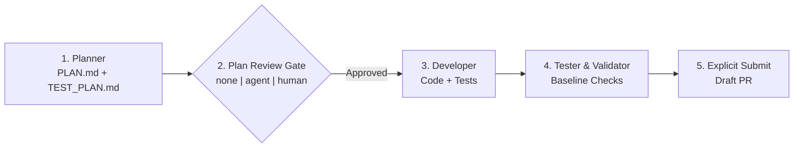

# Workflows, Role Contracts & Review Gates

SwarmOS uses a **Plan-First** lifecycle across all supported coding harnesses (`claude`, `codex`, `opencode`, `omp`). Every task produces a concrete design and test plan before implementation code is written.

---

## 1. Built-In Workflow Recipes (`.swarm/workflows/`)

SwarmOS scaffolds three workflow recipes in `.swarm/workflows/`:
- **`feature.yaml`**: End-to-end feature delivery from requirements analysis and design through implementation and validation.
- **`bugfix.yaml`**: Root-cause analysis, regression test planning, fix implementation, and verification.
- **`refactor.yaml`**: Structural improvements that preserve behavior and pass all repository checks.

Workflow YAML files customize the step descriptions and role context compiled into `.swarm/active/WORKUNIT.md` and `SYSTEM_PROMPT.md`, while the SwarmOS engine enforces the execution sequence:



---

## 2. Role Contracts & Artifacts

Each workflow phase binds to a role prompt in `.swarm/prompts/` and reads/writes well-defined artifacts in `.swarm/active/`:

| Role | Prompt File | Reads | Produces |
| :--- | :--- | :--- | :--- |
| **Planner** (`planner`) | `.swarm/prompts/planner.md` | `WORKUNIT.md` and repository context | `.swarm/active/PLAN.md` (`design`) & `.swarm/active/TEST_PLAN.md` (`test-plan`) |
| **Reviewer** (`reviewer`) | `.swarm/prompts/reviewer.md` | `WORKUNIT.md`, `PLAN.md`, `TEST_PLAN.md` | `.swarm/active/REVIEW.md` (`review` starting with `VERDICT: APPROVED` or `VERDICT: CHANGES_REQUESTED`) |
| **Developer** (`developer`) | `.swarm/prompts/developer.md` | Approved `PLAN.md` and `TEST_PLAN.md` | Working-tree implementation changes + checkpoint commit |
| **Tester / Validator** (`tester`) | `.swarm/prompts/tester.md` | Implementation and approved-base validation policy | Validation check output (`validation` artifact) |

SwarmOS compiles `.swarm/active/WORKUNIT.md` and `.swarm/active/SYSTEM_PROMPT.md` freshly for each claimed task and injects managed pointer blocks into `AGENTS.md` and `CLAUDE.md` inside the worktree so interactive and headless tools find the active contract immediately.

---

## 3. Plan Review Gates (`none | agent | human`)

```bash
# Preview the effective workflow, resolved gate, and role agents without side effects
swarm work 42 --dry-run --backend github

# Agent gate: planner writes PLAN.md + TEST_PLAN.md, then the sandboxed reviewer audits it
swarm work 42 --gate agent --planner-agent claude --reviewer-agent omp --developer-agent codex --backend github

# Human gate: generate and publish the plan, pause for maintainer review, then resume
swarm work 42 --gate human --phase plan --backend github
swarm review 42 --approve --notes "Plan looks great; proceed with implementation" --backend github
swarm work 42 --phase implement --backend github
```

How gate verification keeps reviews trustworthy:
- **Cryptographic plan binding**: Both `agent` and `human` approvals bind to the exact `WorkUnit` digest and the SHA-256 digests of `PLAN.md` and `TEST_PLAN.md`. If the issue or plan files are edited after approval, SwarmOS requires a fresh review before implementation or submission.
- **Exact reviewer verdicts**: Under `--gate agent`, the isolated reviewer must begin `.swarm/active/REVIEW.md` with `VERDICT: APPROVED` or `VERDICT: CHANGES_REQUESTED`. Any `CHANGES_REQUESTED` verdict stops the workflow before code is modified and publishes the findings for inspection.
- **Authenticated human decisions**: Under `--gate human`, planning pauses with label `swarm:plan-review` until a repository maintainer runs `swarm review <issue> --approve` (or `--reject`).

---

## 4. Interactive Slash Commands

When working interactively inside a provisioned worktree (`.swarm/worktrees/issue-<N>`) with Claude Code or OpenCode, you can also use the generated slash commands:

- `/swarm-plan` — Draft `.swarm/active/PLAN.md` and `.swarm/active/TEST_PLAN.md` for the active WorkUnit.
- `/swarm-review` — Audit the current plan against all constraints and acceptance criteria.
- `/swarm-implement` — Implement the approved plan step by step.
- `/swarm-validate` — Run `swarm validate` and verify every acceptance criterion.

---

## Related Guides

- **[Project & Maintainer Setup (`docs/project.md`)](project.md)** — Initialize `.swarm/`, configure agents, and approve issues.
- **[Developer & Worker Guide (`docs/developer.md`)](developer.md)** — Everyday CLI commands, handoffs, recovery, and worker pools.
- **[Architecture (`docs/ARCHITECTURE.md`)](ARCHITECTURE.md)** — Git-CAS coordination, claim fencing, and checkpoint design.
