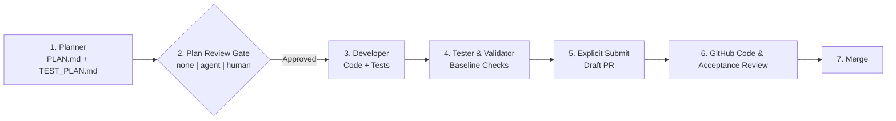

# Workflows, Role Contracts & Review Gates

SwarmOS uses a **Plan-First** lifecycle across all supported coding harnesses (`claude`, `codex`, `opencode`, `omp`). Every task produces a concrete design and test plan before implementation code is written.

---

## 1. Built-In Workflow Recipes (`.swarm/workflows/`)

SwarmOS scaffolds three workflow recipes in `.swarm/workflows/`:
- **`feature.yaml`**: End-to-end feature delivery from requirements analysis and design through implementation and validation.
- **`bugfix.yaml`**: Root-cause analysis, regression test planning, fix implementation, and verification.
- **`refactor.yaml`**: Structural improvements that preserve behavior and pass all repository checks.

Workflow YAML files customize the step descriptions and role context compiled into `.swarm/active/WORKUNIT.md` and `SYSTEM_PROMPT.md`, while the SwarmOS engine enforces the execution sequence:



---

## 2. Role Contracts & Artifacts

Each workflow phase binds to a role prompt in `.swarm/prompts/` and reads/writes well-defined artifacts in `.swarm/active/`:

| Role | Prompt File | Reads | Produces |
| :--- | :--- | :--- | :--- |
| **Planner** (`planner`) | `.swarm/prompts/planner.md` | `WORKUNIT.md` and repository context | `.swarm/active/PLAN.md` (`design`) & `.swarm/active/TEST_PLAN.md` (`test-plan`) |
| **Reviewer** (`reviewer`) | `.swarm/prompts/reviewer.md` | `WORKUNIT.md`, `PLAN.md`, `TEST_PLAN.md` | `.swarm/active/REVIEW.md` (`review` starting with `VERDICT: APPROVED` or `VERDICT: CHANGES_REQUESTED`) |
| **Developer** (`developer`) | `.swarm/prompts/developer.md` | Approved `PLAN.md` and `TEST_PLAN.md` | Working-tree implementation changes + checkpoint commit |
| **Tester / Validator** (`tester`) | `.swarm/prompts/tester.md` | Implementation and approved-base validation policy | Validation check output (`validation` artifact) |

SwarmOS compiles `.swarm/active/WORKUNIT.md` and `.swarm/active/SYSTEM_PROMPT.md` freshly for each claimed task and injects managed pointer blocks into `AGENTS.md` and `CLAUDE.md` inside the worktree so interactive and headless tools find the active contract immediately.

### Matching the plan to the work

Not every issue needs the same amount of planning. A typo fix shouldn't come with a ten-step design, and an open question shouldn't get confidently "solved" in one pass. The planner starts `PLAN.md` by naming the work's **shape**, then sizes the plan to fit:

| Shape | What it looks like | What the plan does |
| :--- | :--- | :--- |
| **Routine** | Clear fix in a known place | Stays short |
| **Involved** | Knowable, but spans several packages or has real trade-offs | Names the alternatives and why one wins |
| **Exploratory** | Nobody knows the right answer yet | Starts with a small probe, keeps the change reversible, and lists follow-up WorkUnits |
| **Urgent** | Users are affected right now | Stops the harm first; the root cause becomes a follow-up |

Every plan also opens with **What we know** (each fact backed by a file, test, or command output), **What we're assuming**, and **Open questions**. The reviewer checks that the plan's rigor fits its shape and that the facts hold up. Because `PLAN.md` is attached to the Draft PR, the people reviewing the code see the same reasoning.

When something about the repo surprises an agent, it notes it in `.swarm/active/LESSONS.md`. SwarmOS copies those notes into the implementation summary under **What we learned**, and `swarm repo lessons` turns lessons from merged PRs into proposed `.swarm/rules/lessons.md` entries for a maintainer to commit.

You don't have to pick a shape yourself. `swarm repo plan --scan` and `swarm issue lint <N>` suggest one from the issue text, along with hints for making the issue stronger (for example, a bugfix with no reproduction step). The planner confirms or corrects the shape once it has read the code. The shape is never stored on the WorkUnit, so it never changes what you approved.

---

## 3. Plan Review Gates (`none | agent | human`)

```bash
# Preview the effective workflow, resolved gate, and role agents without side effects
swarm issue work 42 --dry-run --backend github

# Agent gate: planner writes PLAN.md + TEST_PLAN.md, then the sandboxed reviewer audits it
swarm issue work 42 --gate agent --planner-agent claude --reviewer-agent omp --developer-agent codex --backend github

# Human gate: generate and publish the plan, pause for maintainer review, then resume
swarm issue work 42 --gate human --phase plan --backend github
swarm issue review-plan 42 --approve --notes "Plan looks great; proceed with implementation" --backend github
swarm issue work 42 --phase implement --backend github
```

How gate verification keeps reviews trustworthy:
- **Cryptographic plan binding**: Both `agent` and `human` approvals bind to the exact `WorkUnit` digest and the SHA-256 digests of `PLAN.md` and `TEST_PLAN.md`. If the issue or plan files are edited after approval, SwarmOS requires a fresh review before implementation or submission.
- **Exact reviewer verdicts**: Under `--gate agent`, the isolated reviewer must begin `.swarm/active/REVIEW.md` with `VERDICT: APPROVED` or `VERDICT: CHANGES_REQUESTED`. Any `CHANGES_REQUESTED` verdict stops the workflow before code is modified and publishes the findings for inspection.
- **Authenticated human decisions**: Under `--gate human`, planning pauses with label `swarm:plan-review` until a repository maintainer runs `swarm issue review-plan <issue> --approve` or `swarm issue review-plan <issue> --reject`.

`swarm issue approve <issue>` makes the issue's WorkUnit the approved work contract before execution; plan approval is a second, separate checkpoint. `swarm issue validate` runs the approved-base checks and protected-path policy, not a pass/fail decision for each acceptance criterion. `swarm issue submit <issue>` links a Draft PR proposing implementation of the issue contract; `swarm issue status <issue>` exposes its PR number and URL. Continue implementation with `swarm pr work <PR>`, stage interactive PR plans or implementation with `swarm pr stage <PR> --phase plan|implement` in `.swarm/worktrees/pr-<PR>` (not the original issue worktree), update ancestry with `swarm pr rebase <PR>`, and publish only through `swarm pr submit <PR>`. These operations retain the issue's approval gates; maintainers use GitHub for final code and acceptance review. See [Continuing an Existing PR](developer.md#continuing-an-existing-pr).

---

## Continuing from a rewritten checkpoint

Keep task history additive when possible: commit further changes or merge required upstream fixes. If you deliberately rebase an upstream issue checkpoint, SwarmOS keeps the recorded checkpoint and asks you to reconcile the replacement explicitly. `swarm issue status 29` shows the recorded checkpoint, worktree HEAD and attached branch, local task branch, and live remote branch as full SHAs. Its `--json` output includes the same observations, with missing refs and lookup errors reported separately.

With your active claim, finish the rewrite on the attached task branch and leave the worktree clean. Copy the recorded and replacement SHAs into the commands below:

```bash
issue=29
expected=FULL_RECORDED_CHECKPOINT_SHA
candidate=FULL_LOCAL_REPLACEMENT_SHA
swarm issue reconcile "$issue" --checkpoint --expected-head "$expected" --candidate-head "$candidate" --dry-run
swarm issue reconcile "$issue" --checkpoint --expected-head "$expected" --candidate-head "$candidate"
```

The preview reports whether validation or fresh plan review is needed. An unchanged patch can retain its current authenticated plan approval. For a changed patch, update `PLAN.md` to describe the replacement and include its full candidate SHA, stage the revised plan with `swarm issue stage 29 --phase plan`, and obtain a new `swarm issue review-plan 29` decision before reconciling. The existing human gate still requires an authorized maintainer's approval.

Reconciliation validates a pinned candidate snapshot using the approved base's checks and protected paths. It then atomically updates the remote task branch and authoritative checkpoint, recording predecessor and replacement heads in the existing rebase evidence. A changed remote head, claim, task, plan, or local candidate stops publication; preserve your work and inspect status again. This mode supports upstream Git-backed issue work before PR submission. For a linked PR, use the [PR revision workflow](developer.md#continuing-an-existing-pr). Local file-backed stores and fork checkpoint reconciliation are unsupported. Running `issue reconcile` without `--checkpoint` retains its existing PR-outcome repair behavior.

### Checkpoint retention

Git-backed checkpoint publication, PR publication, and verified fork recording retain commits permanently under `refs/heads/swarm-checkpoints/issue-<number>/<full-SHA>`. Task-branch cleanup preserves these refs, so historical checkpoints survive branch rewrites, deletion, and Git garbage collection. Fetch a retained checkpoint explicitly:

```bash
issue=29
checkpoint=FULL_CHECKPOINT_SHA
ref="refs/heads/swarm-checkpoints/issue-$issue/$checkpoint"
git fetch origin "$ref:refs/remotes/origin/swarm-checkpoints/issue-$issue/$checkpoint"
git show "$checkpoint"
```

These refs appear as branches in the hosting UI. Allow the coordinator to create `swarm-checkpoints/**` refs and exclude that namespace from branch-protection or ruleset patterns that would block creation. Publication requires the server's atomic-push support. Keep `swarm-state/**` refs as audit ledgers; they are separate from task code history.

Available legacy checkpoints are retained during subsequent publication. SwarmOS reports older missing objects by full SHA and continues with available history; an already garbage-collected object needs recovery from another clone or backup. The current predecessor and candidate must both be available before a replacement can publish.

## 4. Interactive Slash Commands & Shared Skills

SwarmOS separates per-issue execution planning from repository-wide roadmap planning (and never overrides a harness's built-in `/plan` command):

- **Inside a claimed task worktree (`.swarm/worktrees/issue-<N>`)**:
  - `/swarm-plan` — Draft `.swarm/active/PLAN.md` and `.swarm/active/TEST_PLAN.md` for the active WorkUnit.
  - `/swarm-review` — Audit the current plan against all constraints and acceptance criteria.
  - `/swarm-implement` — Implement the approved plan step by step.
  - `/swarm-validate` — Run the approved checks and test-plan scenarios, reporting observed results and unverified criteria. The coordinator runs claim-bound `swarm issue validate` and publishes its validation report.
- **At the repository root for onboarding & upgrades**:
  - `/swarm-onboard` (in Claude Code and OpenCode) or `swarm repo onboard` as a prompt for any harness — Preview `swarm repo init`, agree on validation checks that match your CI, merge SwarmOS files with what the repository already has, and hand back a reviewable diff.
- **At the repository root for roadmap ideation & backlog triage**:
  - `/swarm-project-plan` (in Claude Code and OpenCode) or the shared `.swarm/skills/triage-and-plan.md` skill (used as a regular prompt in Codex and `omp`) — Collaboratively refine an idea into a repo-local plan file, preview `Step N` child tasks with `swarm repo plan --from <file>`, publish a native `Epic` and draft child sub-issues on explicit maintainer instruction (`--apply`), and selectively approve child WorkUnits with `swarm issue approve <N>`, or triage open issues with `swarm repo plan --scan`.

## 5. Command Progress

Long-running issue, PR, and node work can pause for the claim budget. Each claim has an absolute allowance of the approved lease duration times one plus the approved renewal count; heartbeat renewals consume that count. Before each agent run, the coordinator checks that at least one third of the approved lease duration remains available. After the last renewal, it stops a running developer or tester when expiry reaches that reserve, preserves safe edits through the fenced checkpoint path, and hands off to `implement` without a failed verdict. Incomplete planner/reviewer output is discarded, and that phase restarts.

Follow the printed continuation command, such as `swarm issue work 42 --phase implement` or `swarm pr work 123 --phase implement`, to acquire a fresh budget and resume. Backend, repository, and fork selections appear in the command when selected. `swarm issue status 42` distinguishes the nominal total allowance from current expiry and shows renewals used and remaining. PR checkpoints remain unpublished until `swarm pr submit`; node workers count budget pauses as task attempts without counting failures or triggering automatic submission.

`swarm issue work` reports stage starts, completions, pauses, and handoffs to stderr. During a quiet stage, a local heartbeat prints every 15 seconds with the current stage and elapsed time. This timer reports that execution is still running; lease renewal continues separately.

The final result stays on stdout, including when using `--json`. Pass `--progress=false` to silence progress messages. Interactive execution and dry runs do not print these messages.

Progress messages contain stage metadata only. Failed harness runs report the role, exit status when available, and cancellation or timeout without printing captured transcripts, command arguments, or nested harness diagnostics.

`swarm issue validate`, `swarm issue submit`, `swarm pr validate`, and `swarm pr submit` also report progress to stderr by default. Each trusted required check gets a start line and a PASS/FAIL line with elapsed time; while it runs, a heartbeat names the check every 15 seconds. Phases between checks also receive running lines. Use `--progress=false` to silence progress while keeping the same stdout and `--json` results.

Issue submission announces checkpoint creation, validation, checkpoint push/record, draft PR creation or update, and submission recording. PR submission validates the existing checkpoint or reuses an exact matching passing run from the same worker and claim, publishes and records the revision, then updates review evidence and rebase metadata. Retries announce only the phases they execute. Check output remains captured in the validation report.

## Related Guides

- **[Owning a Busy Repository (`docs/backlog.md`)](backlog.md)** — Backlog lanes, duplicates, quiet issues, and task shapes at scale.
- **[Project & Maintainer Setup (`docs/project.md`)](project.md)** — Initialize `.swarm/`, configure agents, and approve issues.
- **[Developer & Worker Guide (`docs/developer.md`)](developer.md)** — Everyday CLI commands, handoffs, recovery, and worker pools.
- **[Architecture (`docs/ARCHITECTURE.md`)](ARCHITECTURE.md)** — Git-CAS coordination, claim fencing, and checkpoint design.

### Recovering from a rejected agent plan

When a reviewer returns `CHANGES_REQUESTED`, SwarmOS records planning as the next phase and prints the rejected review plus the command to revise it: `swarm issue work <N> --phase plan`, or `swarm pr work <PR> --phase plan` for PR work. Each invocation runs at most one planning and review round. After plan-only work, run `swarm issue review-plan <N>` to review the revised reports.

Automatic retries are limited per approved task revision. The default allows two extra planner attempts: initial plan → reject → retry 1 → reject → retry 2 → reject → refused. Failed planner runs and unchanged reports also consume attempts; review-only runs do not. `swarm issue status <N>` shows the used count, approved limit, and next-phase reason. `swarm node run` skips capped tasks and continues with other ready issues.

To recover when the budget is exhausted, revise both reports in the managed worktree and use `swarm issue stage <N> --phase plan` or `swarm pr stage <PR> --phase plan`. Successful non-fork staging resets the count. An authenticated human review of either verdict, or maintainer approval of a changed WorkUnit revision, also resets it. Automatic plans, new claims, and approval of identical content preserve the count.

With `plan_mode: agent`, manual staging is disabled: use `swarm issue review-plan <N>` to review existing reports, or edit the WorkUnit and have a maintainer approve the changed revision. With `plan_mode: interactive`, work pauses for manual staging even when the stored budget is exhausted, without spending an attempt. Fork staging preserves the count; fork tasks need maintainer human review or a changed approved revision to reset it. Exhaustion never approves a plan or bypasses its review gate.

Released builds can reuse coordinator-recorded validation during `swarm issue submit` and `swarm pr submit` when the checkpoint tree, approved base, trusted policy, claim, worker, and swarm version match. Reuse output and PR evidence show the original run's age and tree SHA. Explicit `issue validate` and `pr validate` always run checks, as do CI, development builds, and fork submissions.
