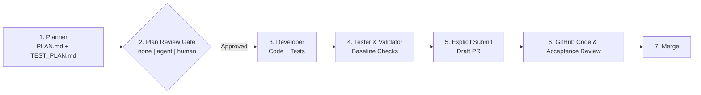

# Workflows, Role Contracts & Review Gates

SwarmOS uses a **Plan-First** lifecycle across all supported coding harnesses (`claude`, `codex`, `opencode`, `omp`). Every task produces a concrete design and test plan before implementation code is written.

---

## Convert one intake issue

Use `swarm issue convert` when you have one report ready to scope into a task. For a whole tracker, use [backlog scanning and normalization](backlog.md#3-apply-what-you-agree-with), which suggests fields for multiple issues.

1. Read the report and prepare one objective, explicit constraints and observable acceptance criteria. Name what is in scope and out of scope. Choose dependencies, workflow and dimensions as needed; conversion never invents requirements from the report.
2. As a maintainer, preview the proposed contract and validation result. For example, scope issue 123 to fixing an empty search result:

```bash
swarm issue convert 123 --objective 'Return an empty result for an empty query' \
  --constraint 'Keep the existing search API' \
  --acceptance 'An empty query returns an empty result without an error' --dry-run
swarm issue convert 123 --objective 'Return an empty result for an empty query' \
  --constraint 'Keep the existing search API' \
  --acceptance 'An empty query returns an empty result without an error' --dry-run --json
```

3. Review the diff, then apply those same fields without `--dry-run`. Lint the draft, approve the contract separately, and start work:

```bash
swarm issue convert 123 --objective 'Return an empty result for an empty query' \
  --constraint 'Keep the existing search API' \
  --acceptance 'An empty query returns an empty result without an error'
swarm issue lint 123
swarm issue approve 123
swarm issue work 123
```

Conversion keeps the original issue number, URL and report, plus unrelated labels and metadata. It removes readiness and needs-scope labels and adds `swarm:draft`; approval remains a separate maintainer decision. The task gate defaults to `none`, with stricter workflow or repository gates enforced at approval. The linked PR references the original issue and closes it automatically when merged into the default branch.

Existing WorkUnits use `swarm issue edit`; external-file contracts are edited in their referenced file. Conversion refuses closed issues, pull requests, Epics and issues with recorded coordination state. Follow the reported status and recovery guidance before retrying. A failed write reports completed steps; after the contract body has been saved, use `issue edit` for further changes. Dependency projection warnings leave the converted contract intact and identify links to retry.

## 1. Built-In Workflow Recipes (`.swarm/workflows/`)

SwarmOS scaffolds three workflow recipes in `.swarm/workflows/`:
- **`feature.yaml`**: End-to-end feature delivery from requirements analysis and design through implementation and validation.
- **`bugfix.yaml`**: Root-cause analysis, regression test planning, fix implementation, and verification.
- **`refactor.yaml`**: Structural improvements that preserve behavior and pass all repository checks.

Workflow YAML files customize the step descriptions and role context compiled into `.swarm/active/WORKUNIT.md` and `SYSTEM_PROMPT.md`, while the SwarmOS engine enforces the execution sequence:



---

## 2. Role Contracts & Artifacts

Each workflow phase binds to a role prompt in `.swarm/prompts/` and reads/writes well-defined artifacts in `.swarm/active/`:

| Role | Prompt File | Reads | Produces |
| :--- | :--- | :--- | :--- |
| **Planner** (`planner`) | `.swarm/prompts/planner.md` | `WORKUNIT.md` and repository context | `.swarm/active/PLAN.md` (`design`, ending with a `## HANDOFF` section) & `.swarm/active/TEST_PLAN.md` (`test-plan`) |
| **Reviewer** (`reviewer`) | `.swarm/prompts/reviewer.md` | `WORKUNIT.md`, `PLAN.md`, `TEST_PLAN.md` | `.swarm/active/REVIEW.md` (`review` starting with `VERDICT: APPROVED` or `VERDICT: CHANGES_REQUESTED`) |
| **Developer** (`developer`) | `.swarm/prompts/developer.md` | Approved `PLAN.md` (including its handoff) and `TEST_PLAN.md` | Working-tree implementation changes + checkpoint commit, and `.swarm/active/IMPLEMENTATION.md` (`implementation`, ending with a `## HANDOFF` section) |
| **Tester / Validator** (`tester`) | `.swarm/prompts/tester.md` | Implementation, the developer's handoff in `WORKUNIT.md`, and approved-base validation policy | Validation check output (`validation` artifact) |

SwarmOS compiles `.swarm/active/WORKUNIT.md` and `.swarm/active/SYSTEM_PROMPT.md` freshly for each claimed task and injects managed pointer blocks into `AGENTS.md` and `CLAUDE.md` inside the worktree so interactive and headless tools find the active contract immediately.

### Handoffs between roles

Developers and testers start from what earlier roles already checked instead of rediscovering the repository. The planner ends `PLAN.md` with a `## HANDOFF` section: entry points and symbols, tests and fixtures to extend, exact focused verification commands, assumptions already checked, conditions that reopen the plan, and **What this change breaks**, a list of existing tests, docs, templates, and call sites that depend on what the plan changes, found by searching the repository. Every file the plan calls new must be absent at the approved base; otherwise the plan names it as modified.

The developer ends `IMPLEMENTATION.md` with its own handoff for the tester: changed behavior, changed files, acceptance gaps, and the commands it ran with their results. SwarmOS records that report in the `implementation` artifact, so the tester reads it under **Prior Artifacts** in `WORKUNIT.md` even when the run resumes in a fresh session.

Handoffs are evidence, not authority. Each role verifies the claims against the source, and a handoff never changes the approved inputs, the plan review gate, or validation. The tester still checks every acceptance criterion independently, and the coordinator still reruns the required checks.

### Matching the plan to the work

Not every issue needs the same amount of planning. Maintainers record `size`, `uncertainty`, and `risk` on a WorkUnit, and approved policy selects the matching execution profile:

| Dimension | Values | What it describes |
| :--- | :--- | :--- |
| `size` | `small`, `multi_area` | How widely the change reaches |
| `uncertainty` | `known`, `unknown` | Whether the solution is understood |
| `risk` | `standard`, `sensitive`, `urgent` | The care and response the work needs |

Profiles tailor planning and review guidance: compact plans for small changes, detailed handoffs for changes across areas, bounded investigations for unknown solutions, independent review for sensitive work, and mitigation first when users are affected now. Existing gates and required checks still apply.

Plans ground decisions in evidence, assumptions, and open questions. Reviewers check those facts and acceptance coverage using the compiled profile. Because `PLAN.md` is attached to the Draft PR, people reviewing the code see the same reasoning.

When something about the repo surprises an agent, it notes it in `.swarm/active/LESSONS.md`. SwarmOS copies those notes into the implementation summary under **What we learned**, and `swarm repo lessons` turns lessons from merged PRs into proposed `.swarm/rules/lessons.md` entries for a maintainer to commit.

`swarm repo plan --scan` and `swarm issue lint <N>` suggest dimensions from the issue text and touchpoints, with signals and hints such as a missing reproduction step. These suggestions stay advisory. Only maintainer-set dimensions on the approved WorkUnit select a profile. If dimensions are absent, the planner records advisory suggestions and follows general evidence and acceptance coverage guidance.

---

## 3. Plan Review Gates (`none | agent | human`)

```bash
# Preview the effective workflow, resolved gate, and role agents without side effects
swarm issue work 42 --dry-run --backend github

# Agent gate: planner writes PLAN.md + TEST_PLAN.md, then the sandboxed reviewer audits it
swarm issue work 42 --gate agent --planner-agent claude --reviewer-agent omp --developer-agent codex --backend github

# Human gate: generate and publish the plan, pause for maintainer review, then resume
swarm issue work 42 --gate human --phase plan --backend github
swarm issue review-plan 42 --approve --notes "Plan looks great; proceed with implementation" --backend github
swarm issue work 42 --phase implement --backend github
```

How gate verification keeps reviews trustworthy:
- **Cryptographic plan binding**: Both `agent` and `human` approvals bind to the exact `WorkUnit` digest and the SHA-256 digests of `PLAN.md` and `TEST_PLAN.md`. If the issue or plan files are edited after approval, SwarmOS requires a fresh review before implementation or submission.
- **Exact reviewer verdicts**: Under `--gate agent`, the isolated reviewer must begin `.swarm/active/REVIEW.md` with `VERDICT: APPROVED` or `VERDICT: CHANGES_REQUESTED`. Any `CHANGES_REQUESTED` verdict stops the workflow before code is modified and publishes the findings for inspection.
- **Authenticated human decisions**: Under `--gate human`, planning pauses with label `swarm:plan-review` until a repository maintainer runs `swarm issue review-plan <issue> --approve` or `swarm issue review-plan <issue> --reject`.

`swarm issue approve <issue>` makes the issue's WorkUnit the approved work contract before execution; plan approval is a second, separate checkpoint. `swarm issue validate` runs the approved-base checks and protected-path policy, not a pass/fail decision for each acceptance criterion. `swarm issue submit <issue>` links a Draft PR proposing implementation of the issue contract; `swarm issue status <issue>` exposes its PR number and URL. Continue implementation with `swarm pr work <PR>`, stage interactive PR plans or implementation with `swarm pr stage <PR> --phase plan|implement` in `.swarm/worktrees/pr-<PR>` (not the original issue worktree), update ancestry with `swarm pr rebase <PR>`, and publish only through `swarm pr submit <PR>`. These operations retain the issue's approval gates; maintainers use GitHub for final code and acceptance review. See [Continuing an Existing PR](developer.md#continuing-an-existing-pr).

### Where a WorkUnit's time went

Each role run that produces an artifact records a breakdown in that artifact's metadata. `swarm issue status <issue>` and `swarm pr status <PR>` show these runs as a compact per-role table, and `--json` adds a `role_runs` list. The Draft PR evidence includes the same table. A planner run produces both the plan and the test plan, so it appears once. A run that fails or is cancelled before producing an artifact records nothing.

- **Measured by SwarmOS**: total elapsed time, preflight time (locating the harness and its version and login checks), setup time (temporary workspace and home), and snapshot time (copying the worktree into the run's isolated workspace, including the reviewer's read-only copy). Repair and re-plan counters are SwarmOS's own attempt numbers, starting at 0.
- **Reported by the harness**: input, output, cached-input and reasoning tokens, tool calls and repeated identical shell commands, and the model and reasoning effort actually used. SwarmOS reads these after the run ends, from the harness's own record of that run only. Isolated Claude Code, Codex and OhMyPi runs keep their session in your harness history, and SwarmOS opens only the file named by the run's session id or private control directory. For OpenCode, SwarmOS asks the run's private server for that one session's messages. Trusted-local runs read the session log from the run's private home directory. The configured model shown under provenance is never copied into this table. What each harness reports is listed in its page under [harness setup](harness/README.md).

A value that was not observed shows as `unavailable` in text and `null` in JSON; a measured zero shows as `0`. Isolated runs now leave their transcripts in your own harness history (`~/.claude/projects`, `$CODEX_HOME/sessions` or `~/.codex/sessions`, `~/.omp/agent/sessions`, or OpenCode's data store), as an interactive session would; SwarmOS never copies, moves or deletes them. Large, malformed, ambiguous, or unexpected records are ignored rather than partly counted. Model time and tool time are not reported by any supported harness yet. These figures describe a run; they never decide approval, review, or validation.

---

## Continuing from a rewritten checkpoint

Keep task history additive when possible: commit further changes or merge required upstream fixes. If you deliberately rebase an upstream issue checkpoint, SwarmOS keeps the recorded checkpoint and asks you to reconcile the replacement explicitly. `swarm issue status 29` shows the recorded checkpoint, worktree HEAD and attached branch, local task branch, and live remote branch as full SHAs. Its `--json` output includes the same observations, with missing refs and lookup errors reported separately.

With your active claim, finish the rewrite on the attached task branch and leave the worktree clean. Copy the recorded and replacement SHAs into the commands below:

```bash
issue=29
expected=FULL_RECORDED_CHECKPOINT_SHA
candidate=FULL_LOCAL_REPLACEMENT_SHA
swarm issue reconcile "$issue" --checkpoint --expected-head "$expected" --candidate-head "$candidate" --dry-run
swarm issue reconcile "$issue" --checkpoint --expected-head "$expected" --candidate-head "$candidate"
```

The preview reports whether validation or fresh plan review is needed. An unchanged patch can retain its current authenticated plan approval. When a preserved checkpoint needs a replacement plan, select it explicitly for isolated planning:

```bash
swarm issue work "$issue" --phase plan --plan-checkpoint --expected-head "$expected" --candidate-head "$candidate" --dry-run
swarm issue work "$issue" --phase plan --plan-checkpoint --expected-head "$expected" --candidate-head "$candidate"
swarm issue review-plan "$issue"
swarm issue reconcile "$issue" --checkpoint --expected-head "$expected" --candidate-head "$candidate"
swarm issue work "$issue"
```

Recovery planning reads the exact candidate in a temporary snapshot and stages only `PLAN.md` and `TEST_PLAN.md`. Repository policy and role prompts come from the approved base. The plan and independent review bind to that candidate and its recorded predecessor; changing either report or the candidate requires fresh review. Human gates still require an authorized independent maintainer's `issue review-plan --approve` decision.

This route supports direct local and GitHub issue work with native isolated Codex or harness-tools Bubblewrap planners in agent plan mode. Use an explicit issue number and both full SHAs. Recovery planning retains an authorized claim when a run fails so you can retry or explicitly release it. Review the plan, then reconcile explicitly before resuming ordinary work. Planning and review leave the preserved checkout and recorded checkpoint in place.

Reconciliation validates a pinned candidate snapshot using the approved base's checks and protected paths. It then atomically updates the remote task branch and authoritative checkpoint, recording predecessor and replacement heads in the existing rebase evidence. A changed remote head, claim, task, plan, or local candidate stops publication; preserve your work and inspect status again. This mode supports upstream Git-backed and local file-backed issue work before PR submission. For a linked PR, use the [PR revision workflow](developer.md#continuing-an-existing-pr). Fork checkpoint reconciliation is unsupported. Running `issue reconcile` without `--checkpoint` retains its existing PR-outcome repair behavior.

## Discarding an abandoned checkpoint

Sometimes a recorded checkpoint should not be continued. For example, an attempt was released, the WorkUnit was edited and re-approved on a newer base, and the old checkpoint no longer descends from it. `swarm issue claim` and `swarm issue work` then stop with `checkpoint ... does not descend from approved base ...`. If nobody holds a claim and the issue has no PR, a maintainer can discard the checkpoint. Copy the full SHA from `swarm issue status 29`:

```bash
swarm issue discard-checkpoint 29 --expected-head FULL_RECORDED_CHECKPOINT_SHA
```

This command needs the same authority as `swarm issue approve`. It is refused while the issue is claimed, after a PR is opened, or for a fork contributor's checkpoint. The command keeps the commit permanently under its retention ref in the repository's ledger namespace (`refs/heads/swarm-checkpoints/issue-29/<sha>` in branch mode, `refs/swarm/checkpoints/issue-29/<sha>` in hidden mode; see [Checkpoint retention](#checkpoint-retention)) and leaves the old task branch where it is. `swarm issue status` lists every discarded checkpoint with its retention ref. The next claim starts on a new `swarm/issue-29-restart-<sha>` branch at the approved base and plans again from scratch. If your clone still has the old worktree at `.swarm/worktrees/issue-29`, it is moved, unchanged, to `.swarm/worktrees/issue-29-discarded-<sha>`.

### Checkpoint retention

Git-backed checkpoint publication, PR publication, and verified fork recording retain commits permanently. With `ledger_namespace: branch` (the default when the key is absent), retention refs are `refs/heads/swarm-checkpoints/issue-<number>/<full-SHA>`. With `ledger_namespace: hidden`, they are `refs/swarm/checkpoints/issue-<number>/<full-SHA>`. Task-branch cleanup preserves these refs, so historical checkpoints survive branch rewrites, deletion, and Git garbage collection. Fetch a retained checkpoint explicitly:

```bash
issue=29
checkpoint=FULL_CHECKPOINT_SHA
prefix="refs/heads/swarm-checkpoints"   # hidden mode: prefix="refs/swarm/checkpoints"
ref="$prefix/issue-$issue/$checkpoint"
git fetch origin "$ref:refs/remotes/origin/swarm-checkpoints/issue-$issue/$checkpoint"
git show "$checkpoint"
```

In branch mode these refs appear as branches in the hosting UI. Allow the coordinator to create `swarm-checkpoints/**` refs and exclude that namespace from branch-protection or ruleset patterns that would block creation. Hidden-mode refs stay out of the branch list, and rulesets cannot restrict them. Publication requires the server's atomic-push support in both modes. Keep the issue state refs (`swarm-state/**` or `refs/swarm/state/**`) as audit ledgers; they are separate from task code history.

The namespace comes only from `.swarm/config.yaml` on the upstream default branch. To move an existing repository to hidden refs, pause workers, run `swarm repo migrate-refs`, then merge `ledger_namespace: hidden`. See [Ledger ref namespaces](GITHUB.md#ledger-ref-namespaces) for the full procedure and the security tradeoff.

Available legacy checkpoints are retained during subsequent publication. SwarmOS reports older missing objects by full SHA and continues with available history; an already garbage-collected object needs recovery from another clone or backup. The current predecessor and candidate must both be available before a replacement can publish.

## 4. Interactive Slash Commands & Shared Skills

SwarmOS separates per-issue execution planning from repository-wide roadmap planning (and never overrides a harness's built-in `/plan` command):

- **Inside a claimed task worktree (`.swarm/worktrees/issue-<N>`)**:
  - `/swarm-plan` — Draft `.swarm/active/PLAN.md` and `.swarm/active/TEST_PLAN.md` for the active WorkUnit.
  - `/swarm-review` — Audit the current plan against all constraints and acceptance criteria.
  - `/swarm-implement` — Implement the approved plan step by step.
  - `/swarm-validate` — Run the approved checks and test-plan scenarios, reporting observed results and unverified criteria. The coordinator runs claim-bound `swarm issue validate` and publishes its validation report.
- **At the repository root for onboarding & upgrades**:
  - `/swarm-onboard` (in Claude Code and OpenCode) or `swarm repo onboard` as a prompt for any harness — Preview `swarm repo init`, agree on validation checks that match your CI, merge SwarmOS files with what the repository already has, and hand back a reviewable diff.
- **At the repository root for roadmap ideation & backlog triage**:
  - `/swarm-project-plan` (in Claude Code and OpenCode) or the shared `.swarm/skills/triage-and-plan.md` skill (used as a regular prompt in Codex and `omp`) — Collaboratively refine an idea into a repo-local plan file, preview `Step N` child tasks with `swarm repo plan --from <file>`, publish a native `Epic` and draft child sub-issues on explicit maintainer instruction (`--apply`), and selectively approve child WorkUnits with `swarm issue approve <N>`, or triage open issues with `swarm repo plan --scan`.

## 5. Command Progress

Long-running issue, PR, and node work can pause for the claim budget. Each claim has an absolute allowance of the approved lease duration times one plus the approved renewal count; heartbeat renewals consume that count. Before each agent run, the coordinator checks that at least one third of the approved lease duration remains available. After the last renewal, it stops a running developer or tester when expiry reaches that reserve, preserves safe edits through the fenced checkpoint path, and hands off to `implement` without a failed verdict. Incomplete planner/reviewer output is discarded, and that phase restarts.

Follow the printed continuation command, such as `swarm issue work 42 --phase implement` or `swarm pr work 123 --phase implement`, to acquire a fresh budget and resume. Backend, repository, and fork selections appear in the command when selected. `swarm issue status 42` distinguishes the nominal total allowance from current expiry and shows renewals used and remaining. PR checkpoints remain unpublished until `swarm pr submit`; node workers count budget pauses as task attempts without counting failures or triggering automatic submission.

`swarm issue work` reports stage starts, completions, pauses, and handoffs to stderr. During a quiet stage, a local heartbeat prints every 15 seconds with the current stage and elapsed time. Heartbeats also show the active role and time since observed harness output (or `unknown`), or the coordinator state, tracker, or checkpoint operation and its duration; lease renewal continues separately.

The final result stays on stdout, including when using `--json`. Pass `--progress=false` to silence progress messages. Interactive execution and dry runs do not print these messages.

Progress messages contain stage metadata only. Failed harness runs report the role, exit status when available, and cancellation or timeout without printing captured transcripts, command arguments, or nested harness diagnostics.

Explicit checkpoint planning and agent review use the same stage progress. `swarm issue reconcile --checkpoint` reports admission, snapshot preparation, required checks and checkpoint publication; `--progress=false` silences its progress. Dry runs perform inspection without progress or checks.

`swarm issue validate`, `swarm issue submit`, `swarm pr validate`, and `swarm pr submit` also report progress to stderr by default. Each trusted required check gets a start line and a PASS/FAIL line with elapsed time; while it runs, a heartbeat names the check every 15 seconds. Phases between checks also receive running lines. Use `--progress=false` to silence progress while keeping the same stdout and `--json` results.

Issue submission announces checkpoint creation, validation, checkpoint push/record, draft PR creation or update, and submission recording. PR submission validates the existing checkpoint or reuses an exact matching passing run from the same worker and claim, publishes and records the revision, then updates review evidence and rebase metadata. Retries announce only the phases they execute. Check output remains captured in the validation report.

## Related Guides

- **[Owning a Busy Repository (`docs/backlog.md`)](backlog.md)** — Backlog lanes, duplicates, quiet issues, and dimensions at scale.
- **[Project & Maintainer Setup (`docs/project.md`)](project.md)** — Initialize `.swarm/`, configure agents, and approve issues.
- **[Developer & Worker Guide (`docs/developer.md`)](developer.md)** — Everyday CLI commands, handoffs, recovery, and worker pools.
- **[Architecture (`docs/ARCHITECTURE.md`)](ARCHITECTURE.md)** — Git-CAS coordination, claim fencing, and checkpoint design.

### Recovering from a rejected agent plan

Default direct `swarm issue work <N>` continues through planning, agent review, implementation, testing and trusted required checks to a validated checkpoint. When an agent requests changes, the next planner receives the recorded findings and writes a revised pair of reports before a fresh review. The trusted `lease.plan_replan_limit` allows two extra planner attempts by default. Attempts are spent before planning; failed or unchanged output spends the attempt too. Restarting or reclaiming work does not replenish it. PR work and node scheduling retain their separate, single-review behavior.

Human rejection creates an obligation to obtain fresh authenticated human approval on the exact reports, under every direct-issue gate. With remaining allowance, work can prepare a replacement draft, then stops for `swarm issue review-plan <N> --approve`. Agent approval cannot discharge that obligation. Base or policy movement does not erase it. Both reports must exist before either human review decision can be recorded.

Resume a bare rejection with effective planner feedback:

```bash
swarm issue work 42 --planner-instructions 'Add the missing recovery case'
```

General `--instructions` also reaches the planner; developer, tester and reviewer instructions do not authorize a planner run. `--next` applies the same admission rules before claiming, skips blocked issues with reasons, and carries the instructions to the selected issue. Explicit `--phase plan`, `--phase review` and `--handoff` keep their requested boundaries.

With `plan_mode: agent`, manual staging is disabled. If the reports are absent and the human draft allowance is zero or exhausted, the identical WorkUnit cannot recover by restarting, reclaiming, or reapproving it. A maintainer must deliberately revise the contract and approve it separately. Release an active owner claim first:

```bash
swarm issue release 42
swarm issue edit 42 --objective 'A substantively revised objective chosen by the maintainer'
swarm issue approve 42
swarm issue work 42
```

Outside agent plan mode, completed reports can be staged with `swarm issue stage <N> --phase plan` in an authorized managed worktree. Staging records a complete pair but preserves a human approval obligation and its consumed draft allowance. A fresh human rejection with both reports present can establish another allowance within a positive trusted limit; a zero limit grants no draft.

When required checks fail, the coordinator writes `.swarm/active/REPAIR.md` with failing checks and regression, pre-existing and flaky classifications. Automatic direct-issue repair consumes the persisted `lease.validation_repair_limit` allowance (one by default). Resuming a recorded regression also spends an attempt before development. Restarting, reclaiming, changing reports or creating checkpoints does not reset it; a newly approved task, base or policy revision does.

An explicit `--phase implement`, or effective `--developer-instructions`, requests one initial round without replenishing automatic allowance. All-pre-existing failures require effective developer instructions even with an explicit implement phase:

```bash
swarm issue work 42 --developer-instructions 'Address the known failing check within the approved scope'
```

Further automatic rounds use only the remaining allowance. Refusal, unchanged repair, cancellation, claim loss and security failures stop the run. PR repair retains its existing invocation budget. Publishing remains separate: review the checkpoint, then explicitly run `swarm issue submit <N>`.

Released builds can reuse coordinator-recorded validation during `swarm issue submit` and `swarm pr submit` when the checkpoint tree, approved base, trusted policy, claim, worker, and swarm version match. Successful checkpoint reconciliation records validation atomically with the checkpoint, so an unchanged submit can reuse that run under the same rules. Reuse output and PR evidence show the original run's age and tree SHA. Explicit `issue validate` and `pr validate` always run checks, as do CI, development builds, and fork submissions.

### Policy-selected execution profiles

Maintainers can record `size`, `uncertainty` and `risk` on a WorkUnit to get
planning guidance suited to its needs. Approved policy selects the first matching
profile: urgent work starts with the smallest mitigation, unknown solutions get
a bounded investigation and decision artifact, sensitive work gets compact
planning with strong independent review and adversarial cases, multi-area work
gets a detailed handoff, and small work gets compact guidance. Profiles supply
prompt variants and evidence expectations; all existing gates and required
checks still apply. Planners follow the compiled profile. When dimensions are
absent, suggested dimensions remain advisory and general planning guidance applies.
