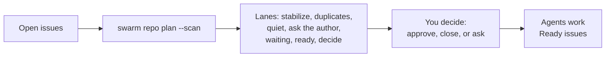

# Owning a Busy Repository

A popular project collects issues faster than anyone can read them. After a while the tracker turns into one long list where a typo fix, an open design question, a live regression, and a duplicate from last year all look alike. Maintainers spend their evenings sorting, and contributors give up trying to find something they can actually finish.

SwarmOS can't make a backlog smaller, but it can make it legible. One scan sorts open issues into a few **lanes** by what you should do next, suggests a **shape** for each one so you can tell quick fixes from research projects, and points out likely duplicates and issues nobody has touched in months. The same scan covers open pull requests, and a second command turns what agents learned in merged work into notes for the next contributor. You make every decision; SwarmOS never closes, comments on, or relabels anything on its own.



---

## 1. Take a first look

Run a scan from your repository checkout. Without `--apply` it only reads:

```bash
swarm repo plan --scan --backend github
```

At the top of the report is **Backlog at a Glance**, one row per lane:

| Lane | What lands here | What to do |
| :--- | :--- | :--- |
| **Stabilize first** | Issues that read like users are affected right now (crashes, regressions, outages, vulnerabilities) | Approve a minimal mitigation and file the root cause separately |
| **Probably duplicates** | Issues that share most of their wording with an older open issue | Compare the two, then close one or merge the details by hand |
| **Quiet for a while** | No activity for 90 days (change with `--stale-days`, or `--stale-days 0` to turn off) | Ask whether it still matters, or close it |
| **Ask the author** | Raw issues missing an Objective, Constraints, or Acceptance Criteria | Let `--normalize` draft them, then ask the author to confirm |
| **Waiting on something** | Blocked by open dependencies or by protected paths | Unblock the prerequisite first |
| **Ready for agents** | Approved WorkUnits | Nothing; contributors pick these up with `swarm issue work --next` |
| **Needs a maintainer decision** | Valid drafts awaiting your approval | Approve Routine ones in a batch; read Exploratory ones first |

Each issue appears in exactly one lane, the first that applies, so the most pressing issues surface first. Expand a lane to see its issues, each with a short note on why it is there. The full table of every open issue follows.

> [!TIP]
> Save the whole report with `--export backlog.yaml` (or `.json`). It includes every issue's lane, shape, signals, and suggested WorkUnit, which is handy for a spreadsheet or a weekly triage meeting.

## 2. Read the shapes

Every issue gets a suggested shape, so you can see how much thinking it needs before anyone starts:

- **Routine**: a clear fix in a known place. Great first tasks for new contributors.
- **Involved**: knowable, but spans several areas or overlaps other issues. The plan will need to weigh alternatives.
- **Exploratory**: nobody knows the right answer yet. Its plan should start with a small probe.
- **Urgent**: users are affected now. Stop the harm first.

The shape comes from the issue's own words and touchpoints, and the report lists the signals behind it. It is a starting point, not a verdict: the planner confirms or corrects it after reading the code. See [Matching the plan to the work](WORKFLOWS.md#matching-the-plan-to-the-work).

## 3. Apply what you agree with

When the report looks right, sync the triage labels and turn raw issues into WorkUnit drafts:

```bash
swarm repo plan --scan --apply --normalize --backend github
```

- Labels are only added when an issue doesn't already have them, so re-running the scan doesn't make every issue look freshly active.
- `--normalize` rewrites a raw issue into structured WorkUnit sections and keeps the reporter's original text below them, under **Original Report**. Exploratory issues get a `human` plan gate so you see the plan before any code is written, and Urgent ones get at least an `agent` gate.
- Nothing is approved unless you also pass `--ready` or run `swarm issue approve <N>`.

To share the report with your team, post it to a tracking issue:

```bash
swarm repo plan --scan --apply --publish-issue 1 --backend github
```

Long reports are trimmed to fit in one GitHub comment. The lanes always come first, and the trimmed comment says where to find the full list.

## 4. Open pull requests

Below the issue lanes, the scan lists **Open Pull Requests** in lanes of their own:

| Lane | What lands here | What to do |
| :--- | :--- | :--- |
| **Competing PRs** | Two or more open PRs that close the same issue | Pick one to continue and close the rest |
| **Dependency updates** | PRs opened by Dependabot or Renovate | Merge the ones that pass, or adopt them as one WorkUnit (see [section 5](#5-dependency-updates-without-the-noise)) |
| **Quiet PRs** | No activity for `--stale-days` | Ask the author whether to continue, or close it |
| **Ready for review** | Out of draft | Review it |
| **In progress** | Drafts | Nothing yet |

Each PR shows whether it belongs to a WorkUnit. SwarmOS only says so when the issue's coordination state records that exact PR, so a PR body that says "Closes #12" is shown as a mention, not a link. PRs from outside SwarmOS show up too, so you get one view of everything waiting on you. The scan only reads pull requests.

## 5. Dependency updates without the noise

Dependabot is great at noticing that something is out of date, and less great at knowing when to bother you. Left alone, it opens a PR per package per week, each one red or green for its own reasons, and they pile up until someone closes them all and does the upgrade by hand. A little configuration plus the scan turns that stream into a few owned pieces of work.

### Group the updates

Ask Dependabot for fewer, larger PRs. This `.github/dependabot.yml` sends one weekly PR for all GitHub Actions bumps and one for Go minor and patch updates, and keeps each major Go upgrade in its own PR because those are the ones most likely to need code changes:

```yaml
version: 2
updates:
  - package-ecosystem: "github-actions"
    directory: "/"
    schedule:
      interval: "weekly"
    labels: ["dependencies", "ci"]
    groups:
      actions:
        patterns: ["*"]

  - package-ecosystem: "gomod"
    directory: "/"
    schedule:
      interval: "weekly"
    open-pull-requests-limit: 5
    labels: ["dependencies"]
    groups:
      go-minor-and-patch:
        update-types: ["minor", "patch"]
```

Swap `gomod` for your ecosystems (`npm`, `pip`, `cargo`, and so on). See GitHub's [Dependabot options reference](https://docs.github.com/en/code-security/dependabot/working-with-dependabot/dependabot-options-reference) for everything else you can tune.

### See them in one place

`swarm repo plan --scan` puts every PR opened by `dependabot[bot]` or `renovate[bot]` in the **Dependency updates** lane, so they don't crowd out PRs from people. SwarmOS recognizes them by the author GitHub records, and it never copies a dependency PR's body into the report or into an agent's prompt. That text carries upstream release notes, which are written by package authors, not by you.

### Why GitHub Actions bumps fail SwarmOS Validation

An Actions update edits `.github/workflows/**`, which `.swarm/validation/required-checks.yaml` lists under `protected_paths`. `swarm repo validate` in CI therefore fails on those PRs. That's on purpose: a bot re-pinning the actions your CI runs is exactly the kind of change a maintainer should look at. You have two ways through:

1. **Review and merge it yourself.** Read the new pins, then merge with that check failing.
2. **Adopt it as a WorkUnit** with `allow_harness_changes: true`, as described below. Approving that WorkUnit is your explicit sign-off for touching workflows.

### Adopt updates as a WorkUnit

When an update needs code changes (a major version, a deprecated API, a test that broke), or you'd rather land a batch as one reviewed change, turn it into a WorkUnit and let an agent own it:

```bash
swarm issue create \
  --title "Upgrade GitHub Actions: checkout 4 to 7, setup-go 5 to 7" \
  --objective "Apply the pending Dependabot updates for GitHub Actions and keep CI green" \
  --constraint "Pin every action to a full commit SHA with a version comment" \
  --acceptance "All workflows use the new major versions" \
  --acceptance "SwarmOS Validation and the existing CI checks pass" \
  --backend github
```

For an update that touches `.github/workflows/**` or `.swarm/`, edit the new issue's WorkUnit to set `allow_harness_changes: true`, then run `swarm issue approve <N>`. The agent works in its own worktree, validates against the approved base, and opens one Draft PR. Once that merges, Dependabot normally closes its own PRs for the same updates, because the dependencies are already current.

> [!NOTE]
> Contributors working through `--fork` can't change `.github/workflows/**` or `.swarm/**`, even with `allow_harness_changes: true`. Workflow updates need a worker with access to the upstream repository.

## 6. Let the repo remember what it learned

Agents hit the same surprises people do: a test that needs a service running, a package with a misleading name, a script that only works from the repo root. When that happens, the agent writes a one-line note in `.swarm/active/LESSONS.md`, and SwarmOS adds it to the PR's implementation summary under **What we learned**. Reviewers see it next to the change.

Once that work is merged, collect the lessons:

```bash
# See what agents learned in the last 50 merged PRs
swarm repo lessons --backend github

# Append the new ones to .swarm/rules/lessons.md, then review and commit
swarm repo lessons --apply --backend github
git diff .swarm/rules/lessons.md
```

`swarm repo lessons` only reads lessons from **merged** PRs whose link to a WorkUnit is recorded in coordination state, and it skips anything `lessons.md` already says. `--apply` changes the file in your checkout and nothing else. You decide what gets committed. Once it's merged, every new task starts with those lessons in its system prompt.

> [!TIP]
> Edit freely before committing. Merge similar lessons, delete ones that went stale, and keep each line short. A tight `lessons.md` helps more than a long one.

## 7. Keep it calm

A short routine keeps the backlog from piling up again:

1. **Weekly**: run the scan, clear **Stabilize first** and **Competing PRs**, merge or adopt **Dependency updates**, and close or merge anything in **Probably duplicates**.
2. **Monthly**: walk **Quiet for a while** and **Quiet PRs**, and ask authors whether those still matter.
3. **After a release**: run `swarm repo lessons --apply` and commit what's worth keeping.

## For contributors

You don't need to understand the whole backlog to help:

1. Pick an issue from **Ready for agents**, ideally a Routine one, or let `swarm issue work --next` choose for you.
2. Your agent reads `.swarm/rules/lessons.md` first, so it starts out knowing what tripped up the contributors before you. Its `PLAN.md` opens with what it found in the code. If the task turns out bigger than it looked, the plan says so and suggests a split instead of quietly growing.
3. If you spot a duplicate or an issue that no longer applies, mention it on the issue. A maintainer will take care of it.

## Related Guides

- **[Day in the Life of a Repo Admin (`docs/ADMIN_GUIDE.md`)](ADMIN_GUIDE.md)**: the daily maintainer playbook
- **[Workflows & Review Gates (`docs/WORKFLOWS.md`)](WORKFLOWS.md)**: role prompts, plan gates, and task shapes
- **[Developer & Worker Guide (`docs/developer.md`)](developer.md)**: everyday commands for contributors
