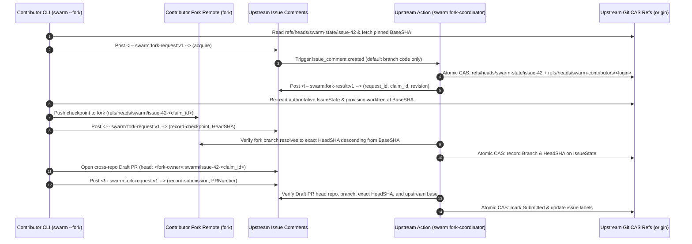

# Fork Mode (`--fork`) — Open-Source Contributions Without Upstream Push Access

SwarmOS uses Git compare-and-swap (CAS) refs (`refs/heads/swarm-state/issue-<N>`) to coordinate task leases, checkpoint bindings, and review gates without standing up an external database. In same-repository mode (the default), workers push state refs and task branches directly to `origin`.

Open-source contributors typically do not have write access to the upstream repository. **Fork Mode (`--fork`)** lets external contributors claim approved `WorkUnit` issues, run coding agents in isolated worktrees, push checkpoints to their own personal GitHub fork, and open validated cross-repository Draft PRs—while keeping issue approval, validation policy, and human review strictly under upstream maintainer control.

---

## 1. Architecture: Why an Upstream GitHub Action Over Comment-Only Leases

When designing fork-based coordination without a hosted service, two candidate designs emerge:

| Approach | How It Works | Why It Is Chosen / Rejected |
| :--- | :--- | :--- |
| **(a) Comments as authoritative leases** | Contributors post structured `claim` / `renew` / `checkpoint` comments on the issue, and clients scan comment history to infer who holds the lease. | **Rejected.** GitHub issue comments have no atomic compare-and-swap primitive, cannot fence two concurrent claimants racing at the same second, can be edited or deleted by their authors, and would split SwarmOS state across two incompatible storage models (Git refs vs. comment streams). |
| **(b) Trusted upstream GitHub Action + upstream Git CAS ref (Selected)** | Contributors post typed worker requests (`<!-- swarm:fork-request:v1 -->`) as issue comments. An opt-in upstream GitHub Action (`swarm-fork-coordinator.yml`) running from the upstream default branch authenticates the event actor, validates the request, and executes atomic CAS updates against `refs/heads/swarm-state/issue-<N>` and `refs/heads/swarm-contributors/<login>`. | **Selected.** Preserves a single authoritative state store (`refs/heads/swarm-state/issue-<N>`), enforces cryptographic fencing (`claim_id`) and per-contributor active claim caps via `git push --atomic`, and never grants upstream ref write credentials to contributors or executes untrusted fork code. |



### Core Security Invariants

1. **Upstream Approval & Policy Pinning:** Only an upstream maintainer (`admin`, `maintain`, or `write` permission) can run `swarm issue approve <N>`. Approval pins `BaseSHA`, `WorkUnitDigest`, and `PolicyDigest` into `refs/heads/swarm-state/issue-<N>`. In fork mode, the contributor CLI and validation engine load `.swarm/config.yaml`, workflow definitions, role prompts, and `.swarm/validation/required-checks.yaml` **exclusively from the upstream `BaseSHA` commit**—never from the contributor's fork checkout.
2. **Default-Branch Coordinator Execution:** The upstream `swarm-fork-coordinator.yml` workflow triggers on `issue_comment.created` for issues only, checks out the upstream repository's default branch with `persist-credentials: false`, and runs `swarm fork-coordinator --event "$GITHUB_EVENT_PATH"`. It **never checks out or executes code from the contributor's fork or pull request**.
3. **Request Transport Never Carries Authority:** The `<!-- swarm:fork-request:v1 -->` JSON payload carries only worker operation parameters (`operation`, `issue_number`, `fork_repo`, `claim_id`, `agent`, `phase`, `status`, `duration`, `gate`, `artifact`, `branch`, `head_sha`, `pr_number`, `reason`, `next_phase`). It cannot supply lease `owner`, `base_sha`, `policy_digest`, `max_renewals`, or arbitrary `IssueState`.
4. **Protected Harness & Workflow Paths:** During `swarm submit --fork` (and `swarm validate --fork`), any modification to `.swarm/**` (outside ephemeral `.swarm/active/**`) or `.github/workflows/**` is unconditionally rejected—even if the issue's `WorkUnit` sets `allow_harness_changes: true`.

---

## 2. Threat Model & Fail-Closed Behavior

Every cross-trust-boundary step in fork mode is designed to fail closed:

- **Edited or Forged Request Comments:**
  `swarm fork-coordinator` re-fetches the comment and issue directly from the GitHub API using the event IDs, verifies `created_at == updated_at` (rejecting edited comments), confirms the comment body matches, and derives the lease owner strictly from the API-verified comment author.
- **Replayed or Out-of-Order Requests:**
  Every successful fork mutation records the GitHub comment ID in `IssueState.LastForkRequestID` inside the upstream CAS commit. Any request with `comment_id <= LastForkRequestID` is rejected as a replay. On client timeout, `swarm --fork` re-queries the original request comment ID and upstream `IssueState.LastForkRequestID` before returning an error; it never blindly posts a second mutation request.
- **Forged Coordinator Responses:**
  The contributor CLI polls specifically for a `<!-- swarm:fork-result:v1 -->` comment referencing its exact `request_id` authored by the verified `github-actions[bot]` identity (`Bot` user type), and then re-reads `refs/heads/swarm-state/issue-<N>` from `origin` to confirm `LastForkRequestID == request_id`.
- **Human Review Artifact Spoofing:**
  Contributors can record agent plan/test/review artifacts under their active `claim_id`, but the coordinator rejects any `update-artifact` request with `Metadata["kind"] == "human"`, as well as any maintainer-only approval or review operation.
- **Per-Contributor Claim Exhaustion (Sybil / Hoarding Mitigation):**
  Upstream `.swarm/config.yaml` configures `fork.max_active_claims` (default `1`). On every `acquire`, `release`, `handoff`, and `record-submission`, `ForkIndexedStore` revalidates the actor's active claims against authoritative `refs/heads/swarm-state/issue-*` refs and updates `refs/heads/swarm-contributors/<lowercase-login>` + `refs/heads/swarm-state/issue-<N>` in a single `git push --atomic` with `--force-with-lease`. Lease duration and `max_renewals` are derived from the approved upstream policy (using the Action's clock), capping any shorter `--duration` requested by the contributor.
- **Expired Claims & Takeover Fencing:**
  Fork work branches are namespaced per claim: `swarm/issue-<N>-<claim_id>`. If a contributor's lease expires and another contributor acquires the issue, `AcquireFork` issues a fresh `claim_id`, updates `ForkRepo`, and clears the previous claim's `Branch`, `HeadSHA`, and head-bound implementation/validation artifacts inside the same atomic CAS while preserving the previous contributor's fork branch untouched on their own fork. Subsequent `renew`, `record-checkpoint`, or `record-submission` requests carrying the displaced `claim_id` fail with `ErrClaimFence`.
- **Malicious Fork `.swarm/` or `.github/workflows/` Changes:**
  Policy and prompts are loaded from `BaseSHA` via `git show <BaseSHA>:...`. Candidate changes touching `.swarm/**` or `.github/workflows/**` are rejected by `validation.Validate` when `ForkMode: true` regardless of `allow_harness_changes`.
- **Mutable Fork Heads & Partial Publication:**
  When checkpointing, the contributor pushes `refs/heads/swarm/issue-<N>-<claim_id>` to their `fork` remote with `--force-with-lease` and sends `record-checkpoint` with the exact `HeadSHA`. The coordinator verifies via the fork repository that the branch carries the active `claim_id` suffix, resolves to the exact `HeadSHA`, and has the approved upstream `BaseSHA` as an ancestor before recording `Branch` and `HeadSHA` upstream. If the fork push succeeds but the coordinator step fails, the unrecorded fork branch has no authority upstream; retrying reconciles the same `claim_id` and `HeadSHA`.
- **Cross-Repository Draft PR Verification & Retry:**
  `swarm submit --fork` opens (or reuses) a Draft PR from `<fork-owner>:swarm/issue-<N>-<claim_id>` into the upstream base branch, then sends `record-submission` with `pr_number`. The coordinator fetches the PR from the upstream GitHub API (`GET /repos/<upstream>/pulls/<number>`) and verifies that it is a Draft PR, targets the upstream repository and base branch, originates from `IssueState.ForkRepo` and `IssueState.Branch`, and matches `IssueState.HeadSHA` before recording the canonical API `HTMLURL` and updating labels. If verification fails, the PR stays an unrecorded draft for inspection or retry.
- **Disabled Actions, Oversized Payloads, or Denied Ref Pushes:**
  Payloads exceeding GitHub's comment size limit are rejected by the client before posting. If GitHub Actions is disabled or branch protection blocks the Action from pushing `refs/heads/swarm-state/*` or `refs/heads/swarm-contributors/*`, the client times out with setup guidance and never falls back to treating comments as leases.

---

## 3. Maintainer Setup (Enabling Fork Mode on an Upstream Repository)

Maintainers opt in to fork contributions by scaffolding the coordinator workflow pinned to an immutable, fork-capable SwarmOS release tag or full commit SHA:

```bash
# 1. Set an immutable published fork-capable SwarmOS release tag or full 40-char commit SHA
export SWARM_VERSION_PIN="<published-fork-capable-tag-or-full-commit-sha>"

# 2. Generate .github/workflows/swarm-fork-coordinator.yml pinned to SWARM_VERSION_PIN
swarm init --fork-coordinator --swarm-version "$SWARM_VERSION_PIN"
```

> [!NOTE]
> Always set `SWARM_VERSION_PIN` to a version or commit SHA that includes fork-coordinator support (do not use `v0.3.0`, which predates fork mode).

### Optional `.swarm/config.yaml` Settings

By default, each fork contributor can hold `1` active fork claim at a time. Maintainers can adjust this cap in `.swarm/config.yaml`:

```yaml
fork:
  max_active_claims: 1
```

### Approving Issues for Contributors

Maintainers create and approve issues in the upstream repository as usual:

```bash
swarm issue approve 42 --backend github
```

---

## 4. Contributor Walkthrough (`swarm --fork`)

Contributors never need write access to `origin`. Instead, they clone the upstream repository as `origin` and add their personal GitHub fork as the `fork` remote:

```bash
# 1. Clone the upstream repository as origin and add your personal GitHub fork as "fork"
git clone https://github.com/OWNER/REPO.git
cd REPO
gh repo fork --remote=true --remote-name=fork

# 2. Let swarm fetch a token with public_repo (or repo + pull_requests + issues) access when it needs one
export SWARM_GITHUB_TOKEN_COMMAND="gh auth token"

# 3. Claim an approved upstream issue via the upstream coordinator Action
swarm --fork claim 42

# 4. Run the full plan -> implement -> validate loop in an isolated worktree
#    Checkpoints are pushed to your "fork" remote on branch swarm/issue-42-<claim_id>
swarm --fork work 42

# 5. Renew an active lease if you need more time
swarm --fork renew 42

# 6. Validate and open a cross-repository Draft PR (<fork-owner>:swarm/issue-42-<claim_id> -> upstream)
swarm --fork submit 42
```

> [!TIP]
> If your fork remote uses a custom name other than `fork`, pass `--fork --fork-remote <remote-name>`.

### Supported vs. Maintainer-Only Commands in `--fork` Mode

| Command | Available with `--fork`? | Behavior in Fork Mode |
| :--- | :--- | :--- |
| `swarm --fork claim <N>` | Yes | Validates `fork` remote via GitHub API, posts `acquire` request, provisions worktree at upstream `BaseSHA` on branch `swarm/issue-<N>-<claim_id>`. |
| `swarm --fork pull` | Yes | Finds the next ready upstream issue, acquires a fork claim, and provisions the local worktree. |
| `swarm --fork work <N>` | Yes | Runs plan, gate, implement, and validate phases using policy from upstream `BaseSHA`; pushes checkpoints to `fork` and records them via the coordinator. |
| `swarm --fork stage <phase> <N>` | Yes | Runs a single workflow stage and records phase/artifact updates via the coordinator. |
| `swarm --fork review <N>` | Yes (agent review only) | Runs the sandboxed `reviewer` agent role; `--approve` and `--reject` (human review) are rejected in `--fork` mode. |
| `swarm --fork validate <N>` | Yes | Evaluates `required-checks.yaml` from upstream `BaseSHA` and enforces fork protected paths (`.swarm/**` and `.github/workflows/**`). |
| `swarm --fork submit <N>` | Yes | Validates worktree, pushes final checkpoint to `fork`, opens/reuses a `<fork-owner>:<branch>` Draft PR, and records submission via the coordinator. |
| `swarm --fork renew <N>` / `release <N>` | Yes | Renews or releases the active fork claim via the coordinator. |
| `swarm --fork status [N]` | Yes | Reads authoritative state directly from upstream refs. |
| `swarm --fork node run` | Yes | Polls upstream ready issues and executes fork claims using the `fork` remote. |
| `swarm issue ...` / `plan --apply\|--ready` / `review --approve\|--reject` | **No (Maintainer only)** | Fails immediately in `--fork` mode; must be run by an upstream maintainer without `--fork`. |
