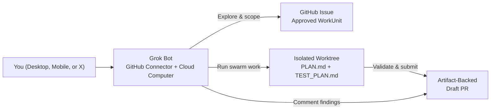
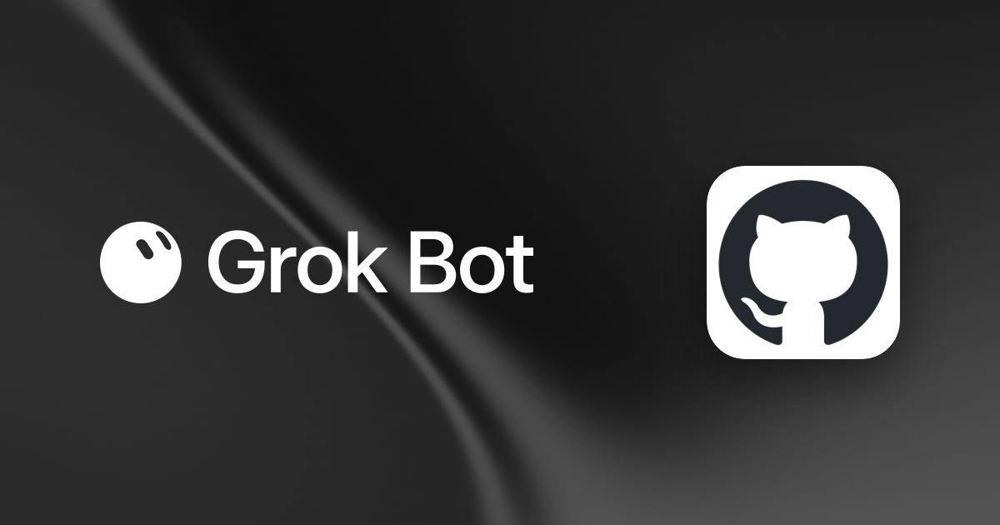

<div align="center">


# Working with Grok Bot & SwarmOS

**Use Grok Bot as an always-on repository teammate: talk to your codebase, turn ideas into structured tasks, review pull requests, and coordinate SwarmOS workers.**

[**Connect to GitHub**](#1-connect-grok-bot-to-your-repository) · [**Talk to Your Repo**](#2-talk-to-your-repository) · [**Review PRs & Plans**](#3-invite-grok-bot-as-a-reviewer) · [**Coordinate SwarmOS Workers**](#4-let-grok-bot-drive-swarmos)

</div>

---

Grok Bot gives you persistent AI teammates with their own cloud computer, browser, terminal, and GitHub connection. Pairing Grok Bot with **SwarmOS (`swarm`)** gives those teammates a structured way to work alongside humans and other coding agents: instead of burying plans in chat history or drifting out of sync on an external board, every task lives in a GitHub Issue `WorkUnit`, every claim and checkpoint is tracked in Git, and every pull request carries its plan and validation trail.



---

## 1. Connect Grok Bot to Your Repository

<div align="center">

</div>

1. **Create a focused Bot** in the [Grok Bot app](https://x.ai/bot) (see the [Grok Bot Getting Started guide](https://docs.x.ai/grok-bot/get-started)). Give it a clear role such as *"Repo Maintainer & Reviewer"* or *"SwarmOS Release Coordinator"*.
2. **Add the GitHub connector**: open **Connect apps** in the sidebar, add [**GitHub for Grok Bot**](https://x.ai/bot/plugin/48677658/github), and complete authentication in your browser. In any chat, type `@` to attach the GitHub connector to your request (see [Computer and apps](https://docs.x.ai/grok-bot/computer-and-apps#connect-an-app)).
3. **Grant repository access**:
   - If you connect through the GitHub plugin/app, select the repositories you want Grok Bot to access.
   - If your team uses a dedicated GitHub account for your bot, invite that account as a repository collaborator with the permissions matching its role.
4. **Do a quick read-only check**: ask your Bot to open the repository, summarize `README.md`, and link an open issue and pull request so you know it is looking at the right project.

> [!NOTE]
> All Bots on your Grok account share the same cloud computer, workspace files (`/workspace`), and signed-in browser sessions. Keep repository credentials scoped to what you want your Bots on that account to use.

---

## 2. Talk to Your Repository

You don't need a rigid system prompt to get Grok Bot working with your repo—talk to it like a teammate and point it at your committed `.swarm/` context files.

### Orient Grok Bot on a project and draft the next task
> **Prompt:**  
> *"Get familiar with `OWNER/REPO`. Read `README.md` along with `.swarm/project.md`, `.swarm/architecture.md`, and `.swarm/conventions.md`. Summarize how the codebase is put together, spot the highest-leverage improvement from the open issues, and draft a SwarmOS WorkUnit with an Objective, Constraints, and Acceptance Criteria for me to review."*

### Investigate an issue before anyone writes code
> **Prompt:**  
> *"Look at issue #42 in `OWNER/REPO`. Check the acceptance criteria against the current implementation and tests. Tell me which files need to change, what edge cases we should watch out for, and propose a step-by-step plan before we kick off a worker."*

Once you are happy with a new issue's scope, approve the revision with `swarm issue approve <issue>` so workers know it is ready to claim.

---

## 3. Invite Grok Bot as a Reviewer

Grok Bot is a great second pair of eyes on both plans and pull requests.

### Ask Grok Bot to review a pull request
> **Prompt:**  
> *"Review PR #123 on `OWNER/REPO` against issue #42. Check the diff against the linked `PLAN.md` and `TEST_PLAN.md`, verify every acceptance criterion is covered by a real test, and leave inline review comments with file and line references for any bugs or missing edge cases."*

You can also turn that prompt into a saved Grok Bot skill or routine, or use the community [Grok Bug Bot template](https://x.ai/bot/mXAP6VMDNxs4uLiv2B2HW) for comment-only PR bug hunts across selected repos.

### Combining Grok Bot reviews with SwarmOS Plan Gates

SwarmOS supports two review gate styles so you can choose how plans are approved before code is written:

- **Human Plan Gate (`--gate human`)**: Ask Grok Bot to review the proposed plan and post its findings on the issue or in chat. When you are ready to green-light the plan, record your maintainer decision via the CLI and resume execution:
  ```bash
  swarm review 42 --approve --notes "Reviewed plan with Grok Bot; ready to implement"
  swarm work 42 --backend github
  ```
- **Automated Agent Gate (`--gate agent`)**: SwarmOS runs your configured reviewer harness inside an isolated read-only snapshot and verifies that `.swarm/active/REVIEW.md` begins with `VERDICT: APPROVED` or `VERDICT: CHANGES_REQUESTED` before starting implementation.

---

## 4. Let Grok Bot Drive SwarmOS

Because every Grok Bot has a persistent cloud computer with a terminal (`/workspace`), your Bot can also act as the coordinator that runs `swarm` and orchestrates your coding harnesses.

### Prepare the Bot's workspace once

On the computer where Grok Bot will run `swarm`, install `git`, `gh`, the pinned `swarm` binary from the [README Quickstart](../README.md#quickstart), and the coding harnesses configured for your repository (`claude`, `codex`, `opencode`, or `omp`). Then register each checkout:

```bash
cd /workspace/your-repo
swarm doctor --backend github
swarm repo add --backend github
```

### Give Grok Bot a task handoff

```text
Work on OWNER/REPO from its checkout in /workspace/your-repo.
1. Run `swarm status --backend github` and `swarm work 42 --dry-run --backend github`
   so we can see the resolved agents, plan gate, and base commit.
2. Run `swarm work 42 --backend github`. If the task pauses on a human gate,
   share the generated PLAN.md and TEST_PLAN.md with me and wait for my approval.
3. Once implementation and `swarm validate 42` pass, run `swarm submit 42 --backend github`
   and send me the Draft PR link.
```

### Run a multi-repository worker pool

When you have several approved issues queued up across one or more repositories, Grok Bot can drain a bounded batch and report back when the Draft PRs are open:

```bash
swarm node init --id grok-coordinator
swarm node run --all --concurrency 2 --max-jobs 4 --auto-submit --backend github
```

Add `--watch` when you want the worker pool to keep polling for newly approved issues.


### Contributing from a personal fork without upstream write access (`--fork`)

When Grok Bot (or an external contributor) does not have push access to the upstream repository, it can still claim approved issues and ship changes through a personal GitHub fork:

- **Local working strategy:** SwarmOS provisions an isolated local worktree (`.swarm/worktrees/issue-42`) on branch `swarm/issue-42-<claim_id>` anchored to the upstream approved `BaseSHA`, loading all `.swarm/` policies and checks from that upstream commit.
- **Remote contribution strategy:** Checkpoints are pushed to the contributor's writable `fork` remote (`refs/heads/swarm/issue-42-<claim_id>`), and `swarm --fork submit 42` opens a fork-qualified Draft PR (`<fork-owner>:swarm/issue-42-<claim_id>` targeting the upstream base branch). Issue approval, human plan gates (`swarm review 42 --approve`), PR review, and merge stay with upstream maintainers.

**1. Upstream maintainer setup:**

```bash
# Generate .github/workflows/swarm-fork-coordinator.yml pinned to your installed release
# (or pass --swarm-version <tag-or-full-commit-sha> to pin a specific version)
swarm init --fork-coordinator
swarm issue approve 42 --backend github
```

**2. Contributor / Grok Bot fork walkthrough:**

```bash
# Clone upstream as origin and add your personal GitHub fork as the writable "fork" remote
git clone https://github.com/OWNER/REPO.git /workspace/your-repo
cd /workspace/your-repo
gh repo fork --remote=true --remote-name=fork

# Claim, execute, renew if needed, and submit a fork-qualified Draft PR
swarm --fork claim 42
swarm --fork work 42
swarm --fork renew 42
swarm --fork submit 42
```

See **[Fork Mode (`docs/fork-mode.md`)](fork-mode.md)** for full setup details.
---

## 5. Using Grok Models Inside a Local SwarmOS Harness

SwarmOS launches local CLI harnesses through its built-in drivers (`claude`, `codex`, `opencode`, and `omp`). When you want an xAI **Grok model** (such as Grok 4) to power a local planner, reviewer, or developer role directly, pair `opencode` with [OpenCode's xAI provider](https://opencode.ai/docs/providers/#xai) in `.swarm/config.yaml`:

```yaml
agents:
  grok:
    binary: opencode
    harness: opencode
    model: xai/grok-4
    roles: [planner, reviewer, developer]
    env: [XAI_API_KEY]
    sandbox: sandbox-exec   # or bwrap on Linux
    review_network: true    # allows the sandboxed reviewer to reach the xAI API
```

Then route any role to `grok`:

```bash
swarm work 42 --planner-agent grok --reviewer-agent grok --developer-agent codex --backend github
```

---

## Next Steps

- **[OpenAI Dot & Codex Guide (`docs/openai-dot.md`)](openai-dot.md)** — Connect Codex Cloud environments and remote repositories for OpenAI Dots.
- **[Fork Mode Guide (`docs/fork-mode.md`)](fork-mode.md)** — Contribute from a personal GitHub fork without upstream push access.
- **[Project & Maintainer Setup (`docs/project.md`)](project.md)** — Configure `.swarm/config.yaml`, validation rules, and task approvals.
- **[Developer & Worker Guide (`docs/developer.md`)](developer.md)** — Full CLI reference, reviewer sandboxing, checkpoints, and recovery.
