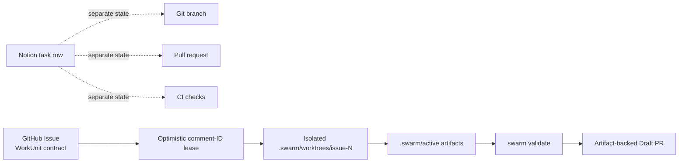
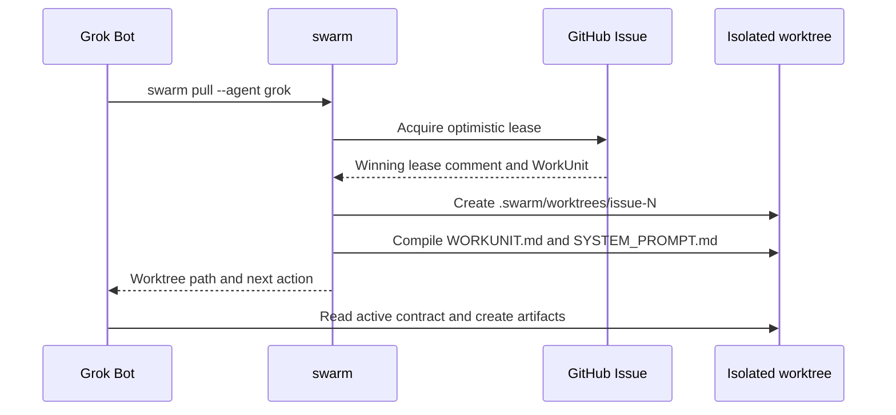
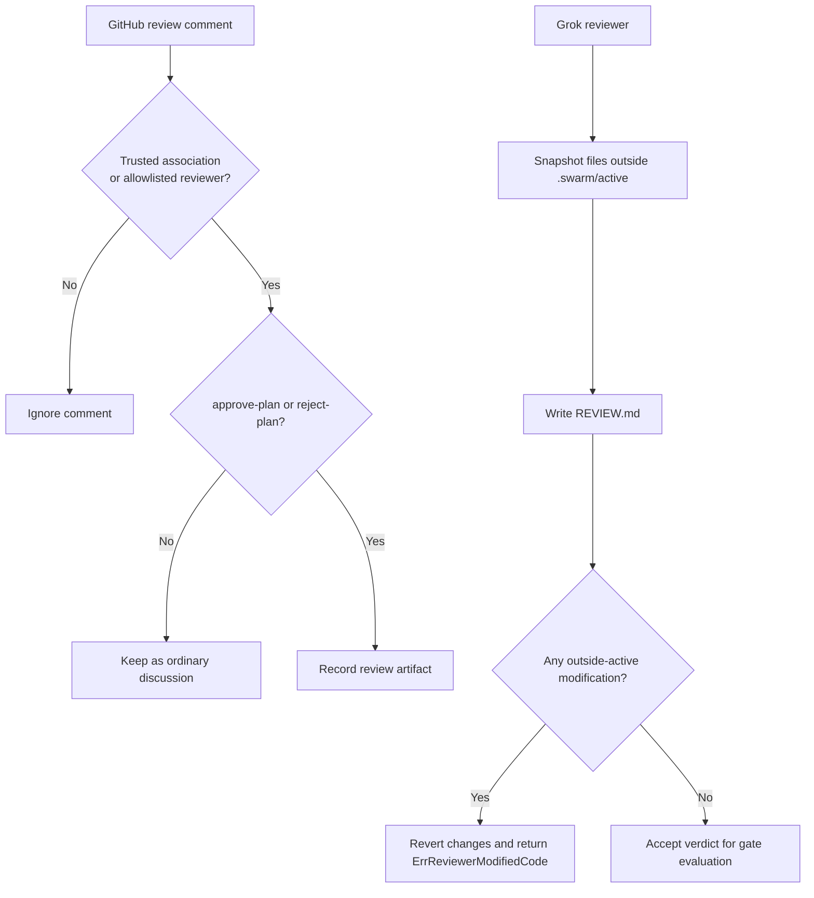

# Using Grok Bots with SwarmOS

Grok can participate in SwarmOS as a coding worker, a continuously running node, or an independent plan reviewer. SwarmOS keeps the coordination record beside the code: GitHub Issues carry the work contract, GitHub comments carry concurrency-safe leases and artifacts, and `.swarm/` carries the repository-specific instructions and validation policy.

> [!TIP]
> Run `swarm init --sync-labels` before adding workers. Commit the generated `.swarm/` directory so Grok and every human contributor work from the same contracts.

---

## 1. Why GitHub + `.swarm/` Beats Notion Databases for Grok Bot Orchestration

A Notion database can be useful for product planning, but it is a poor source of truth for autonomous code delivery. It is separate from the GitHub Issue, branch, review, CI result, and pull request that actually define whether a change can ship.

| External Notion workflow | Failure mode for multiple Grok Bots | SwarmOS replacement |
| :--- | :--- | :--- |
| A row says a task is in progress. | The row can drift from the Git branch or PR; a bot may act on stale status. | A GitHub Issue is the `WorkUnit` contract, and its living state comment records the lease, artifacts, and handoff state next to the discussion. |
| Several bots poll a database for open work. | A simple status update is not an atomic claim lock; two bots can select the same task. | An optimistic lease comment is created and then checked by GitHub `CommentID`. The lowest active comment ID wins; the losing worker releases its attempt and moves on. |
| A row links to a proposed implementation. | Nothing requires a test plan, protected-path check, or validation before a PR is created. | `.swarm/active/PLAN.md`, `TEST_PLAN.md`, and review artifacts form a Plan-First contract. `swarm validate` enforces `.swarm/validation/required-checks.yaml` and protected paths before `swarm submit` opens an artifact-backed Draft PR. |
| Bot instructions live in a separate page. | Repository conventions and prompt changes are hard to review, version, or reproduce. | `.swarm/config.yaml`, project context files, role prompts, workflows, and validation rules are committed with the repository. |



With this model, a Grok Bot does not have to infer what is safe to do from a dashboard. It receives an explicit objective, constraints, acceptance criteria, workflow, gate, and validation policy from the repository it is changing.

---

## 2. System Prompt / Bootstrapping Instructions for Your Grok Bot

Give a Grok Bot the following instruction when connecting it to a SwarmOS repository. It is intentionally repository-relative: the generated `.swarm/` files provide the project-specific details.

```text
You are a SwarmOS Grok worker. Treat the repository and its committed .swarm/
files as the authoritative operating contract.

1. Orient yourself before claiming work. Read:
   - .swarm/config.yaml
   - .swarm/project.md
   - .swarm/architecture.md
   - .swarm/conventions.md

2. Claim work only through SwarmOS. Run `swarm pull --agent grok` to claim the
   next eligible swarm:ready issue, or `swarm pull --all --agent grok` when
   operating across registered repositories. Work only in the isolated
   .swarm/worktrees/issue-<N> worktree that SwarmOS provisions. Do not change
   the primary checkout to implement a claimed issue.

3. Inside that worktree, read:
   - .swarm/active/WORKUNIT.md
   - .swarm/active/SYSTEM_PROMPT.md
   - AGENTS.md, when present
   These define the objective, constraints, acceptance criteria, role contract,
   and local repository instructions for the current work unit.

4. Follow the Plan-First contract. Before implementation, produce
   .swarm/active/PLAN.md and .swarm/active/TEST_PLAN.md. Pass the configured
   review gate, implement only the approved work, run `swarm validate`, and use
   `swarm submit` to create the artifact-backed Draft PR. Obey every command in
   .swarm/validation/required-checks.yaml and never weaken validation or CI to
   make a task pass.
```

### What the bot sees after a claim



> [!IMPORTANT]
> `WORKUNIT.md` and `SYSTEM_PROMPT.md` are generated for the specific claim. A bot should not reuse an active prompt or plan from another issue, even when the tasks appear similar.

---

## 3. Pulling Work & Using the Host Harness to Ship PRs

### Run Grok directly through SwarmOS

The `grok` adapter uses `grok -p "<combined prompt>"` in headless mode. Start a complete work cycle on the next eligible issue with:

```bash
swarm work --next --agent grok --headless
```

If the Grok executable has a different name or location, override it without changing repository configuration:

```bash
SWARM_GROK_BIN=/path/to/grok-bot swarm work --next --agent grok --headless
```

For interactive use, omit `--headless`; SwarmOS invokes Grok with the task prompt after preparing the worktree and active context.

### Let Grok drive a host coding harness

Grok does not need to be the process that edits files. It can act as an orchestration layer that claims the task, enters the provisioned worktree, and uses a local coding harness or its own tool loop. The safety boundary remains the same: the active WorkUnit, role prompts, review gate, validation policy, and submission path are owned by SwarmOS.

```bash
# Claim and provision the next task for Grok's tool loop.
swarm pull --agent grok

# In .swarm/worktrees/issue-<N>, Grok reads .swarm/active/ and carries out the
# approved plan with its selected local harness or tools.

# The worker must run the repository's required checks and record their result.
swarm validate <N>

# Submit only after validation succeeds; this creates the artifact-backed Draft PR.
swarm submit <N>
```

`.swarm/validation/required-checks.yaml` is not advisory. It specifies the commands and protected paths that the host harness must respect, including when Grok delegates code editing to another local tool.

### Run a continuous Grok worker pool

A node profile declares which agent models a machine can run. Initialize a Grok-capable worker, then run two concurrent workers that claim eligible tasks and submit validated results:

```bash
swarm node init --id grok-worker-01 --models grok
swarm node run --all --agent grok --concurrency 2 --auto-submit
```

Each worker receives a separate worktree and lease. Concurrent polling is safe because a task is not owned merely because a worker observed it; ownership is established by the optimistic GitHub comment lease.

| Command | Result |
| :--- | :--- |
| `swarm pull --agent grok` | Claims and provisions one eligible ready issue. |
| `swarm work --next --agent grok --headless` | Claims the next eligible issue and executes the configured workflow non-interactively. |
| `swarm validate <N>` | Runs required checks and protected-path checks for issue `<N>`. |
| `swarm submit <N>` | Publishes the validated work on its branch as a Draft PR with artifact context. |

---

## 4. Using Grok Bot as a Safe Reviewer Agent (CLI & GitHub Contributor Bot)

### Use Grok for an automated plan review

Route distinct workflow roles to different coding agents so Grok independently evaluates a plan before implementation:

```bash
swarm work 12 \
  --planner-agent claude \
  --reviewer-agent grok \
  --developer-agent codex \
  --gate agent \
  --headless
```

For a review handed from another contributor or node, run the standalone review handoff:

```bash
swarm work 12 --phase review --handoff --reviewer-agent grok
```

The reviewer reads the active WorkUnit, plan, and test plan, then writes `.swarm/active/REVIEW.md`. A review must begin with one of these verdicts:

```text
VERDICT: APPROVED
```

```text
VERDICT: CHANGES_REQUESTED
```

Only an approved review allows the associated work unit to move forward under an agent review gate.

### Add a Grok GitHub account as a trusted reviewer

Invite the Grok Bot GitHub account (for example, `grok-bot`) to the repository with the minimum permissions it needs to read issues and post review comments. Then explicitly allow that identity in the committed SwarmOS configuration:

```yaml
security:
  require_ready_label: true
  ready_label: "swarm:ready"
  trusted_associations: ["OWNER", "MEMBER", "COLLABORATOR"]
  trusted_reviewers: ["grok-bot"]
```

The association list covers trusted repository participants. `trusted_reviewers` adds explicitly named bot accounts such as `grok-bot`; it does not make every external commenter a reviewer.

### Three reviewer safety controls

| Control | How it protects the review process |
| :--- | :--- |
| **1. Trusted Reviewer Allowlist** | `security.trusted_reviewers` and `trusted_associations` govern who may record `/swarm approve-plan` or `/swarm reject-plan`. Comments from untrusted drive-by accounts are ignored rather than becoming approval artifacts. |
| **2. Read-Only Worktree Guard** | During agent review, SwarmOS snapshots the worktree outside `.swarm/active/`. If Grok modifies production, configuration, or CI files, SwarmOS reverts those unauthorized changes and returns `ErrReviewerModifiedCode`; the review is rejected. The permitted output is the review artifact under `.swarm/active/`. |
| **3. Protected-Path Tamper Defense & HTML Comment Stripping** | `swarm validate` rejects unauthorized changes to protected paths such as CI, validation, and contract files. Before a GitHub Issue body becomes a WorkUnit prompt, SwarmOS strips HTML comments, preventing hidden prompt-injection instructions from being passed to the reviewer. |



> [!WARNING]
> Do not grant a reviewer bot a bypass by placing it in `trusted_reviewers`. The allowlist authorizes review commands only; it does not authorize code edits, CI changes, or validation-policy changes. Keep protected-path rules in `.swarm/validation/required-checks.yaml` under maintainer control.

For the complete worker and handoff model, see the [Developer, Team & Worker Node Guide](developer.md) and the [Workflow & Role Contracts](WORKFLOWS.md).
