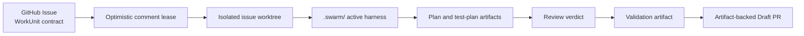
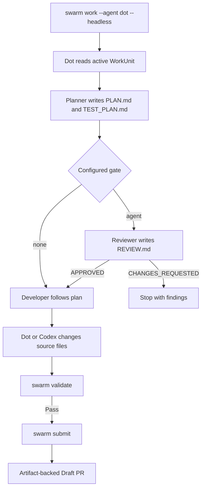
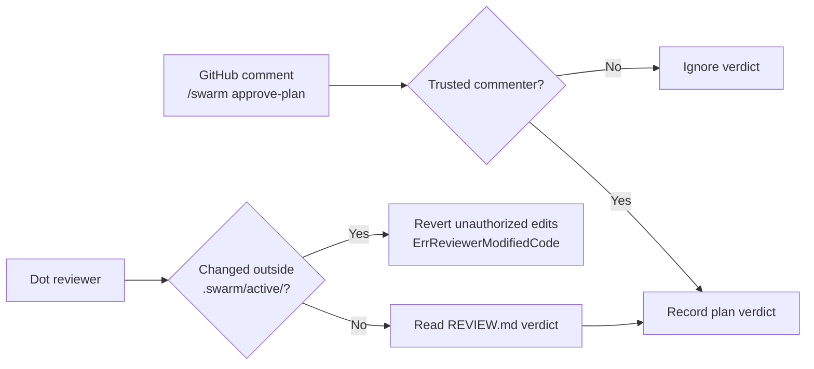

# Using OpenAI Dots & Codex with SwarmOS

OpenAI Dot and Codex can work as first-class SwarmOS agents: a Dot can plan, review, implement, validate, and submit work without losing the repository contract that defines the work. This guide explains how to replace an external task board with GitHub-native coordination, how a Dot should orient itself in a worktree, and how to use Dot safely as both a coding and review agent.

> [!TIP]
> Start with [`docs/project.md`](project.md) to initialize the repository harness, then use this guide to route work to `dot` or `codex`.

---

## Replacing Notion Databases with GitHub-Native Contracts for OpenAI Dots

A Notion database is useful for human planning, but it is not an execution contract for an autonomous worker. A card can be duplicated, assigned late, lack the source-tree constraints that make a change safe, and end with an unreviewed pull request dump. SwarmOS keeps the coordination record in the GitHub repository and issue that the work actually changes.

| External task-board pattern | Failure mode with multiple Dots | SwarmOS replacement |
| :--- | :--- | :--- |
| A manually updated status column | State becomes stale; two Dots can both see “Ready” and begin the same task. | An optimistic, expiring lease in the issue’s living state comment. Concurrent claims are resolved by comment ID, so one worker wins and the other continues looking for work. |
| Free-form card description | The Dot must guess constraints, acceptance criteria, and repository conventions. | A schema-validated GitHub `WorkUnit` with an Objective, Constraints, Acceptance Criteria, workflow, and review gate. |
| A link to a repository | Context is detached from the exact checkout and branch being changed. | An isolated `.swarm/worktrees/issue-<N>` worktree with a compiled active harness. |
| “Done” followed by a PR URL | A PR may omit its plan, test evidence, or proof that policy checks ran. | Published design, test-plan, review, implementation, and validation artifacts plus an artifact-backed Draft PR. |

```mermaid
sequenceDiagram
    participant Board as External Task Board
    participant D1 as Dot A
    participant D2 as Dot B
    Board-->>D1: Stale “Ready” card
    Board-->>D2: Same stale “Ready” card
    D1->>D1: Start duplicate work
    D2->>D2: Start duplicate work

    participant Issue as GitHub WorkUnit Issue
    participant Lease as SwarmOS lease comment
    D1->>Issue: Read validated WorkUnit
    D2->>Issue: Read validated WorkUnit
    D1->>Lease: Optimistic claim
    D2->>Lease: Optimistic claim
    Lease-->>D1: Lowest comment ID wins
    Lease-->>D2: Claim race lost; select next work unit
```

### What is a WorkUnit?

A GitHub Issue becomes executable when it contains a `WorkUnit` contract. SwarmOS parses and validates the contract before an agent receives it. The compiled version is written to `.swarm/active/WORKUNIT.md` in the issue worktree, where it includes the current objective, constraints, acceptance criteria, workflow steps, and any already-published artifacts.



This changes the Dot’s unit of work from “a card that looks available” to “a leased, validated repository contract.” The issue remains the durable coordination record for humans, Dots, Codex, and other agents.

---

## Teaching an OpenAI Dot How to Read the Repo and Active Artifacts on Pull

A Dot should not begin by inferring policy from a single source file. It must read the repository harness first, then the generated active artifacts for its claimed worktree. `swarm pull --agent dot` claims a matching ready issue, creates or reuses its isolated worktree, and compiles that context.

```bash
# Find, lease, and provision the next compatible WorkUnit.
swarm pull --agent dot

# Work from the path printed by the command, for example:
cd .swarm/worktrees/issue-12
```

### Required reading order

| Order | File | Why the Dot reads it |
| :---: | :--- | :--- |
| 1 | `.swarm/config.yaml` | Default agent and gate, lease policy, role routing, and repository security policy. |
| 2 | `.swarm/project.md` | Project stack, build/test entry points, and project-level operating context. |
| 3 | `.swarm/architecture.md` | Architectural boundaries and invariants that guide file-level changes. |
| 4 | `.swarm/conventions.md` | Local code, test, and review conventions. |
| 5 | `.swarm/validation/required-checks.yaml` | Required validation commands and protected path globs. |
| 6 | `AGENTS.md` | Includes the SwarmOS-injected active pointer block that tells the Dot where its current contract lives. |
| 7 | `.swarm/active/WORKUNIT.md` | The authoritative Objective, Constraints, Acceptance Criteria, workflow steps, and prior design/review artifacts. |
| 8 | `.swarm/active/SYSTEM_PROMPT.md` | The compiled role prompt plus the repository and work-unit context. |
| 9 | `.swarm/active/PLAN.md` | Existing implementation plan, when a planner has already produced one. |
| 10 | `.swarm/active/TEST_PLAN.md` | Acceptance-to-verification mapping produced with the plan. |
| 11 | `.swarm/active/REVIEW.md` | Existing reviewer verdict and findings, when a review has run. |

> [!IMPORTANT]
> `PLAN.md`, `TEST_PLAN.md`, and `REVIEW.md` are conditional artifacts. Read each when it exists; do not recreate, override, or bypass a prior artifact without following the WorkUnit’s workflow and gate.

### Copy-paste runbook for a Dot

Give the following instruction to an OpenAI Dot at repository entry and after every `swarm pull --agent dot`:

```text
You are operating in a SwarmOS worktree. Before planning, reviewing, or editing:

1. Read .swarm/config.yaml.
2. Read .swarm/project.md, .swarm/architecture.md, and .swarm/conventions.md.
3. Read .swarm/validation/required-checks.yaml. Treat protected paths as immutable
   unless the WorkUnit explicitly permits harness changes.
4. Read AGENTS.md, including the managed SwarmOS active pointer block.
5. Read .swarm/active/WORKUNIT.md. It is the authoritative contract: honor its
   Objective, Constraints, Acceptance Criteria, workflow steps, and prior artifacts.
6. Read .swarm/active/SYSTEM_PROMPT.md for your assigned role.
7. If present, read .swarm/active/PLAN.md, .swarm/active/TEST_PLAN.md, and
   .swarm/active/REVIEW.md before taking action.

Do not replace a completed artifact. For planner work, write PLAN.md and TEST_PLAN.md.
For review work, write only .swarm/active/REVIEW.md and start it with exactly
VERDICT: APPROVED or VERDICT: CHANGES_REQUESTED. For implementation, follow the
approved plan and validate with swarm validate before submission.
```

The active pointer in `AGENTS.md` is managed by SwarmOS. It gives tools that automatically consume repository instructions a stable route to the current work unit without permanently embedding issue-specific instructions in the repository’s normal guidance.

---

## Executing Work and Opening PRs with Dot + Codex

### Run Dot or Codex directly

Use `dot` when you want the OpenAI Dot harness, or `codex` when you want Codex directly. Both run in the isolated issue worktree rather than the primary checkout.

```bash
# Claim and run the next ready WorkUnit non-interactively with Dot.
swarm work --next --agent dot --headless

# Run the same workflow with Codex directly.
swarm work --next --agent codex --headless

# Use a non-default Dot executable, wrapper, or absolute path.
SWARM_DOT_BIN="$HOME/bin/dot" swarm work --next --agent dot --headless
```

For a specific issue, include its number instead of `--next`:

```bash
swarm work 12 --agent dot --headless
```

In headless mode, SwarmOS invokes Dot using `dot exec` with a combined prompt that directs it to the compiled system prompt and `WORKUNIT.md`. Codex uses the analogous `codex exec` form. The process runs with its working directory set to `.swarm/worktrees/issue-<N>`.

| Agent selection | Headless execution shape | Interactive execution shape |
| :--- | :--- | :--- |
| `--agent dot` | `dot exec "<combined prompt>"` | `dot "<task prompt>"` |
| `--agent codex` | `codex exec "<combined prompt>"` | `codex "<task prompt>"` |

### Expected artifact and delivery flow



A typical explicit handoff keeps planning, implementation, validation, and submission visible as separate operations:

```bash
# Produce and publish the design and test-plan artifacts.
swarm work 12 --phase plan --agent dot --headless

# Apply the approved plan with Codex.
swarm work 12 --phase implement --agent codex --headless

# Execute protected-path checks and required commands from the repository harness.
swarm validate 12

# Commit the issue worktree branch and create the Draft PR with artifact summaries.
swarm submit 12
```

`swarm submit` is deliberately last: it records the resulting branch and Draft PR only after validation has succeeded. The PR can therefore point reviewers back to the WorkUnit and its design, test-plan, review, and validation evidence rather than presenting an unexplained diff.

### Run a multi-repository Dot worker pool

Register repositories first as described in the [Developer, Team & Worker Node Guide](developer.md). Then initialize a node that advertises both available OpenAI harnesses and drain work across registered repositories:

```bash
# Persist the node profile and declare the harnesses it can run.
swarm node init --id openai-dot-node-01 --models dot,codex

# Claim compatible WorkUnits across registered repositories with four workers.
# Successfully validated jobs are submitted as Draft PRs.
swarm node run --all --agent dot --concurrency 4 --auto-submit
```

Each worker still receives its own issue lease and isolated worktree. Concurrency increases throughput; it does not cause multiple workers to share a checkout or claim the same WorkUnit.

---

## Using OpenAI Dot as a Safe Reviewer Agent (Local and GitHub Collaborator)

Dot can provide a model-diverse plan audit while Claude plans and Codex implements. The review agent receives the same compiled contract but is constrained to the review artifact.

```bash
# Claude plans, Dot reviews the plan, and Codex implements only after approval.
swarm work 12 \
  --planner-agent claude \
  --reviewer-agent dot \
  --developer-agent codex \
  --gate agent \
  --headless

# Or claim a handed-off review step from the ready queue.
swarm work --next --phase review --handoff --reviewer-agent dot --headless
```

The reviewer must inspect `WORKUNIT.md`, `PLAN.md`, and `TEST_PLAN.md`, then write `.swarm/active/REVIEW.md` beginning with one of the following exact lines:

```text
VERDICT: APPROVED
```

```text
VERDICT: CHANGES_REQUESTED
```

A `CHANGES_REQUESTED` verdict stops the automated path before implementation. Its concrete findings become part of the issue’s review artifact for the planner or maintainer to address.

### Invite a GitHub Dot reviewer

If the Dot service uses the `openai-dot` GitHub account, invite that account as a repository collaborator or reviewer using your normal GitHub organization policy. Then explicitly allow the account for SwarmOS comment verdicts when that is desired:

```yaml
# .swarm/config.yaml
security:
  require_ready_label: true
  ready_label: "swarm:ready"
  trusted_associations: ["OWNER", "MEMBER", "COLLABORATOR"]
  trusted_reviewers: ["openai-dot"]
```

The allowlist is for review-control comments, not a broad permission grant. Repository permissions remain governed by GitHub, and source changes still pass SwarmOS validation and protected-path checks.

### Three reviewer safety controls

| Control | What SwarmOS enforces | Operational result |
| :--- | :--- | :--- |
| **Collaborator and `security.trusted_reviewers` verification** | A `/swarm approve-plan` or `/swarm reject-plan` verdict is accepted only from an `OWNER`, `MEMBER`, or `COLLABORATOR`, or from an account explicitly listed under `security.trusted_reviewers` such as `openai-dot`. | A random commenter cannot move a plan past its gate or reject work through a forged-looking command. |
| **Read-only worktree guard (`ErrReviewerModifiedCode`)** | Before and after `RunAgentReview`, SwarmOS snapshots non-active worktree state. If the reviewer changed a file outside `.swarm/active/`, SwarmOS reverts the unauthorized repository edits and returns `ErrReviewerModifiedCode`. | A reviewer Dot is limited to its review output—normally `.swarm/active/REVIEW.md`—rather than becoming an untracked implementation agent during plan review. |
| **HTML comment sanitization and protected paths** | SwarmOS strips hidden `<!-- ... -->` content from issue descriptions before parsing the WorkUnit that reaches `WORKUNIT.md`. Validation also rejects edits to configured protected paths unless the WorkUnit explicitly permits harness changes. | Hidden issue-body prompt injection does not reach Dot’s task contract, and a submitted change cannot silently weaken validation or CI policy. |



> [!WARNING]
> Do not grant an account reviewer trust merely because it posts a plausible command. Add `openai-dot` to `trusted_reviewers` only after verifying the account identity and configuring the intended GitHub repository permissions. A trusted comment verdict approves or rejects a plan; it does not replace protected-path validation, required checks, or normal pull-request review.

With these controls, Dot can be used as a productive local planner, developer, or reviewer while GitHub Issues, durable artifacts, leases, and the repository harness remain the source of truth.
