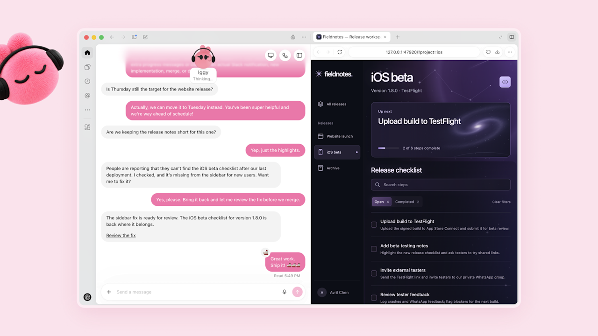
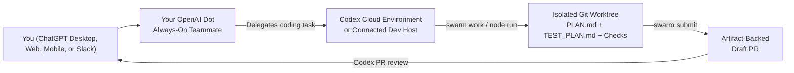

<div align="center">


# Working with OpenAI Dot, Codex & SwarmOS

**Keep your repositories moving with an always-on OpenAI Dot that plans, coordinates Codex tasks, and ships validated Draft PRs through SwarmOS.**

[**Connect Your Dot**](#1-set-up-your-dot-and-github-access) · [**Add Repos to Codex**](#2-add-the-repositories-you-want-to-swarm-on-to-codex) · [**Talk to Your Repo**](#3-talk-to-your-dot-about-the-repository) · [**Review PRs with Codex**](#4-review-prs-and-run-codex-roles)

</div>

---

An [OpenAI Dot](https://openai.com/index/introducing-dots/) is an always-on teammate in ChatGPT with its own cloud computer, memory, and connected apps, and it can [create and manage tasks directly inside Codex environments](https://help.openai.com/en/articles/20001530-getting-started-with-your-dot).

Pairing your Dot with **SwarmOS (`swarm`)** gives it a clean, repo-native engineering workflow: instead of juggling ad-hoc chat threads or external task boards, your Dot works from approved GitHub Issue `WorkUnit` contracts, isolates every task in a Git worktree, enforces your plan review gates and test checks, and brings back artifact-backed Draft PRs ready for your review.

<div align="center">

</div>



---

## 1. Set Up Your Dot and GitHub Access

1. **Create your Dot** at [chatgpt.com/dots](https://chatgpt.com/dots) in the ChatGPT desktop app, web app, or mobile app (see [Getting started with your dot](https://help.openai.com/en/articles/20001530-getting-started-with-your-dot)).
2. **Connect GitHub**: in ChatGPT/Codex settings, connect the GitHub integration and authorize the repositories you want your Dot and Codex to work with.
3. **Review shared plugin permissions**: [plugin connections are shared across your Dot, ChatGPT, and Codex](https://help.openai.com/en/articles/20001529-dots-privacy-security-and-safety-faqs), and you can set **Custom Rules** for which actions your Dot can take automatically versus when it should ask you first.
4. **Verify repository visibility**: ask your Dot to read one of your repositories and summarize `README.md` and `.swarm/project.md` so you know it can see the right repo and branch.

---

## 2. Add the Repositories You Want to Swarm On to Codex

Before asking your Dot to run coding tasks in Codex, add the target repositories to your configured Codex remote environment (or connected host) and register them with SwarmOS.

### Option A: Configure a Codex Cloud Environment

OpenAI Dots can launch tasks inside [Codex Cloud environments](https://learn.chatgpt.com/docs/environments/cloud-environments) once the environment has been created and published in Codex:

1. Open ChatGPT on web or desktop and choose **Work in → Cloud → Select environment → Create environment** (or go to **Settings → Codex Cloud → Environments → Create environment**).
2. **Add the GitHub repositories you want to swarm on**: select every repository this environment should check out. If a repository is missing from the picker, add it to your GitHub app installation permissions first.
3. **Install `swarm` and your coding tools in the environment setup**:
   - Have the environment setup install the pinned `swarm` binary from the [README Quickstart](../README.md#quickstart), along with `git`, `gh`, and the coding harnesses your `.swarm/config.yaml` uses (such as `codex`, `claude`, `opencode`, or `omp`).
   - Make sure the binaries are on the task shell's `PATH` and configure any required model or GitHub credentials in the environment's variables/secrets settings.
4. **Save and Publish**: click **Publish** (or **Republish** when adding new repositories to an existing environment) so new tasks start from the prepared workspace.
5. **Register each checkout with SwarmOS**: inside each repository checked out in the environment, register it so `swarm work --next --all` and `swarm node run --all` know where it lives:
   ```bash
   swarm doctor --backend github
   swarm repo add --backend github
   swarm repo list
   ```

### Option B: Connect Your Own Mac, Windows, or SSH Dev Machine

If your repositories, credentials, and coding CLIs already live on a workstation or remote dev box, you can point your Dot and Codex at that machine instead:

- **Connect your computer to your Dot**: open the ChatGPT desktop app on that machine, open your Dot's profile, and under **Computers → Your computer** select **Allow access**.
- **Or connect an SSH host to Codex**: add the host alias to `~/.ssh/config`, ensure `codex` and `swarm` are installed on the remote host's `PATH`, and add the host under **Settings → Connections** in the ChatGPT desktop app (see [Codex Remote Connections](https://learn.chatgpt.com/docs/remote-connections#connect-to-an-ssh-host)).
- **Add and clone the repositories you want to swarm on**:
  ```bash
  # Register an existing local checkout
  swarm repo add --backend github

  # Or clone and register additional GitHub repositories into ~/.swarm/repos/<owner>/<repo>
  swarm repo add OWNER/REPO --clone --backend github
  swarm repo list
  ```

---

## 3. Talk to Your Dot About the Repository

Once your Codex environment or remote machine has your repositories registered, you can talk to your Dot naturally from desktop, mobile, or Slack.

### Explore the repo and shape a new WorkUnit
> **Prompt:**  
> *"Using the Codex environment `MY-ENV` for `OWNER/REPO`, read `README.md` and `.swarm/project.md`, `.swarm/architecture.md`, and `.swarm/conventions.md`. Check open issue #42 and tell me if the objective, constraints, and acceptance criteria are concrete enough to implement, or suggest improvements before I approve it."*

### Hand off an approved issue to your Dot
After a maintainer approves the task (`swarm issue approve 42 --backend github`), give your Dot a clear handoff:

```text
In the Codex environment for OWNER/REPO, run SwarmOS on issue #42:
1. Run `swarm doctor --backend github` and `swarm work 42 --dry-run --backend github`
   to confirm the resolved agents, gate, and base commit.
2. Run `swarm work 42 --backend github`. Read the generated WORKUNIT.md,
   PLAN.md, and TEST_PLAN.md inside `.swarm/worktrees/issue-42`.
3. If the task uses a human gate, send me the plan summary and wait for my approval.
4. Once implementation and `swarm validate 42` pass, run `swarm submit 42 --backend github`
   and share the Draft PR link with me.
```

### Drain a multi-repo backlog with a worker pool
When you have several approved tasks across the repositories you added to your environment or remote host, ask your Dot to run a bounded worker pool:

```bash
swarm node init --id dot-coordinator
swarm node run --all --concurrency 2 --max-jobs 4 --auto-submit --backend github
```

---

## 4. Review PRs and Run Codex Roles

### Trigger `@codex review` on GitHub Pull Requests

With your repository connected to Codex and [Codex Code Review](https://learn.chatgpt.com/docs/third-party/github) enabled in [chatgpt.com/settings/code-review](https://chatgpt.com/settings/code-review):

- Comment `@codex review` on any pull request (or enable **Automatic review**) to have Codex inspect the diff against your repository's `AGENTS.md` guidance and flag high-priority bugs.
- Comment `@codex security review` for a deeper security-focused review pass.
- Comment `@codex fix the CI failures` when you want Codex to spin up a follow-up task on the PR branch.

When a SwarmOS task uses a **human plan gate (`--gate human`)**, you can use your Dot's or Codex's review notes to inform your decision, then record your approval via the CLI:

```bash
swarm review 42 --approve --notes "Plan and acceptance coverage look solid"
swarm work 42 --backend github
```

### Use Codex CLI Directly in `.swarm/config.yaml`

SwarmOS includes a native `codex` harness driver (`codex exec "<combined prompt>"` in headless mode and `codex "<task>"` interactively). You can route any role to `codex`—or define a `dot` policy alias that invokes the Codex driver—in `.swarm/config.yaml`:

```yaml
agents:
  codex:
    binary: codex
    roles: [planner, developer, tester]
  dot:
    binary: codex
    harness: codex
    roles: [planner, reviewer, developer]
    env: [OPENAI_API_KEY]
    sandbox: sandbox-exec   # or bwrap on Linux
    review_network: true
```

Then mix and match agents per role from the CLI:

```bash
swarm work 42 \
  --planner-agent claude \
  --reviewer-agent dot \
  --developer-agent codex \
  --tester-agent opencode \
  --backend github
```

---

## Next Steps

- **[Working with Grok Bot (`docs/grokbot.md`)](grokbot.md)** — Connect Grok Bot to GitHub, chat with your repo, and coordinate SwarmOS tasks.
- **[Project & Maintainer Setup (`docs/project.md`)](project.md)** — Configure `.swarm/config.yaml`, validation rules, and task approvals.
- **[Developer & Worker Guide (`docs/developer.md`)](developer.md)** — Everyday CLI workflows, reviewer isolation, checkpoints, and recovery.
